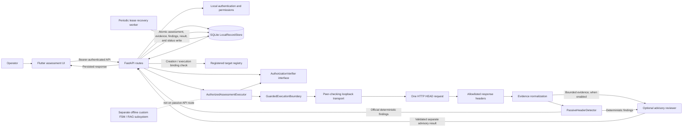

# AEGISCORE AI: A Bounded Passive Assessment Prototype with Evidence-Linked Findings and Advisory Review

## Final academic content prepared for institutional template transfer

- **Institution:** North Western University, Khulna
- **Department:** [Department name]
- **Degree/programme:** [Degree and programme]
- **Student:** [Student name and ID]
- **Supervisor:** [Supervisor name]
- **Submission year:** [Year]

> **Preparation status.** This is the content-complete thesis manuscript prepared from the supervisor-review baseline and the user's confirmation that supervisor approval has been communicated. The official North Western University, Khulna undergraduate CSE thesis template, department instructions, citation style, and administrative approval wording have not been supplied or verified. This Markdown file is not a typeset submission copy. Square-bracket literature citations use a provisional numeric system; `[P#]` identifiers point to project evidence and are not scholarly references. Replace every bracketed personal or programme placeholder only with confirmed information. Do not add a signature, approval date, declaration, or certification without the required genuine document.

## Preliminary pages and manuscript navigation

### Title page fields

**AEGISCORE AI: A Bounded Passive Assessment Prototype with Evidence-Linked Findings and Advisory Review**

Thesis submitted to North Western University, Khulna, in [confirmed degree and programme]<br>
Department: [confirmed department]<br>
Submitted by: [student name and ID]<br>
Supervisor: [supervisor name and designation]<br>
Submission term/year: [confirmed term/year]

Use the approved title-page wording and layout when the NWU CSE template is obtained. No declaration, certification, supervisor signature, or university approval page is supplied or implied by this manuscript.

### Declaration, certification, acknowledgements, and ethics pages

Insert only the current institution-issued forms and student-authored acknowledgements if the department requires them. The user has communicated supervisor approval; this is not a documentary approval record. No human-participant approval or target-owner authorization is claimed by this work.

### Contents

The final word-processing copy should generate page numbers after it is placed in the approved template.

1. Abstract and keywords
2. List of figures
3. List of tables
4. Abbreviations
5. Chapter 1 — Introduction
6. Chapter 2 — Literature Review and Research Gap
7. Chapter 3 — Methodology
8. Chapter 4 — System Architecture
9. Chapter 5 — Implementation
10. Chapter 6 — Experimental Evaluation and Results
11. Chapter 7 — Security Analysis and Limitations
12. Chapter 8 — Discussion, Conclusion, and Future Work
13. References
14. Appendices A–G

### List of figures

| Figure | Title |
|---|---|
| Figure 4.1 | Implemented passive assessment workflow and trust boundaries |
| Figure 4.2 | Assessment lifecycle sequence |

### List of tables

| Table | Title |
|---|---|
| Table 4.1 | Component and source map |
| Table 6.1 | Detector repeatability and evidence-reference results |
| Table 6.2 | Advisory validation fixture results |
| Table 6.3 | Local processing-time results |
| Table 6.4 | Historical regression-suite results |
| Table 7.1 | Threats, implemented controls, and residual limitations |

### Abbreviations

| Abbreviation | Meaning |
|---|---|
| AI | Artificial intelligence |
| API | Application programming interface |
| CSE | Computer science and engineering |
| CWE | Common Weakness Enumeration |
| FSM | Finite-state machine |
| HTTP | Hypertext Transfer Protocol |
| HTTPS | Hypertext Transfer Protocol Secure |
| LLM | Large language model |
| RAG | Retrieval-augmented generation |
| UI | User interface |

The need for each preliminary page, final wording, ordering, page numbering, and layout remains subject to the North Western University, Khulna CSE instructions.

## Abstract

AEGISCORE AI is a prototype for passive assessment of registered numeric-loopback HTTP endpoints. This thesis evaluates the implemented workflow rather than the broader autonomous system proposed initially. Each assessment binds to a registered endpoint and issues one bounded HTTP `HEAD` request through a guarded executor. It captures selected security-header metadata without reading response bodies or following redirects. Deterministic rules produce configuration observations linked to evidence identifiers. An optional reviewer can comment on findings but cannot create official findings or change their severity or lifecycle state.

Evaluation used synthetic fixtures, fake adapters, controlled local transports, temporary SQLite databases, and automated tests. Across 100 calls on one synthetic HTTPS observation, output was one normalized set of five findings per call; all 500 finding/evidence links passed identifier-membership checks. Reviewer fixtures covered references, claims, abstention, schema validation, and failure isolation. The historical Python suite recorded 863 passed, 0 failed, and 0 skipped. These results show repeatability and selected tested invariants only; they do not estimate detection accuracy, model quality, or deployment security. The evaluation had no trusted production authorization verifier, live provider, authenticated browser-to-API workflow, or Debian 13 OS-level egress test. The study reports an implementation-bounded prototype and its evidence and limitations.

**Keywords:** passive assessment; HTTP security headers; evidence references; authorization; guarded execution; advisory reviewer; SQLite recovery

## Chapter 1 — Introduction

### 1.1 Background

Automated web-security assessment ranges from practitioner-guided test procedures to systems that plan and carry out multi-stage penetration tests. The reviewed literature includes interactive large-language-model (LLM) assistance, task benchmarks, expert-annotated evaluations, and multi-agent attack workflows [1–5]. Those approaches differ substantially in scope and evaluation method. AEGISCORE's implemented assessment route addresses a narrower engineering question: how can an application make one bounded passive observation of a specifically registered local endpoint, report deterministic security-header configuration observations with evidence references, and keep optional AI commentary outside the authority path?

The project's initial proposal described a broader AI-assisted assessment architecture. The current codebase contains offline orchestration and retrieval components, but those components are not called by the passive assessment API. The thesis therefore evaluates the integrated passive workflow actually present in the API, not the proposal's broader agent, retrieval-augmented generation (RAG), active-testing, or vulnerability-discovery ambitions [P1–P4].

### 1.2 Problem statement

An assessment application must control both what it requests and what it later claims. A target string or loopback IP address alone does not establish permission. A returned header value is untrusted input, and a generated interpretation must not become an official finding merely because it is fluent. Persistent execution also needs ownership checks so that a stale or competing worker cannot overwrite a newer result. A bounded prototype can demonstrate these application-level controls in code and selected tests, while still leaving authority provenance and deployment isolation unresolved.

This study investigates the implementation and fixture-level behavior of those boundaries for a passive HTTP-header workflow. It does not seek to establish the detection accuracy of the rules or the security of an operational deployment.

### 1.3 Aim

To document and evaluate AEGISCORE AI's implemented local passive-assessment workflow, focusing on endpoint binding, deterministic evidence-linked observations, optional advisory constraints, and persistence lifecycle controls.

### 1.4 Objectives

1. Trace the assessment path across the Flutter client, FastAPI routes, target authorization and execution boundary, detector, advisory reviewer, and SQLite persistence.
2. Describe the numeric-loopback-only, exact-endpoint, single-`HEAD` execution scope and distinguish application checks from operating-system isolation.
3. Measure normalized detector repeatability and evidence-reference membership for the recorded synthetic fixture.
4. Evaluate represented advisory reference, schema, claim, abstention, timeout, and failure-isolation cases using the existing deterministic test adapters.
5. Summarize the recorded lifecycle, lease, transaction, authorization, and recovery tests without treating test counts as probabilities of security.
6. Identify which initial proposal objectives remain unimplemented or unverified.

### 1.5 Research questions

**RQ1.** For one fixed synthetic HTTP-header observation, does the deterministic detector return the same normalized findings and valid finding/evidence identifier links across 100 repeated calls?

**RQ2.** Does the advisory reviewer accept the represented valid fixture and reject the tested invalid references, malformed schemas, and unsupported-claim cases, while abstaining when evidence is insufficient?

**RQ3.** Do the represented authorization, target-scope, lease, transaction, and recovery tests preserve their expected deny, rollback, or unchanged-state invariants?

**RQ4.** What local processing time was measured when the deterministic reviewer validator used a scripted in-memory adapter instead of detector-only processing?

These questions concern repeatability, specified validator cases, test invariants, and local code-path timing. They do not ask whether the system accurately detects vulnerabilities in real environments or whether a live AI provider is reliable.

### 1.6 Scope and delimitations

The thesis scope is the current passive assessment route and its product integration. Target execution accepts registered numeric IPv4 loopback addresses in `127.0.0.0/8` or IPv6 loopback `::1`, with an exact registered scheme, endpoint, port, and permitted path. The request is one bounded HTTP `HEAD`. Redirect following, response-body inspection, `GET` for target assessment, crawling, port scanning, exploit payloads, and arbitrary external network access are outside scope. The API's `GET` routes retrieve assessment records; they are not target-execution requests.

The detector produces security-header configuration observations from normalized metadata. The optional reviewer is advisory and disabled unless server configuration injects it. The evaluation is based on fixed synthetic fixtures, fake adapters, controlled local transports, temporary databases, and automated tests. No live provider, production approval authority, authorized deployment target, or Debian 13 firewall environment is represented as evaluated.

### 1.7 Terminology

- **Configuration observation:** a deterministic rule result describing a security header that was not observed under the rule's conditions. It is not a confirmed exploit or a general vulnerability verdict.
- **Evidence-reference membership:** a check that an identifier points to evidence supplied for a finding. It does not establish that the evidence semantically proves the accompanying prose.
- **Advisory review:** optional non-authoritative commentary constrained to supplied deterministic findings and their evidence identifiers.
- **Target authorization verifier:** an interface whose result is validated by the application. The production authority and verifier are not configured in the evaluated environment.
- **Fixture result:** a result from constructed deterministic inputs or controlled tests, not a live-target or population estimate.

## Chapter 2 — Literature Review and Research Gap

### 2.1 Review method and limits

This chapter audits the 13 source records represented by the 12 candidate entries in the earlier project bibliography after its combined OWASP entry was separated, and critically synthesizes the ten sources used in this draft. The remaining three documentation candidates are accounted for but excluded as unused. The chapter draws on the full papers and source-verification notes recorded in TASK 07.2 [P2]. The set is a selected candidate collection, not a documented systematic search: it has no database search protocol, inclusion/exclusion flow, comprehensive coverage claim, or field-wide evidence map. Accordingly, the research gap below is limited to this reviewed set and is not a claim of global novelty.

### 2.2 Traditional web-security testing and benchmarks

The OWASP Web Security Testing Guide (WSTG) is practitioner guidance for structured web-security testing. Its versioned 4.2 release and the separate living project page are distinct references [7, 8]. OWASP Benchmark describes a test suite for assessing detector speed and accuracy, while OWASP Juice Shop is a deliberately insecure training application [9, 10]. These sources provide context for testing guidance, benchmark design, and training environments; none is an AEGISCORE evaluation dataset. The synthetic header fixture used in this study was not a Juice Shop response, and no OWASP Benchmark or ZAP experiment was conducted.

This distinction matters because a header-presence rule suite is not equivalent to an active scanner or a labeled detector benchmark. The current system observes a limited response and reports configured rule outcomes; it does not discover routes or exercise exploit conditions.

### 2.3 LLM-assisted and automated penetration testing

Deng et al.'s PentestGPT addresses automation of expert penetration-testing tasks and evaluation of progress through the process [1]. Its benchmark covers 13 training targets, 182 subtasks, 26 categories, and 18 Common Weakness Enumeration (CWE) items. The system combines Reasoning, Generation, and Parsing modules around a task-tree/feedback workflow. A human executes proposed actions and returns observations, making the workflow interactive rather than wholly autonomous. The paper compares GPT-3.5, GPT-4, and Bard, reports stronger results on easier targets than harder ones, and discusses hallucinated or unnecessary operations. The authors also identify benchmark contamination and reproducibility concerns. This is a broader, active workflow than AEGISCORE's passive detector, so its task-progress measures are not a direct baseline.

Isozaki et al. seek a reproducible benchmark and analyze LLM penetration-testing performance through PentestGPT [2]. Their primary paper's Table 1 enumerates 13 VulnHub machines and 152 tasks. A later review by Happe and Cito lists 162 tasks; this draft uses the primary paper's table and preserves the discrepancy. Isozaki et al. test GPT-4o and Llama 3.1-405B, including structured task-list and context-summary ablations intended to address planning hallucination and forgetting. They report unreliable end-to-end completion and variation across reconnaissance, exploitation, and privilege escalation. They note human tester variation, incomplete walkthrough coverage, one trial per task, and ablations on only two boxes. This supports caution about benchmark scope and experimental variation, not a performance comparison with AEGISCORE.

Happe and Cito review 19 papers representing 18 prototypes, comparing testbed provenance, scope, tasks, models, sample sizes, stopping conditions, metrics, and qualitative analysis [3]. They identify variation in evaluation practice and recommend clearer provenance, baselines, subtask success criteria, better-described samples, quantitative outcomes, and trace analysis. They caution that capture-the-flag environments do not necessarily represent real-world penetration testing. This is directly relevant to AEGISCORE's fixture: a repeated synthetic input is useful for consistency checking but is not a representative benchmark or accuracy estimate.

PentestEval divides penetration testing into six stages, from information collection through exploit revision, and reports 346 tasks across 12 vulnerable scenarios [4]. Two certified penetration testers designed scenarios; three additional experts annotated and cross-checked ground truth. The paper reports nine evaluated LLMs, more than 3,000 stage evaluations, and 180 end-to-end tests. It reports weaker performance in difficult decision/exploit stages and acknowledges that expert annotations may miss valid attack paths. Its web-facing/external-network scope and stage outcomes differ from AEGISCORE's one-request header rules. The available review verified the arXiv record and full manuscript, but not a final IEEE publisher landing record; this draft cites the arXiv record only.

### 2.4 Multi-agent security assessment

PENTESTLLMAGENT studies autonomous IP-to-root testing and introduces AutoPentest-Bench with 13 VulnHub targets and 93 subtasks [5]. The authors analyze 130 interaction logs from 10 LLM configurations and describe rigid planning, context forgetting, and command-generation errors. Their approach combines a task-dependency graph, hierarchical agents, backtracking, and retrieval of prevalidated commands. The best reported configuration achieves 77% end-to-end success and 88% subtask completion on that paper's benchmark. Those figures are specific to its benchmark and cannot be compared with AEGISCORE's repeatability metric. The repository's separate FSM/RAG modules do not make the passive API a multi-agent system.

### 2.5 Uncertainty, evidence, and advisory output

The ACL 2026 paper on uncertainty quantification in LLM agents frames uncertainty over interactive agent trajectories and discusses estimator trade-offs, heterogeneous sources, uncertainty dynamics, and limited fine-grained evaluation [6]. Its numerical analysis uses τ²-bench with GPT-4.1 and Kimi-K2.5 and trajectory-level task outcomes because the benchmark lacks turn-level labels. The paper provides context for evaluation design but does not evaluate AEGISCORE or validate security-header claims. AEGISCORE's insufficient-evidence fixture demonstrates an abstention behavior, not calibrated confidence; the project has no provider-generated evaluation sample.

The reviewed sources include task parsing, walkthroughs, and expert-annotated benchmark ground truth [1–4], but they do not provide evidence that the AEGISCORE advisory text is semantically entailed by a particular HTTP-header value. Local identifier membership is narrower: it establishes that a response references an existing finding/evidence pair. Lexical claim rejection likewise does not prove semantic grounding or prompt-injection immunity.

### 2.6 Authorization and safety boundaries

The selected candidate literature informs broad assessment and evaluation context but does not establish the trustworthiness of a local authorization-reference string or provide a production approval lifecycle for AEGISCORE. The current implementation defines a verifier contract and validates injected verifier evidence against a registered endpoint. Tests cover selected invalid, expired, revoked, unknown-issuer, and unavailable cases [P4, P7, P8]. No real issuer, trust key set, revocation service, or production verifier is configured. These are implementation controls and test cases, not externally established approval authority.

### 2.7 Comparative analysis

| Work/source | Assessment scope | Automation and AI | Evidence/evaluation | Authorization and safety boundary | Relation and limitation for AEGISCORE |
|---|---|---|---|---|---|
| WSTG [7, 8] | Broad practitioner web-testing guidance | Human-led procedures | Guidance, not a benchmark result | Emphasizes controlled testing; not an AEGISCORE authority verifier | Context for web testing; no use as AEGISCORE result evidence |
| PentestGPT [1] | Interactive, multi-step penetration testing | LLM-assisted workflow | Task/target evaluation | Human participation and a task environment | Broader active scope; not a comparative accuracy baseline |
| Isozaki et al. [2] | VulnHub task benchmark | LLMs through a structured workflow | Machine/task set and walkthroughs | Human participation and walkthrough limitations are discussed | Highlights sample/procedure constraints; different task from header observation |
| Happe and Cito [3] | Review of benchmark practices | Synthesis of LLM security evaluations | Discusses testbeds, metrics, and experiment design | Not a target authorization product | Supports cautious evaluation framing; not a detection rule baseline |
| PentestEval [4] | Six-stage penetration-testing benchmark | LLMs and tool/system comparisons | 346 tasks, 12 scenarios, stage and end-to-end measures | Controlled benchmark environments; publisher metadata still requires confirmation | Adjacent evaluation literature; different capabilities and outcome labels |
| PENTESTLLMAGENT [5] | Active multi-agent IP-to-root testing | Task dependency planning and agents | AutoPentest-Bench and multi-agent outcomes | Different active execution scope | Not architecturally or quantitatively comparable to this MVP |
| ACL uncertainty work [6] | LLM-agent uncertainty | Agent uncertainty methods and analysis | Benchmark-based agent evaluation | Does not verify AEGISCORE's evidence claims | Context for calibration terminology; no AEGISCORE calibration evidence |
| AEGISCORE | Registered numeric-loopback passive HTTP-header observation | Deterministic rules; optional fake/provider-neutral advisory seam, disabled by default | One synthetic repeatability fixture plus regression tests | Exact registered endpoint, verifier contract, guarded dispatch, lease persistence; production authority and OS isolation unavailable | Evaluated only on represented fixtures and tests; no comparative superiority claim |

### 2.8 Research gap and contribution boundary

Within the reviewed candidate set, the studies focus mainly on broader active penetration testing, multi-stage agent tasks, and their benchmarks. The candidate set does not directly evaluate the particular engineering combination implemented in AEGISCORE: one exact registered numeric-loopback endpoint, one passive HTTP `HEAD`, deterministic header-configuration observations, evidence identifier membership, a separately stored opt-in advisory result, and lease-checked persistence/recovery. This is a bounded motivation for documenting and testing that combination; it does not prove no such system exists elsewhere.

The defensible project contribution is an implementation and fixture-based evaluation of this narrow integration, together with an explicit accounting of its security boundary and deployment gaps. It is not a new detection algorithm, a new agent framework, a calibrated uncertainty method, an empirical finding that AI improves detection, or evidence of superior performance against existing tools. The custom FSM and offline RAG workflows remain separate code paths and are not contributions evaluated in this study [P1, P3, P4].

## Chapter 3 — Methodology

### 3.1 Research design

This work uses an implementation-oriented case study with deterministic software experiments and security-invariant regression tests. The artifact under study is the AEGISCORE passive assessment route as present in the repository. Evidence comes from a reproducible fixture script, reviewer fixture tests, local timing measurements, and the recorded Python and Flutter test reports [P3, P8, P9]. The approach is descriptive and test-based. It does not estimate performance over a population of websites or users.

### 3.2 System and evaluation environment

The TASK 06.9 run was recorded on a Windows development workspace with the repository Python environment. The detector experiment used a fixed synthetic HTTPS observation with HTTP status 200, empty normalized security headers, and fixed valid assessment/evidence identifiers. Reviewer tests use scripted in-memory adapter responses. Persistence and lifecycle tests use controlled SQLite fixtures, including temporary databases; execution tests use fake or controlled local transports. No public target, live authority, real provider, or production data store was used [P3].

The recorded historical Flutter check in TASK 06.8 reported 59 passed and one skipped test, an analyzer result with zero issues, and a successful web build. Those results were not rerun for this draft. During TASK 07.1, a later Flutter command did not complete with a result; it is not counted as a pass or failure here [P9].

### 3.3 Experiment E1: deterministic output repeatability

The fixture script called `PassiveHeaderDetector.analyze` 100 times on the same synthetic observation. It removed only `created_at` before sorting and comparing complete findings. Metrics were the number of distinct normalized finding sets, findings per call, and membership validity of each finding's assessment/evidence IDs. The reference check was performed across all generated links. This is a repeated-call test of one input, not 100 independent assessments [P3].

### 3.4 Experiment E2: advisory validation and failure isolation

The deterministic reviewer test used a scripted fake adapter. Cases included a valid response, unknown finding or evidence references, cross-finding evidence, unsupported or unqualified claims, insufficient evidence, valid and invalid response schemas, provider timeout/unavailability, and repeated reviewer failures. The test oracle was the expected local accept/reject/abstain/unavailable state and preservation of deterministic findings/status. Denominators are small by design and describe only the cases built into the fixtures [P3, P8].

### 3.5 Experiment E3: local processing time

The recorded timing experiment warmed each path 20 times and then took 250 paired measurements of detector-only and detector-plus-reviewer execution with an in-memory scripted adapter. It reported median, mean, and empirical 95th percentile. The interval includes local Python validation but excludes provider/network latency, serialization over a deployed API, model generation, load, and deployment hardware effects. It is not a model latency or service-level objective [P3].

### 3.6 Experiment E4: security and lifecycle invariants

Automated tests asserted expected outcomes for verifier failures, target mismatch/scope restrictions, guarded HTTP method/redirect/peer behavior, lease ownership and expiry, transaction rollback, restart recovery, same-process recovery after persistence becomes available, evidence/findings preservation, and advisory failure isolation. These are binary assertions over represented code paths. They do not provide a probability that an untested deployment is secure. The retained two-assessment rollback case exercises rollback when a later recovery update fails and ensures an earlier assessment update is not partially committed [P3, P8].

### 3.7 Reproducibility and ethics

TASK 06.9 records the fixture script and Python commands in [P3]. The primary measurements can be reproduced with `python -m scripts.task_06_9_fixture_experiments` and the deterministic metric case with `python -m pytest -q tests/test_assessment_ai_integration.py::test_reliability_fixture_metrics_are_reproducible`. Reproduction should use the repository version and environment named in that report; exact timings may vary. This thesis reports no human-subject study, no public target testing, no real target-owner approval, and no live provider calls. Any future use of real response data or provider processing would require appropriate permissions, privacy review, and deployment controls before collection.

## Chapter 4 — System Architecture

### 4.1 Implemented workflow

The supported product flow begins in the Flutter interface and uses the FastAPI assessment API. Creation and execution are protected by local bearer-session permissions. At creation, the route resolves the supplied endpoint against a target registry, checks a verifier result, and persists target identity, canonical endpoint, registration version, and authorization provenance. At execution, the production executor rechecks this binding, claims a running state with a lease, obtains a one-use guarded authorization for `HEAD`, dispatches through the peer-checking transport, and returns bounded observation metadata. The route normalizes evidence, invokes deterministic rules, optionally calls the injected advisory reviewer, and atomically persists evidence, findings, result, and terminal state [P4, P6, P7]. Figure 4.1 summarizes this route and separates it from the offline FSM/RAG subsystem.

**Figure 4.1. Implemented passive assessment workflow and trust boundaries.**



Figure 4.1 is a source map, not evidence that production configuration is present. The verifier is an interface and is absent from the normal production launcher configuration described by the audit. An injected test verifier allows tests to exercise the validation contract; it is not a trusted external approval authority. The offline FSM/RAG subsystem is shown as separate so it is not mistaken for the passive assessment orchestrator.

### 4.2 Lifecycle sequence

Figure 4.2 traces the creation, verifier checks, guarded execution, result persistence, and return to the client.

**Figure 4.2. Assessment lifecycle sequence.**

```mermaid
sequenceDiagram
  actor User
  participant UI as Flutter client
  participant API as FastAPI
  participant Auth as Local bearer auth
  participant Registry as Target registry
  participant Ver as Verifier interface
  participant Exec as Authorized executor
  participant Guard as Guarded boundary and transport
  participant Rules as Normalizer and deterministic detector
  participant Rev as Optional advisory reviewer
  participant Store as SQLite store

  User->>UI: Create endpoint assessment
  UI->>API: POST /assessments
  API->>Auth: Require session and create permission
  API->>Registry: Resolve target and canonical endpoint
  Registry-->>API: Registered binding
  API->>Ver: Verify authorization evidence
  Ver-->>API: Validated provenance
  API->>Store: Persist target binding and provenance
  Store-->>API: Created assessment
  API-->>UI: Assessment record
  User->>UI: Execute assessment
  UI->>API: POST /assessments/{id}/execute
  API->>Auth: Require session and execute permission
  API->>Exec: Recheck stored target binding and verifier
  API->>Store: Claim running state and lease
  API->>Exec: Execute persisted assessment
  Exec->>Ver: Revalidate immediately before dispatch
  Exec->>Guard: Obtain and consume one-use HEAD authorization
  Guard->>Guard: Connect to numeric loopback; verify connected peer
  Guard-->>API: Bounded status/header observation
  API->>Rules: Normalize evidence and create deterministic findings
  opt Reviewer explicitly enabled in server configuration
    API->>Rev: Send bounded evidence and deterministic findings
    Rev-->>API: Validated advisory or bounded unavailable/abstained result
  end
  API->>Store: Atomically persist evidence, findings, result, terminal state
  Store-->>API: Persisted assessment details
  API-->>UI: Assessment details
```

If terminal persistence is unavailable, the API does not return a persisted completed result. The running lease can be recovered when storage is available and the lease expires. This recovery is bounded and periodic; it is not an immediate guarantee during a continuing storage outage [P3, P6].

### 4.3 Trust boundaries

1. The Flutter client supplies a target string and bearer credential; it cannot issue authorization.
2. The API checks session permissions, but user authentication does not prove target-owner permission.
3. The target registry binds target identity to a canonical endpoint. The verifier contract checks authorization provenance; no production trusted issuer is configured.
4. The executor rechecks the binding and uses a guarded single-use operation. The transport verifies that the connected peer matches the numeric loopback destination.
5. Returned header values are untrusted. Only selected allowlisted metadata is normalized; the body is not inspected.
6. Advisory output is untrusted, separately stored, and cannot create official findings, alter deterministic severity, or change terminal assessment state.
7. SQLite persistence is transactionally protected in tested cases. File permissions, backup/restore, long-term durability, and deployment volume behavior were not accepted in a live deployment.
8. Application-level loopback restrictions are distinct from kernel/container/firewall egress isolation, which remains unverified.

### 4.4 Component and source map

Table 4.1 identifies the current implementation components and the claims made about each.

**Table 4.1. Component and source map.**

| Component | Current implementation location | Thesis treatment |
|---|---|---|
| Flutter navigation, setup, history, details | `frontend/lib/core/navigation/app_router.dart`; `frontend/lib/features/assessment_setup/`; `frontend/lib/services/` | Product client to existing API; no authority or detector logic in client |
| API routes and contracts | `aegiscore/api/routes.py`; `aegiscore/api/schemas.py` | Authenticated create, execute, list/detail/evidence/finding routes |
| Local authentication | `aegiscore/api/auth.py`; app configuration in `aegiscore/api/app.py` | Argon2id password verification and process-memory bearer sessions |
| Target registry and authorization evidence | `aegiscore/target_authorization.py`; `aegiscore/authorization_verification.py` | Exact target binding plus fail-closed verifier interface; production authority absent |
| Guarded execution and HTTP transport | `aegiscore/production_execution.py`; `aegiscore/guarded_execution.py`; `aegiscore/execution.py` | One bounded numeric-loopback `HEAD`, no redirect, selected headers, peer check |
| Deterministic rules | `aegiscore/passive_detector.py` | Five header-configuration observations under input conditions |
| Advisory reviewer | `aegiscore/assessment_ai.py`; provider-neutral adapter contract | Opt-in; fake adapter in evaluation; no live provider |
| SQLite, leases, recovery | `aegiscore/local_persistence.py`; recovery worker in `aegiscore/api/app.py` | Transaction, owner lease, terminal transition, periodic recovery in tested cases |
| Offline custom FSM and retrieval components | `aegiscore/orchestration.py` and related `rag*` / specialist modules | Separate subsystem; not called by the passive API route |

## Chapter 5 — Implementation

### 5.1 Authentication and API

The backend exposes authenticated assessment creation and execution routes with separate permissions. The local authentication component verifies an Argon2id password hash and tracks opaque bearer sessions in process memory. The frontend consumes the backend response models and displays lifecycle status and persisted results. A local account, persistent deployment storage, intended browser/API origin pair, and production launch profile were not supplied for live acceptance [P4, P9]. Authentication is distinct from target authorization.

### 5.2 Target binding and authorization

At assessment creation, the API resolves the requested URL against the configured target registry and stores the canonical endpoint, target ID, authorization reference, registration version, and verifier provenance. The executor checks the stored values against the current registration and asks the verifier to revalidate the evidence before execution. It rejects hostname-based requests and endpoint mismatches. Numeric loopback is necessary but not sufficient: permission must come from a trustworthy authority. The implementation validates a verifier response contract, while the normal launcher does not supply a real issuer, signature verifier, or revocation service [P4, P7].

### 5.3 Passive HTTP execution

The production API delegates through `AuthorizedAssessmentExecutor` and `GuardedExecutionBoundary`; it does not call the underlying HTTP engine directly. The engine uses one `HEAD` with a default five-second request budget, applies a maximum configured timeout of 30 seconds, disables redirects and proxy forwarding, captures a limited allowlist of security headers, and does not read a response body. The connected socket peer is checked against the authorized numeric destination. A 25-second lease safety margin is added to the five-second execution budget for scheduling and persistence overhead. The standard configuration does not require runtime renewal for this bounded operation [P4, P7].

The API boundary also has `GET` operations for reading stored history, details, evidence, and findings. These do not broaden the target-execution method, which remains a single passive `HEAD`.

### 5.4 Deterministic findings

`PassiveHeaderDetector` analyzes normalized evidence after successful observation. Its five rules report that a Content-Security-Policy header, X-Content-Type-Options, framing protection, Referrer-Policy, or (for HTTPS) Strict-Transport-Security was not observed under the rule's conditions. Results are classified as configuration observations and assigned fixed severities. They are not evidence that an exploit is present, and severity labels are not calibrated risk probabilities. Header presence alone also does not establish that a header's value is safe or effective [P5].

### 5.5 Advisory review

The reviewer is optional and enabled through backend configuration/injection; the Flutter client has no per-assessment reviewer switch in the existing API contract. It receives bounded evidence and deterministic findings, validates a strict schema and finding/evidence membership, and can abstain or become unavailable. It cannot add official findings, change severity, or alter assessment status. Header/evidence text is untrusted data. The reviewed implementation uses deterministic fake adapter outputs in evaluation; no Gemini or other live provider integration is enabled. Identifier validation and lexical claim checks do not prove semantic entailment or complete resistance to prompt injection [P5, P8].

### 5.6 Persistence and recovery

Assessment records, evidence, findings, and execution results are persisted in SQLite. Terminal transitions check lease ownership and a valid unexpired lease. Saving a pipeline result is transactional so that tested storage failures do not leave only a subset of evidence, findings, and state. A periodic worker attempts stale-lease recovery while the app remains active; startup recovery also addresses expired leases. Tests include a persistence failure followed by same-process recovery and rollback for a two-assessment recovery transaction. Temporary test databases do not establish production disk durability, backup quality, or deployed file permissions [P6, P8].

## Chapter 6 — Experimental Evaluation and Results

### 6.1 Experiment E1: detector repeatability and evidence links

**Table 6.1. Detector repeatability and evidence-reference results.**

The measurements in Table 6.1 describe repeated calls on the single fixed input.

| Measure | Recorded result | Interpretation |
|---|---:|---|
| Calls on the fixed synthetic HTTPS observation | 100 | Repeated calls to one input, not independent targets |
| Distinct complete normalized finding sets | 1 | Stable normalized output for this fixture after excluding `created_at` |
| Findings per call | 5 | Output of the five applicable rules for the chosen empty-header observation |
| Finding/evidence membership links | 500/500 valid | Generated IDs matched the supplied assessment/evidence IDs in the fixture |
| Total detector timing | 9.099 ms | One recorded local fixture run |
| Mean time per call | 0.091 ms | Rounded value from the same run |

The 500 links are repeated references across one finding set, not 500 independent evidence cases. A membership check does not establish factual accuracy, appropriate severity, or semantic support [P3].

### 6.2 Experiment E2: advisory validation

**Table 6.2. Advisory validation fixture results.**

Table 6.2 reports the selected validator cases and their constructed denominators.

| Fixture measure | Result | What it demonstrates |
|---|---:|---|
| Valid reference response accepted | 1/1 | Represented valid adapter response passed validation |
| Invalid/fabricated or cross-finding references rejected | 3/3 | Tested invalid IDs or evidence ownership cases were rejected |
| Unsupported/unqualified claim cases rejected | 2/2 | Specific constructed strings were rejected by local checks |
| Insufficient-evidence abstention | 1/1 | Represented no-evidence case abstained before adapter invocation |
| Valid schema accepted | 1/1 | One valid fixture response passed the schema |
| Invalid schema cases rejected | 2/2 | Two constructed malformed/missing/unexpected-field responses were rejected |
| Advisory failure isolation | 4/4 cases | Tested failure types retained deterministic results and terminal state |
| Repeated failure isolation | 5/5 cases | Repeated scripted failures preserved the tested invariants |

These small engineered denominators are a validator regression matrix, not estimates of a model's error rate. No provider-generated samples exist [P3, P8].

### 6.3 Experiment E3: local processing overhead

**Table 6.3. Local processing-time results.**

The local measurements in Table 6.3 use a deterministic in-memory adapter.

| Path | Median | Mean | Empirical P95 |
|---|---:|---:|---:|
| Detector only | 0.0233 ms | 0.0236 ms | 0.0267 ms |
| Detector and reviewer with fake adapter | 0.5087 ms | 0.5100 ms | 0.5256 ms |
| Difference in medians | 0.4854 ms | — | — |

These timings are from one local Windows run after 20 warmups and 250 paired observations. The reviewer adapter returned an in-memory deterministic response. The measurement excludes model inference, network, request serialization, server load, and provider timeout/cancellation; it is not live AI latency [P3].

### 6.4 Experiment E4: authorization, execution, and lifecycle tests

The recorded test suite covers selected cases for invalid, expired, revoked, unknown-issuer, unavailable, and malformed authorization evidence; numeric-loopback, hostname, non-loopback, exact endpoint, connected-peer, redirect, one-`HEAD`, and body-read restrictions; lease expiry and ownership; transactional rollback; evidence/findings preservation; process restart and same-process recovery; and advisory failure isolation. The genuine two-assessment rollback test was retained. Outcomes are reported as individual invariants rather than a security percentage. The tests use injected verifiers, fake or controlled local transports, and temporary SQLite databases [P3, P8].

### 6.5 Regression-suite results

**Table 6.4. Historical regression-suite results.**

Table 6.4 keeps historical results separate from any future rerun.

| Historical run | Collected | Passed | Failed | Skipped | Recorded duration | Status in this thesis |
|---|---:|---:|---:|---:|---:|---|
| TASK 06.9 focused Python suite | 175 | 175 | 0 | 0 | 21.53 s | Historical test run |
| TASK 06.9 full Python regression suite | 863 | 863 | 0 | 0 | 47.26 s | Historical test run; primary reported full-suite result |
| TASK 06.9 fixture demonstration selection | 6 | 6 | 0 | 0 | 3.56 s | Historical scripted fixture demonstration, not a live product session |
| TASK 06.8 Flutter suite | 60 | 59 | 0 | 1 | Duration not recorded in the cited report | Historical; analyzer and Web build also reported successful |

No suite was rerun specifically for TASK 07.3 because this milestone assembles academic documentation and does not modify implementation code. A TASK 07.1 Flutter rerun attempt produced no completed result and is not represented as passing. Exact historical provenance is in [P3] and [P9].

### 6.6 Results interpretation

The evidence supports a narrow statement: a fixed synthetic observation produced stable normalized rule output; its generated identifiers matched the supplied fixture identifiers; selected advisory validator and persistence/lifecycle cases passed; and the recorded regression suites completed with the counts above. It does not support a conclusion about detection accuracy, false-positive/negative rate, coverage of web vulnerabilities, a benefit from AI, calibrated confidence, production readiness, or protection from all attacks.

## Chapter 7 — Security Analysis and Limitations

### 7.1 Threat model summary

The relevant untrusted inputs include the user-supplied target, local authorization metadata, target response headers, model-adapter output, and database availability/content. The main protected properties are: no target request without a current endpoint binding and verifier result; no network execution outside the guarded passive request; no unsupported advisory references presented as official findings; and no stale worker overwriting a terminal result without a valid lease. The current threat controls are summarized below [P4, P5, P6, P7].

**Table 7.1. Threats, implemented controls, and residual limitations.**

Table 7.1 summarizes the controls and the residual boundary for each threat.

| Threat or failure | Implemented/tested control | Residual limitation |
|---|---|---|
| Hostname, public address, or endpoint mutation | Numeric loopback and exact registry binding checked at creation and dispatch | Production target registry/verifier are not provisioned |
| Missing, expired, revoked, malformed, or unknown authorization evidence | Verifier result validated; represented cases fail closed in tests | No trusted issuer, real signature keys, or revocation integration |
| Network peer differs from authorized endpoint | Connected socket peer checked before accepting a response | Test transport evidence is not live firewall evidence |
| Redirect or response-body expansion | Redirects rejected; one `HEAD`; no body read | Applies to tested/application execution path only |
| Malicious response header or prompt injection | Header values treated as untrusted and bounded; reviewer validates schema/references/claims | No live model; lexical/reference checks do not prove semantic immunity |
| Fabricated reviewer references or authority escalation | IDs checked against supplied deterministic findings/evidence; reviewer is advisory only | Real provider output has not been evaluated |
| Competing or stale execution worker | Token-owned, expiry-checked leases and transactional terminal write/recovery | Production concurrency/load and storage behavior not measured |
| SQLite failure during terminal write | No persisted completion response; bounded recovery after storage returns/lease expires | Long outage, disk failure and production recovery operations not exercised |
| Arbitrary external egress at OS layer | No such claim is made | Debian 13 egress verification remains deferred (TASK 06.4.4) |

### 7.2 Security and privacy limits

The implementation records only selected response headers and avoids body inspection for target execution. Advisory input is bounded and output errors are intended to be sanitized; test reports cover selected log/result exposure paths. This is not a full log-sink or deployment privacy audit. The current browser/API composition, persistent production database, operating-system permissions, backups, and firewall rules were not live-accepted [P3, P9].

### 7.3 Limitations

1. The detector experiment uses one synthetic response repeated 100 times. It is not a diverse dataset.
2. No independently adjudicated positive/negative response set exists. Accuracy, precision, recall, F1, false-positive rate, and false-negative rate are not measured.
3. Five deterministic header observations are not broad web vulnerability detection; values are not semantically assessed beyond implemented rules.
4. Evidence-reference membership and lexical claim checks do not prove semantic entailment.
5. All advisory evaluation uses scripted fake responses. There are zero live provider-generated evaluation samples; model quality and calibration are unknown.
6. Synchronous adapter timing checks cannot guarantee interruption of an adapter that blocks indefinitely; transport-level cancellation remains a future requirement.
7. The authorization protocol is tested with injected verifier behavior, but no trusted production authority, key management, signed approval source, or current revocation service is configured.
8. No authenticated live browser-to-API assessment or production database deployment was completed.
9. SQLite fixture tests do not establish production-volume durability, backups, restore procedures, Windows ACLs, or Linux file permissions. Persistent deployment configuration has not been accepted.
10. Debian 13 OS/container/firewall egress isolation is unverified and explicitly deferred under TASK 06.4.4.
11. No ZAP comparison, RAG ablation, multi-agent baseline, or proposal-baseline comparison was performed.
12. Historical test counts describe prior runs; this document assembly does not re-run implementation tests.

### 7.4 Threats to validity

- **Construct validity:** ID membership is narrower than evidence sufficiency, and a missing-header observation is narrower than vulnerability truth.
- **Internal validity:** deterministic fixtures make expected outputs easy to encode; they do not ensure independent test construction or broad fault coverage.
- **External validity:** one synthetic endpoint/header case cannot be generalized to production systems.
- **Measurement validity:** fake-adapter timings exclude the dominant costs of a real provider and deployment.
- **Conclusion validity:** fixture counts have small, engineered denominators and should not be interpreted as population rates.
- **Security validity:** test verifiers, transports, and databases validate represented code paths only; no live authority or kernel firewall was observed.

## Chapter 8 — Discussion, Conclusion, and Future Work

### 8.1 Discussion

AEGISCORE's current implementation demonstrates a deliberately narrow product path. Its principal engineering characteristic is separation of authorities: deterministic code controls target scope and official findings, while the optional advisory interface can only return bounded commentary. The persisted lifecycle uses explicit leases and transaction boundaries, and the front end keeps official findings separate from advisory text. The fixture and regression evidence provides useful repeatability and invariant checks for the recorded cases.

These results do not fulfill the broader original proposal. Active reconnaissance, exploit testing, vulnerability-class specialists in the passive route, RAG-assisted diagnosis, calibrated uncertainty, live AI, and comparative evaluation remain outside the implemented/evaluated workflow. The reviewed literature motivates careful evaluation but does not establish that AEGISCORE is novel relative to all prior work or superior to existing scanners [1–6].

### 8.2 Conclusion

This thesis documents an implementation-bounded passive assessment prototype that binds a request to a registered numeric-loopback endpoint, performs one guarded HTTP `HEAD`, produces deterministic header-configuration observations linked to response evidence, and optionally stores constrained non-authoritative commentary. The recorded synthetic fixture was repeatable over 100 calls and its 500 generated finding/evidence links passed the specified identifier-membership check. Recorded regression tests passed for their represented security, advisory, and persistence cases.

The evidence does not demonstrate real-world detection accuracy, AI reviewer quality, production authorization, live browser-to-backend acceptance, or operating-system egress isolation. Therefore, this study concludes that selected implementation behaviors were reproducible under controlled fixtures; it makes no general security-effectiveness or deployment-readiness conclusion.

### 8.3 Future work

1. Obtain the North Western University, Khulna approved template and supervisor/department requirements; resolve all personal and programme placeholders.
2. Retain the published PDF's ACL author form in the bibliography and document the conflicting ACL metadata record; verify PentestEval's final publisher record before replacing its arXiv citation; then apply the approved citation style.
3. Implement and configure an authority-approved verifier, key/issuer trust policy, grant issuance/renewal/expiry/revocation lifecycle, and fresh revocation checks before any live authorized run.
4. Provision the intended authenticated browser/API composition and durable SQLite storage with permissions, backup, and restore procedures.
5. Complete the deferred Debian 13 namespace/firewall test with evidence of exact rules and positive/negative connectivity results.
6. Build a permissioned, versioned, independently adjudicated dataset of passive HTTP-header observations and report per-rule errors with appropriate uncertainty intervals.
7. Evaluate any future live model separately with approved privacy/egress controls, independently scored evidence support, failure behavior, and model-specific latency; keep its output advisory.
8. If broader active or agent workflows are pursued, define a new approved threat model, evaluation protocol, and authorization scope before implementation.

## References (provisional editorial list)

The numbering below preserves traceability to TASK 07.2. It is not a final North Western University, Khulna style selection. Apply the university/supervisor-required style only after it is supplied.

1. Deng, G., Liu, Y., Mayoral-Vilches, V., Liu, P., Li, Y., Xu, Y., Zhang, T., Liu, Y., Pinzger, M. and Rass, S. (2024). “PentestGPT: Evaluating and Harnessing Large Language Models for Automated Penetration Testing.” *Proceedings of the 33rd USENIX Security Symposium*, pp. 847–864. USENIX Association. [USENIX record and paper](https://www.usenix.org/conference/usenixsecurity24/presentation/deng). No DOI is listed by the verified USENIX record.
2. Isozaki, I., Shrestha, M., Console, R. and Kim, E. (2025, version 4). “Towards Automated Penetration Testing: Introducing LLM Benchmark, Analysis, and Improvements.” arXiv:2410.17141. DOI: [10.48550/arXiv.2410.17141](https://doi.org/10.48550/arXiv.2410.17141). Preprint; no journal or conference venue is recorded on the arXiv entry.
3. Happe, A. and Cito, J. (2025, version 2). “Benchmarking Practices in LLM-driven Offensive Security: Testbeds, Metrics, and Experiment Design.” arXiv:2504.10112. DOI: [10.48550/arXiv.2504.10112](https://doi.org/10.48550/arXiv.2504.10112). Preprint; no journal or conference venue is recorded on the arXiv entry.
4. Yang, R., Cheng, M., Deng, G., Zhang, T., Wang, J. and Xie, X. (2026, version 2). “PentestEval: Benchmarking LLM-based Penetration Testing with Modular and Stage-Level Design.” arXiv:2512.14233. DOI: [10.48550/arXiv.2512.14233](https://doi.org/10.48550/arXiv.2512.14233). The version 2 record is cited as the verified source. Its manuscript carries IEEE Transactions on Information Forensics and Security styling and author-maintained pages report acceptance by that journal, but an official IEEE bibliographic landing record could not be verified for this audit; no IEEE DOI or final volume/page metadata is asserted.
5. Sheng, S., Zhang, J., Yang, J., Cheng, K. and Qin, Z. (2026). “PENTESTLLMAGENT: A Task Dependency Graph Planning-Based Multi-Agent Framework for Automated Penetration Testing.” *Proceedings of the Thirty-Fifth International Joint Conference on Artificial Intelligence (IJCAI-26)*, AI4Tech, pp. 6518–6527. DOI: [10.24963/ijcai.2026/725](https://doi.org/10.24963/ijcai.2026/725). [Official proceedings record](https://ijcai.org/proceedings/2026/725).
6. Oh, C., Park, S., Kim, T. E., Li, J., Li, W., Yeh, S., **Xuefeng Du**, Hassani, H., Bogdan, P., Song, D. and Li, S. (2026). “Uncertainty Quantification in LLM Agents: Foundations, Emerging Challenges, and Opportunities.” *Proceedings of the 64th Annual Meeting of the Association for Computational Linguistics (Volume 1: Long Papers)*, pp. 16219–16250. DOI: [10.18653/v1/2026.acl-long.738](https://doi.org/10.18653/v1/2026.acl-long.738). Author form follows the published [ACL Anthology PDF](https://aclanthology.org/2026.acl-long.738.pdf); ACL's landing-page metadata gives “Sean Du,” a discrepancy recorded in the final academic audit.
7. OWASP Foundation. (2020). *Web Security Testing Guide*, version 4.2. Versioned release dated 3 December 2020. [Official release archive](https://wstg.owasp.org/downloads/).
8. OWASP Foundation. (n.d.). *Web Security Testing Guide* project page. Living project page, separate from the versioned 4.2 release; access date recorded as 24 November 2026. [Official project page](https://owasp.org/projects/web-security-testing-guide).
9. OWASP Foundation. (n.d.). *OWASP Benchmark* project page. Living project page; access date recorded as 24 November 2026. [Official project page](https://owasp.org/projects/benchmark).
10. OWASP Foundation. (n.d.). *OWASP Juice Shop* project page. Living project page; access date recorded as 24 November 2026. [Official project page](https://owasp.org/projects/juice-shop).

**Candidate records not cited in this draft:** OWASP ZAP “Active Scan” documentation (retrieval failed in TASK 07.2); LangChain “LangGraph overview”; Chroma “Introduction.” They are not in the thesis bibliography because no supported claim in this draft uses them. They remain in the 13-record audit inventory in [TASK 07.2] and are not silently treated as cited sources.

## Appendices

These concise appendices are the manuscript's evidence index; the exact inclusion, ordering, and detail required for submission remain subject to the official CSE template. They contain no credentials, private approvals, real target data, or fabricated forms.

### Appendix A — Reproducibility protocol

- **E1 input:** one synthetic HTTPS observation, status 200, empty normalized security headers, and fixed valid assessment/evidence identifiers.
- **E1 procedure:** call `PassiveHeaderDetector.analyze` 100 times; remove `created_at` only before comparing normalized results; compare complete findings; check every emitted assessment/evidence identifier against the fixture identifiers.
- **E2 input:** scripted in-memory adapter cases for valid/invalid references, cross-finding references, unsupported claims, abstention, schema errors, timeout/unavailability, and repeated failures.
- **E3 procedure:** warm each local path 20 times, then take 250 paired detector-only and detector-plus-scripted-adapter timings; report median, mean, and empirical 95th percentile.
- **E4 evidence:** assertion-based verifier, target-scope, guarded-transport, lease, transaction, restart, and recovery tests using injected verifiers, controlled transports, and temporary SQLite.
- **Reproduction commands recorded in TASK 06.9:** `python -m scripts.task_06_9_fixture_experiments` and `python -m pytest -q tests/test_assessment_ai_integration.py::test_reliability_fixture_metrics_are_reproducible`.
- **Boundary:** these procedures are historical fixture/test evidence. They do not constitute a live model, production, or OS-firewall test.

### Appendix B — Advisory validator case summary

| Case | Recorded result | Evidence boundary |
|---|---:|---|
| Valid reference accepted | 1/1 | Scripted fake adapter |
| Invalid/fabricated or cross-finding references rejected | 3/3 | Constructed cases |
| Unsupported/unqualified claim cases rejected | 2/2 | Constructed strings; not semantic entailment |
| Insufficient-evidence abstention | 1/1 | Constructed empty-evidence case |
| Valid schema accepted | 1/1 | One fixture |
| Invalid schema cases rejected | 2/2 | Constructed malformed responses |
| API failure isolation | 4/4 cases | Fake failure modes preserve deterministic state |
| Repeated failure isolation | 5/5 cases | Scripted repeat failures |

### Appendix C — Historical regression summary

| Run | Collected | Passed | Failed | Skipped | Recorded duration | Classification |
|---|---:|---:|---:|---:|---:|---|
| Python focused suite, TASK 06.9 | 175 | 175 | 0 | 0 | 21.53 s | Historical |
| Python full regression, TASK 06.9 | 863 | 863 | 0 | 0 | 47.26 s | Historical primary result |
| Fixture demonstration selection, TASK 06.9 | 6 | 6 | 0 | 0 | 3.56 s | Historical scripted tests |
| Flutter suite, TASK 06.8 | 60 | 59 | 0 | 1 | Not recorded in cited report | Historical; one skipped |

No implementation test was rerun for this documentation milestone. The separate TASK 07.1 Flutter attempt did not produce a completed result and is not counted.

### Appendix D — Example data boundary

The recorded evaluation uses synthetic observation data and fixed test identifiers. Any schema/example included in a later typeset copy must be generated from synthetic or redacted fixtures. No live target response, credential, signing key, student record, or authorization document is included here.

### Appendix E — Security and deployment status

The implementation contains application-level numeric-loopback, exact endpoint, single-`HEAD`, redirect-denial, selected-header, connected-peer, reviewer-separation, and lease/transaction controls in the tested paths. The evaluated environment did not provision real authentication, an authoritative target-authorization verifier, persistent production configuration, an accepted browser-to-live API composition, a live model provider, or operating-system permission controls. Debian 13 OS-level egress verification is deferred. These remain open deployment tasks, not consequences of supervisor approval.

### Appendix F — Evidence traceability

The companion [TASK 07.3 thesis evidence traceability document](TASK_07_3_THESIS_EVIDENCE_TRACEABILITY.md), updated for this final content, maps claims to code, recorded experiments, literature, and limitations. It is an audit artifact and is not a substitute for scholarly references.

### Appendix G — Formal institutional documents

Insert only genuine current forms and approvals that the student is authorized to submit. None is embedded or represented as completed in this manuscript.

## Project evidence registry (not scholarly bibliography)

| ID | Repository evidence | Use in draft |
|---|---|---|
| [P1] | `docs/TASK_07_0_THESIS_OUTLINE_AND_DEFENSE.md` | Scope, research questions, and prior architecture correction |
| [P2] | `docs/TASK_07_2_LITERATURE_REVIEW_AND_RESEARCH_GAP.md` | Full-paper synthesis, candidate metadata, and bounded research-gap argument |
| [P3] | `docs/TASK_06_9_THESIS_EVALUATION.md`; `scripts/task_06_9_fixture_experiments.py` | Primary quantitative results, test counts, methodology, and limitations |
| [P4] | `aegiscore/api/routes.py`; `aegiscore/production_execution.py`; `aegiscore/guarded_execution.py`; `aegiscore/execution.py` | API-to-guarded execution path |
| [P5] | `aegiscore/passive_detector.py`; `aegiscore/assessment_ai.py` | Deterministic observation rules and advisory trust boundary |
| [P6] | `aegiscore/local_persistence.py`; `aegiscore/api/app.py` | SQLite transactions, leases, and recovery worker |
| [P7] | `aegiscore/target_authorization.py`; `aegiscore/authorization_verification.py`; `tests/test_authorization_verification.py` | Endpoint binding and verifier contract/test cases |
| [P8] | `tests/test_passive_pipeline.py`; `tests/test_assessment_lifecycle_recovery.py`; `tests/test_assessment_ai_integration.py`; TASK 06.9 run record | Regression invariants and fixture adapter evidence |
| [P9] | `docs/TASK_06_7_FLUTTER_PRODUCT_INTEGRATION.md`; `docs/TASK_06_8_RELIABILITY_RELEASE_READINESS.md`; `docs/TASK_06_8_3_LIVE_ACCEPTANCE.md` | Flutter workflow, historical test/build, and live acceptance limitations |

