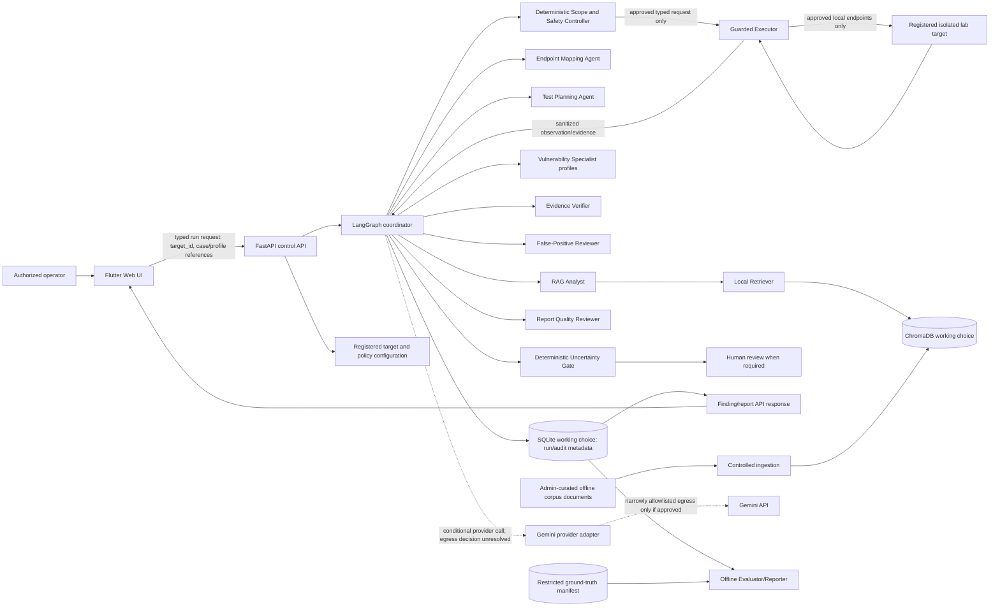
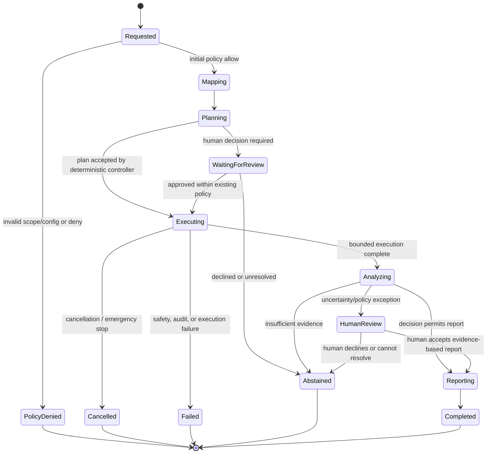

# AEGISCORE AI — Proposed Architecture

**Status:** Architecture design plus Phase 3 policy contracts, Phase 4B fake-only dispatch gate, Phase 5B offline case/profile permit binding, and the Phase 6A read-only FastAPI foundation. Unit tests cover only in-memory behavior; real authorization, target transport, network, persistent storage, agent, and research behavior remain unimplemented or unvalidated. The backend is not production-ready.  
**Review phase:** Phase 6A environment and backend foundation completed. This is not proposal Month 2 and does not include lab setup or dataset preparation.

## 1. Authority and design status

The thesis proposal is the source for research scope, workflow roles, evidence/uncertainty behavior, and evaluation. The Master Prompt Pack selects a working implementation stack. The proposal permits LangGraph or an equivalent stateful workflow, ChromaDB or a similar vector store, and a local or otherwise authorized LLM. It specifies a local Docker Juice Shop target but does not require Compose. Flutter Web, FastAPI, SQLite as the metadata database, Gemini API, Docker Compose, pytest, and Flutter test/analyze are project-level selections from the Master Prompt Pack, not thesis requirements. See [ADR 0001](ADRs/0001-technology-decisions.md).

Except for the Phase 3 safety-contract subset and the Phase 4B guarded fake-transport boundary described below, contracts, data entities, network zones, and flows are proposed design artifacts. Documentation is not validation evidence. Phase 4B tests verify only in-process call gating; they make no authorization, DNS, network-isolation, or real-transport safety claim.

## 2. Design principles and authority boundaries

1. **Controller before capability.** Every target-derived request must be authorized by deterministic policy at run acceptance and rechecked immediately before dispatch.
2. **No agent owns network or shell capability.** LLM roles receive bounded observations and return typed suggestions. Only the guarded executor can issue HTTP requests, and it accepts only a controller-approved request object. No shell tool is exposed to the graph.
3. **Fail closed.** Missing/invalid safety configuration, unknown target IDs, policy-store failures, invalid redirect destinations, exhausted budgets, or audit-write failures stop new requests.
4. **Evidence decides finding state.** LLM output may propose or challenge. A finding cannot become `Verified` unless its deterministic evidence checklist passes. Retrieval is context, not proof.
5. **Separate safety from research scoring.** The safety controller decides whether an operation is permitted. The uncertainty gate decides whether evidence supports reporting, bounded re-check, abstention, or human review. Neither can override the other.
6. **Keep evaluation labels sealed.** Runtime agents do not receive final test labels or ground-truth adjudications. An offline evaluator joins run outputs to the separately controlled experiment manifest after a run is complete.
7. **No silent substitution.** Provider unavailability is an error/abstention. A mock provider is allowed only in an explicitly labeled test/demo mode and cannot be represented as a real security assessment.

## 3. Context and data flow

The diagram depicts intended boundaries, not configured networks. The implemented `GuardedExecutionBoundary` accepts an injected transport, but no production or network-capable transport exists; tests inject only a recording fake. No Docker network or Gemini egress rule exists. A future Executor must be isolated from general outbound traffic and able to reach only the registered lab service through a narrow internal path. LLM/provider requests must not originate from the Executor network. Whether a separate, narrowly allowlisted provider egress path is permitted while experiment egress is default-deny is unresolved (`ARCH-OPEN-01`).

### End-to-end run flow

1. The UI submits a typed request that references a registered `target_id` and selected, approved case/profile identifiers. It cannot supply an arbitrary URL, HTTP method, command, or free-form payload for execution.
2. The API validates the request schema, resolves the target from the explicit registry, records an audit event, and asks the deterministic controller for an initial decision. Unknown, inactive, or malformed registrations fail closed.
3. The Mapping Agent receives the approved scope and bounded observations. Any observation request goes through the Executor and the same controller checks; the agent cannot expand the scope.
4. The RAG Analyst retrieves only from the versioned local corpus. The Planner may use this context to produce a typed plan. The controller checks every proposed step against endpoint scope, permitted operation/profile, request budget, and timeout policy. Planning is not authorization.
5. If policy or uncertainty requires a person, the workflow pauses in a review state. Approval cannot waive hard scope, forbidden-action, or network policies.
6. For each approved step, the controller validates immediately before dispatch. The Executor records request metadata and a sanitized response/evidence reference. Automatic redirects are disabled; each redirect hop is independently validated before any follow-up request.
7. Specialist profiles return candidate findings with evidence requirements. The Verifier checks the predefined checklist; the independent False-Positive Reviewer returns support/challenge/unresolved advice. Neither can grant execution authority.
8. The Uncertainty Gate uses the frozen calibrated decision policy and evidence state to report, request a bounded re-check, abstain, or request human review. It cannot waive a controller denial.
9. The Report Quality Reviewer flags missing citations, duplicates, contradictions, or unsupported wording. It cannot upgrade a finding to `Verified`.
10. The report and audit trail are persisted. After the run, the offline Evaluator joins outputs to the sealed ground-truth partition and computes proposal metrics.

## 4. Component contracts and responsibilities

Most interfaces below are conceptual typed contracts, not implemented schemas. MOD-01 has an in-memory implementation subset in `aegiscore/safety.py`. `REQ-*` are from `docs/REQUIREMENTS.md`; `T-*` are verification identifiers from `docs/TEST_PLAN.md`.

| Component / proposal module | Input → typed output | LLM-driven or deterministic | Authority, boundary, and linked requirements/tests |
|---|---|---|---|
| MOD-01 Scope and Safety Controller | Phase 3: registration/scope/budget/stop contracts. Phase 4B: `OperationIntent` → `OperationAuthorization` + `OperationPermit`; permit binds run ID, target registration version, scope policy/version, exact canonical read-only operation/parameter set, operation identity, budget slots/limits, and operation/run deadlines. | Deterministic | `PolicyEngine` issues permits, tracks one-use/replay state, checks in-memory registration revocation, and latches operation denial. Registration version/revocation are in-memory controls, not proof of real authorization. REQ-002/004/005/006; T-SAFE-01..10. |
| MOD-02 API and Endpoint Mapping Agent (Observer/Recon role) | `ApprovedScope`, bounded `Observation` records → `EndpointInventory` with provenance and confidence | LLM may summarize/classify; observation acquisition is bounded deterministic tooling | No self-directed scan or URL fetch; unknown routes remain unapproved. REQ-007; T-AGENT-01. |
| MOD-03 Test Planning Agent | `EndpointInventory`, allowed profile/case catalog, retrieved context, budget snapshot → `TestPlan` with ordered `ProposedStep`s and rationale | LLM-driven planning; deterministic schema/policy pre-check | A plan is not permission. Controller independently authorizes every step. REQ-008; T-AGENT-02/T-SAFE-03. |
| MOD-04 Guarded Test Executor | `GuardedExecutionBoundary.authorize/authorize_redirect` and `dispatch(OperationAuthorization, OperationIntent)` → `DispatchResult`; injected `OperationTransport` receives canonical operation plus consumed permit | Deterministic | Phase 4B supplies no concrete network transport. The boundary serializes operations, checks cancellation/terminal denial and consumes the exact permit immediately before injection. Tests use only a recording fake. REQ-004/005/006/009; T-SAFE-06..10. |
| MOD-05 RAG Analyst | `RagQuery`, approved class/context → `RetrievedContext` containing chunk IDs, source metadata, relevance metadata, quoted content | Retrieval is deterministic search; synthesis may use LLM | Only approved local corpus; retrieved instructions treated as untrusted data and never as proof. REQ-010; T-RAG-01/02. |
| MOD-06 Vulnerability Specialist (XSS, SQLi, BAC profiles) | `ObservationBundle`, `RetrievedContext`, profile criteria → `CandidateFinding` and `EvidenceRequirement[]` | LLM-driven | Can propose only a candidate; no request capability and no confirmation authority. REQ-011; T-AGENT-03. |
| MOD-07 Evidence Verifier | `CandidateFinding`, `EvidenceBundle`, frozen `EvidenceChecklist` → `EvidenceVerification {items, completeness, state, reasons}` | Deterministic checklist with optional LLM-assisted interpretation | Exact markers, response differences, repeatability, or tool evidence must be checked against predefined rules. Only checklist policy can support `Verified`. REQ-012/015; T-EVID-01/02. |
| MOD-08 False-Positive Reviewer | Candidate plus supporting and contradictory evidence → `ChallengeReview {support, challenge, benign_explanations, duplicate_of, unresolved}` | LLM-driven independent review | Advisory only; cannot execute, change policy, or set final state. REQ-013; T-AGENT-04. |
| MOD-09 Uncertainty and Abstention Gate | `EvidenceVerification`, calibrated score inputs, frozen thresholds, safety decision → `UncertaintyDecision {report, bounded_recheck, abstain, human_review, rationale}` | Deterministic score/policy; LLM self-confidence is not authoritative | Controller denial dominates. Low confidence or policy exception cannot automatically continue. Exact formula/threshold unresolved. REQ-014/015; T-UNC-01..03. |
| MOD-10 Report Quality Reviewer | Draft report and evidence/source references → `QualityFlags[]` | Lightweight LLM/rule checks | Flags only; cannot establish truth or upgrade status. REQ-016; T-REPORT-01. |
| MOD-11 Evaluator and Reporter | Frozen output records plus restricted ground-truth manifest → `MetricRecord`, adjudication log, JSON/CSV/human-readable report | Deterministic | Runs post-hoc; ground truth is unavailable to runtime agents. REQ-017..021; T-EVAL-01..04. |
| MOD-12 Remediation Advisor (optional) | Verified finding and approved references → `Advice` and retest suggestion | Optional LLM role | No tools for code changes, shell, deployment, or production action. REQ-025; T-OPTIONAL-01 if approved. |

### Phase 3 implemented subset and limits

`aegiscore/safety.py` uses Python standard-library data classes, enums, `ipaddress`, URL parsing, locks, and a monotonic clock. Configuration is explicit and validated; the engine denies missing/invalid runtime configuration, an emergency stop, unknown or inactive target IDs, origin/scope mismatch, malformed or unapproved paths, exhausted request/redirect budgets, clock errors, and expired run deadlines. It rejects public IP literals, allows only registered exact host/scheme/port combinations, and allows only exact canonical paths. Redirects must remain on the same registered origin and path allowlist. Query strings are unsupported in this policy contract pending an explicit parameter-scope policy. Only the engine can issue a valid allow decision; LLM output must never be deserialized as one. An allow decision includes its canonical path; `WorkflowSafetyGate` binds it to that target/path for one next-step authorization and permanently latches any denial.

The `RequestIntent` contains only a target ID and path; it cannot authorize an arbitrary URL. The engine has no HTTP, shell, DNS, provider, or persistence capability. An allow decision consumes an in-memory budget slot; this is an authorization reservation, not evidence that a request was sent. A future executor must re-check policy at dispatch, enforce the returned per-request timeout, apply an independent network boundary, and persist an audit event before execution. DNS hostnames are matched exactly but are not resolved or pinned here. Registration fields do not prove external authorization: the configuration source and operator authority remain unresolved (`ARCH-OPEN-02`, `ARCH-OPEN-09`).

### Conceptual typed data contracts

These field lists establish boundaries, not a final schema:

- `TargetRegistration`: immutable `target_id`, local origin, explicitly approved endpoint/path/method constraints, lab identity, approval reference, active flag, policy version. Registration authority and exact address representation remain unresolved. Requests from agents cannot create or edit registrations.
- `RunRequest`: `target_id`, approved case/profile IDs, protocol version, requester/review context, and optional limit no greater than the registered policy cap. It contains no arbitrary target URL, shell command, unrestricted HTTP operation, or secret.
- `RunContext`: `run_id`, target ID, immutable policy snapshot/version, budget counters, deadline, cancellation state, graph state, and references to observations/plans/evidence.
- `PolicyDecision`: allow/deny/review outcome, reason code, target/policy version, checked destination, remaining budget, and audit-event reference.
- `EndpointInventory`: observed endpoint metadata, source request IDs, allowed/unapproved status, and mapping uncertainty. A discovered endpoint does not become allowed automatically.
- `TestPlan` / `ProposedStep`: selected profile/case, endpoint reference, bounded operation description, evidence goal, proposed cost, and rationale. The controller creates a separate `ApprovedRequest`; the LLM cannot create that authority-bearing type.
- `ToolResult` / `EvidenceBundle`: request ID, timestamp, response status/headers selected for capture, sanitized body excerpt/hash, redirect chain, tool result, and integrity/provenance references. Raw body retention/redaction is unresolved.
- `CandidateFinding`: finding ID, class, endpoint/case reference, claim, evidence references, required checklist, model/prompt provenance, and explicitly non-final state.
- `EvidenceVerification`, `ChallengeReview`, `UncertaintyDecision`, `HumanReviewDecision`, and `QualityFlags`: typed outputs with actor, evidence references, reasons, policy/checklist version, and timestamps.
- `AuditEvent`: event ID, run ID, actor/module, event type, decision/reason, request/evidence references, policy/model/prompt/corpus versions where relevant, timestamp, and redacted fields. Audit-store failure prevents further execution.
- `GroundTruthCase`: case/source/category/label/checklist/adjudication/partition. Store behind the offline evaluator boundary; do not expose final-test labels or records to runtime agents or the RAG corpus.

## 5. State transitions

Run state and finding state are separate. The run state below is a proposed lifecycle; the proposal specifies the finding states, not every run-state name.

Each required module also returns one of the following typed terminal/intermediate outcomes. These names are design vocabulary only; exact enum values are not committed in code.

| Module | Module-local transition | Required behavior at transition |
|---|---|---|
| MOD-01 Scope/Safety Controller | `unchecked → allow / deny / review` | Invalid/missing configuration, unknown target, exhausted budget, or policy error cannot transition to `allow`. |
| MOD-02 API/Endpoint Mapping | `not_started → mapped / partial / failed` | New observations remain unapproved until independently registered/allowed. |
| MOD-03 Test Planning | `draft → controller_validated / rejected / needs_review` | `controller_validated` means plan shape/budget pre-check only; each actual request still needs a separate dispatch decision. |
| MOD-04 Guarded Executor | `queued → dispatched → completed / blocked / timed_out / cancelled / failed` | Revalidate each dispatch; do not replay an ambiguous request automatically; stop creating new requests on cancellation. |
| MOD-05 RAG Analyst | `pending → retrieved / empty / unavailable` | `empty/unavailable` must not silently become a no-RAG P run. |
| MOD-06 Vulnerability Specialist | `analysis → candidate / no_candidate / insufficient_context` | A candidate is never a verified finding. |
| MOD-07 Evidence Verifier | `pending → pass / incomplete / contradictory / not_reproduced` | Only `pass` under the frozen checklist may support `Verified`; no state can grant request authority. |
| MOD-08 False-Positive Reviewer | `pending → support / challenge / unresolved` | Advice only; final evidence and policy gates remain separate. |
| MOD-09 Uncertainty Gate | `pending → report / bounded_recheck / abstain / human_review` | Controller denial dominates; insufficient evidence cannot transition directly to report. |
| MOD-10 Report Quality Reviewer | `draft → ready / flagged` | `ready` means no unresolved quality flags under chosen rules, not proof of vulnerability. |
| MOD-11 Evaluator/Reporter | `pending → scored / unscored / invalid_mapping` | `scored` only after output is fixed and evaluator-only ground-truth join is permitted. |
| MOD-12 Remediation Advisor (optional) | `pending → advice / unavailable` | No transition invokes code modification, shell, deployment, or production action. |

Proposal finding states and transitions:

| Current state | Allowed next state | Gate |
|---|---|---|
| Candidate | Verified, Uncertain, Rejected/Not Reproduced | Verifier checklist, challenge review, and uncertainty policy. |
| Verified | Reported (retained as verified) | Checklist passes and report-quality flags are resolved or documented. |
| Uncertain | Candidate after bounded re-check; human review; abstain | Re-check uses remaining budget and controller approval; no automatic continuation below threshold. |
| Rejected/Not Reproduced | Terminal for the current run | Preserve claim/evidence/reason in audit; do not report as confirmed. |

The numeric score, threshold, number of re-checks, and human decision authorization model are not defined here.

## 6. Storage and provenance model

SQLite is the working project choice for metadata, not a proposal-mandated database. ChromaDB is the working choice among proposal-permitted vector stores. The exact schema, transaction model, retention, backup, and access controls are unresolved.

| Store / conceptual entity | Contents and boundary |
|---|---|
| SQLite: `target_registry` | Explicitly registered targets and approved constraints. Registration mechanism and operator permissions unresolved. |
| SQLite: `runs`, `policy_snapshots`, `budgets` | Run metadata and immutable policy/configuration version used for each run. |
| SQLite: `endpoint_observations`, `plans`, `request_records` | Bounded inventory, proposed/approved plan references, and request/response metadata. Store sensitive body material only after a retention/redaction decision; synthetic data is required. |
| SQLite: `evidence`, `findings`, `reviews`, `uncertainty_decisions` | Evidence references, finding lifecycle, reviewer outputs, score inputs, final abstain/report/review reason. |
| SQLite: `rag_sources`, `retrieval_events`, `model_call_metadata`, `audit_events` | Provenance, model/config/prompt/corpus version references, and security-relevant event trail. Never persist API secrets. |
| ChromaDB: approved corpus chunks | Embeddings and chunk metadata; only approved, sanitized sources. Embedding provider and model are unresolved. |
| Restricted experiment manifest | Ground truth, adjudication, evidence checklist, and development/validation/final partition. Separate from runtime access and RAG; evaluator-only after run completion. |

### RAG ingestion and retrieval

1. A controlled curator imports relevant WSTG guidance, selected official tool documentation, and sanitized previously validated lab observations. Runtime agents do not browse arbitrary URLs or ingest target responses into the corpus automatically.
2. Each source receives provenance metadata: stable source ID, title/canonical source, version/date, acquisition date if available, source type, content digest, corpus release, and chunk ID. Exact metadata and document retention remain to be selected.
3. Ingestion and dependency acquisition occur outside the restricted test-execution path. Corpus release and embedding configuration are frozen and recorded for an experiment.
4. Retrieval filters to approved corpus releases and relevant categories. Returned text is labeled untrusted, is passed as quoted/reference context, and is not executed as an instruction.
5. Findings cite source/chunk IDs for rationale. Retrieval similarity indicates relevance only, not vulnerability confidence or proof. Embedding provider/model, chunking, relevance threshold, and update cadence remain unresolved.

## 7. API, credentials, and external services

### Frontend/backend boundary

- Flutter Web is an operator interface only. It submits target IDs, approved case/profile choices, and human-review actions; it cannot send target URLs, arbitrary HTTP requests, shell commands, model credentials, or direct lab traffic.
- FastAPI is intended to validate typed requests, authenticate/authorize operations once that model is decided, resolve registered target IDs, create runs, return sanitized status/findings, and forward cancellation. Beyond the Phase 6A system routes, operational API routes and wire schemas are not committed.
- The backend is the only component allowed to hold provider credentials. The browser receives neither Gemini keys nor embedding-provider secrets.
- The graph and agents cannot call arbitrary HTTP or shell tools. They can request a typed operation; deterministic controller/executor validates it.
- Authentication, local binding, CSRF/CORS, operator roles, target-registration administration, and human-review identity are unresolved. A deployment exposed beyond loopback must not be considered acceptable until these are designed.

### Phase 6A implemented backend foundation

`aegiscore/api/app.py` provides `create_app()` and an importable ASGI `app`. The API currently exposes only `GET /health` and `GET /capabilities`, with Pydantic response models. `/health` reports that the API process answered; it does not check the lab, database, safety configuration, or other dependencies. `/capabilities` returns a static inventory of implemented in-memory safety/fake-transport contracts and explicitly unimplemented real transport, RAG, orchestration, vulnerability workflow, external LLM, and persistent application storage.

These routes accept no target, operation, model, or request-body input. The API package does not import or call the policy engine or guarded execution boundary. It has no target-operation, authorization, or dispatch endpoint. Unknown routes and unsupported methods use FastAPI's standard 404/405 responses. There is no authentication, CORS/CSRF, local-bind, persistence, or production error/audit policy yet; serving these routes beyond a controlled local development context is not approved by this foundation. Tests use FastAPI's in-process test client; no listening server is launched.

The Python environment is defined by `pyproject.toml`, `.python-version`, and `uv.lock`, and is instantiated under `.venv/`. `uv` is a Phase 6A implementation choice, not a thesis requirement or Master Prompt technology requirement. The lock resolved and the in-process tests ran on Python 3.13.2 for Windows. Uvicorn is declared as the ASGI server dependency but was not launched. This environment verification does not validate deployments on other operating systems or Python versions.

### External-service dependencies and egress

- Gemini is a Master Prompt Pack project decision, not the proposal’s selected model. API key/model/SDK versions are unselected and not configured in the inspected environment.
- A provider adapter should be the only LLM network client. The lab Executor must have no route to Gemini, the public internet, or arbitrary DNS. Provider egress, if approved, must be narrow, separately audited, and outside the Executor network.
- This split still leaves a policy conflict: the proposal says experiment-environment outbound Internet is default-deny, while Gemini requires a remote API call. The project must decide whether a provider-only egress exception is approved, use a separately authorized gateway, or suspend live Gemini calls. No exception is assumed here (`ARCH-OPEN-01`).
- The embedding provider is unspecified and may introduce another external dependency. Prefer a local provider if compatible with the Master Prompt; otherwise decide and document egress/data handling before use.
- Only synthetic/test data is in scope. Before any remote model call, minimize and redact observations; target secrets and personal data must never be sent. Data retention and provider processing terms have not been assessed.
- Runtime RAG does not download documents. Source acquisition and software dependency installation are separate from execution, as required by the proposal.

## 8. Error handling, retries, deadlines, and audit

| Condition | Proposed behavior |
|---|---|
| Missing, malformed, or inconsistent safety config; unknown target; policy-store error | Reject before execution. No permissive default. Emit a failure audit record if the audit store remains available. |
| Budget exhausted, timeout reached, emergency stop, cancellation | Stop dispatching new requests immediately; preserve completed evidence and record the stop reason. Do not expand the budget automatically. Exact timeout/budget values are unresolved. |
| DNS resolution mismatch, disallowed IP, redirect to unregistered/out-of-scope destination, or network boundary violation | Do not follow/connect; deny and audit. Executor must disable automatic redirect following. Address pinning/revalidation implementation remains to be selected. |
| Executor transport failure or ambiguous response | Do not automatically replay the target request. Mark evidence incomplete/uncertain. A re-check is a new planned operation subject to remaining budget and controller approval. |
| LLM/provider timeout, rate limit, malformed schema, or provider outage | Record provider/model metadata without secrets. A bounded retry may be considered only for transient analysis calls; retry count/backoff are unresolved. If unavailable, fail or abstain—never silently use mock output. |
| RAG store unavailable or no eligible source | Do not silently run a proposed RAG configuration without retrieval. Return a typed failure/abstention or use an explicitly declared ablation configuration only. |
| Audit persistence failure | Fail closed: no further assessment request until audit persistence is restored. |
| Cancellation while a provider/HTTP call is in flight | Propagate cancellation where supported, prevent subsequent calls, record whether the in-flight operation completed, and mark partial evidence explicitly. Cancellation cannot guarantee rollback of a request already delivered. |

Audit records should link run/policy version, module/actor, decision, request/evidence IDs, error class, and timestamp. Secrets, authorization tokens, and unnecessary raw response data must be redacted. Append-only storage, integrity checks, retention duration, and recovery procedure are design questions, not validated controls.

## 9. Experimental reproducibility

- Freeze case IDs, ground truth, category, evidence checklist, duplicate policy, and protocol before final evaluation.
- Store source-separated Juice Shop and OWASP Benchmark labels; do not merge their semantics by assumption.
- Keep development, validation, and final test partitions separate. Prefer not to split an endpoint or vulnerability instance across partitions. The runtime graph and RAG store must not receive final-test labels.
- Select composite-score weights and abstention threshold on development/validation data, record the method and sample size, and freeze before opening final-test outcomes. Calibration method/binning remain unresolved.
- Run B1 (ZAP), B2 (Multi-Agent+RAG without uncertainty abstention), and P with the same target/scope and comparable budgets. A1 no-RAG is optional. Repeat initially three times if feasible.
- Record target/policy, model/provider/version, prompt version/hash, corpus and embedding version, retrieval references, test-plan version, request/tool logs, evidence, timestamps, and decisions.
- Evaluator receives the ground-truth manifest only after the run output is fixed. Abstentions are separate from TN. Report sample size, paired differences, uncertainty intervals where suitable, and qualitative errors. No experiment/result is claimed in this design document.

## 10. Requirements-to-component and test traceability

| Requirement IDs | Components | Planned test-plan IDs |
|---|---|---|
| REQ-001 | Overall workflow; offline evaluator | T-EVAL-01..04 |
| REQ-002..006 | Safety Controller; target registry; Executor; network boundary | T-SAFE-01..10; T-INT-01 |
| REQ-007 | Endpoint Mapping Agent | T-AGENT-01; T-WF-01 |
| REQ-008 | Planner; Safety Controller | T-AGENT-02; T-SAFE-03 |
| REQ-009 | Executor; audit store | T-SAFE-02..10; T-AUDIT-01 |
| REQ-010 | RAG Analyst; Retriever; ChromaDB working choice | T-RAG-01/02 |
| REQ-011..013 | Specialist; Verifier; False-Positive Reviewer | T-AGENT-03/04; T-EVID-01/02 |
| REQ-014..015 | Verifier; Uncertainty Gate; human review | T-UNC-01..03; T-WF-02 |
| REQ-016 | Report Quality Reviewer | T-REPORT-01 |
| REQ-017 | Controller; Executor; stores; audit | T-AUDIT-01/02 |
| REQ-018..022 | Offline Evaluator; experiment manifest | T-EVAL-01..04 |
| REQ-023..024 | Flutter; FastAPI; provider; storage; lab | T-API-01 (read-only backend foundation implemented; broader API/UI/integration checks remain planned); T-UI-01; T-INT-01; T-SECRET-01 |
| REQ-025 | Optional Remediation Advisor | T-OPTIONAL-01 |
| REQ-026 | Project status and phase gate | Documentation review; not a runtime test |

Full test purposes and acceptance criteria are in [TEST_PLAN.md](TEST_PLAN.md). Phase 3 policy tests and Phase 4B fake-boundary tests are in `tests/test_safety_policy.py` and `tests/test_guarded_execution.py`; other identifiers remain planned verification references.

## 11. Open architecture decisions

- **ARCH-OPEN-01:** Whether any external LLM/provider or embedding egress is permitted while execution remains default-deny. No exception is active or approved; ADR 0002 documents the decision gate.
- **ARCH-OPEN-02:** Named registration authority, authorization-record verification, expiry/revocation source, exact local origin/path/address representation, DNS pinning, allowed methods, and required human approval points.
- **ARCH-OPEN-03:** Numeric request budgets, per-request/run deadlines, response-size/concurrency caps, cancellation semantics for in-flight HTTP, maximum re-checks, and any provider retry limit. ADR 0002 contains discussion defaults only, pending approval.
- **ARCH-OPEN-04:** Gemini model/SDK/version, provider data handling, credential store, and rate/cost limits.
- **ARCH-OPEN-05:** Embedding provider/model, chunking, retrieval threshold, corpus release procedure, and local-vs-remote processing.
- **ARCH-OPEN-06:** Authentication/authorization, browser/API origin, local binding, human-review identity, and target-registration administration.
- **ARCH-OPEN-07:** SQLite/Chroma persistence, schema/migrations, raw response redaction, audit integrity, retention, export, and backup.
- **ARCH-OPEN-08:** Confidence-score formula/calibration method and validation sample adequacy; must be frozen before final-test evaluation.
- **ARCH-OPEN-09:** Operational interpretation of the Master Prompt Pack’s “registered, authorized local lab targets” relative to the proposal’s written-authorization scope and the local target registry.
- **ARCH-OPEN-10:** Trusted storage/authentication for authorization records, registry integrity, revocation freshness, and clock-trust requirements. No real target authorization has been supplied or verified.
- **ARCH-OPEN-11:** Concrete operation-permit serialization/cryptographic or in-process capability design, exact request binding, single-use/replay behavior, and audit-before-dispatch guarantees for the future transport.
- **ARCH-OPEN-12:** Lab network addressing, DNS resolver policy, proxy handling, socket peer verification, firewall/namespace mechanism, and whether external provider egress can be isolated from the executor at the host/network level.

## 13. Safety decisions and the next transport boundary

This section refines the proposed control contract and records the Phase 4B in-memory permit/guarded-boundary implementation. It does not configure a network, verify authorization, or approve a real transport. Evidence is limited to the Phase 3 policy tests and Phase 4B fake-transport unit tests described in Section 4 and `docs/TEST_PLAN.md`.

### 13.1 Target authorization and registration lifecycle

The proposed registration authority is the person responsible for the isolated lab (lab owner/custodian), with the project supervisor approving the research scope or explicitly delegating that approval. The actual people, roles, delegated-registration process, and identity/authentication mechanism are unknown and require approval; this document does not assert that any person has authorized a target.

Before a registration is enabled, a trusted registry maintainer should associate a unique `target_id` and immutable registration version with a controlled authorization record. The record should identify the authorizing party and date, target/lab identity, exact origin and network zone, approved paths and methods or case profiles, permitted testing period, and any specific constraints. Store a stable record reference and integrity metadata in the registry; keep the underlying document in its controlled source of record rather than embedding it in prompts or logs. The evidence format, storage location, integrity mechanism, and verification owner remain unresolved. There are no real authorization records in this repository. The `approval-record-1` value in a unit-test fixture is synthetic test data only.

The registration binds the `target_id` to that authorization record and its exact scope. A user or model may select an existing ID but cannot create authorization by supplying a URL, record string, hostname, or scope. At run start and immediately before each operation, the system must confirm the registration is enabled and that the associated approval remains current. Missing, expired, revoked, ambiguous, conflicting, unverifiable, or stale evidence—and unavailable authorization/registry services or an untrusted clock—must fail closed. Revocation must invalidate future permits; behavior for an already in-flight operation must be cancellation plus an audit event, with no new dispatch. No human approval may waive hard scope or network policy.

The current policy model has only string fields `authorization_ref` and `network_zone_id`; it does not authenticate the registrant, resolve or inspect the reference, model approval dates/revocation, or prove authority. Its test fixtures are not authorization evidence.

### 13.2 Proposed experimental limits (not adopted or validated)

The following are conservative starting values for supervisor review in a controlled local lab. They are **proposed experimental defaults**, not values from the proposal, deployment recommendations, or validated safety limits. They are not currently configured in the runtime.

| Limit | Proposed value | Rationale / semantics |
|---|---:|---|
| Requests per run | 50 | Small enough to bound a local experiment; every redirect hop and retry consumes a request slot. Baseline comparisons must use the same cap. |
| Redirects per request chain | 3 | Bounds redirect loops; disable automatic redirects and authorize each hop. Also retain a proposed aggregate run cap of 10 redirects to prevent many short chains from multiplying traffic. |
| Connection deadline | 2 seconds | Limits time spent establishing one local connection; includes DNS resolution if performed synchronously. |
| Total operation deadline | 10 seconds | Wall-clock cap from operation start through connect, TLS, request write, and bounded response read; it does not extend on redirect or retry. |
| Total run deadline | 300 seconds | Stops new work when the bounded run window expires; in-flight operation still has its own 10-second deadline and cancellation handling. |
| Maximum response bytes | 1 MiB (1,048,576 bytes) per operation | Count HTTP status, headers, framing, and body after TLS; also cap the decoded entity at 1 MiB to prevent compressed expansion. Stop at the cap, mark truncated, and never treat truncated content as complete evidence. |
| Concurrent operations | 1 | Sequential requests make accounting, emergency stop, and evidence attribution simpler for a small controlled lab. |

These caps need supervisor approval and later validation against the proposed case protocol before being called suitable. An authorized operator should set them in a trusted, versioned policy snapshot loaded once per run; run inputs and model output cannot change them. Configuration may lower the proposed ceiling. Raising a ceiling requires a documented policy revision, supervisor approval, risk review, and re-running the safety tests before use. Missing, malformed, stale, or contradictory limit configuration must deny execution; no permissive runtime defaults should be silently substituted. Phase 4B tests use explicitly configured smaller in-memory request/redirect/deadline values and serialize calls through the guarded boundary. They do not adopt these proposed deployment defaults. Per-chain redirect, connection deadline, response-byte cap, and real transport concurrency enforcement remain unimplemented; the current aggregate redirect counter is not equivalent to the proposed per-chain limit.

### 13.3 DNS, destination validation, and network isolation

Exact hostname/origin matching establishes only that a requested name matches a configured string. It does not establish where the name resolves or where a socket connects: DNS can return public, metadata, link-local, or otherwise unauthorized addresses; answers can change between validation and connect; aliases and IPv4-mapped IPv6 can obscure address class; proxies, resolver configuration, routing, and host/container bridges can alter the actual destination. Therefore the current hostname checks are not proof of local-only isolation.

The intended destination policy is positive allowlisting of the registered lab service on a dedicated, isolated local lab network. Permit only explicitly registered service addresses/ports in the approved network zone. Deny public, metadata-service, link-local, multicast, unspecified, and unregistered addresses; loopback is allowed only when that exact loopback endpoint is the registered local target. Private-address classification by itself is insufficient because private networks can contain unrelated services. Disable ambient proxy settings and do not allow a proxy unless separately approved and itself constrained to the lab.

Before any future connection, a transport must resolve A and AAAA records through a defined resolver, canonicalize addresses (including IPv4-mapped IPv6), and validate the complete answer set against the registered address policy. Fail closed on no answers, mixed allowed/disallowed answers, resolver error, or ambiguity. Pin the validated address used for the socket so it cannot be replaced by a second lookup; verify the connected peer address against the pinned set before sending application data. Preserve the registered hostname for TLS SNI and certificate validation. Revalidate every redirect destination and its path/address before following it, with automatic redirect following disabled. Independently enforce egress at the host/container/network layer so application checks are not the only barrier. Resolver selection, address registration, TLS policy for local targets, firewall/network namespace mechanism, and proxy policy remain unresolved. This phase makes no DNS query and no network request.

### 13.4 Implemented operation permit and fake-only boundary

Phase 4B introduced `OperationIntent`, `CanonicalOperation`, `OperationPermit`, and `OperationAuthorization` in `aegiscore/safety.py`, plus `GuardedExecutionBoundary` and the injected `OperationTransport` protocol in `aegiscore/guarded_execution.py`. Phase 5B extends that same in-memory seam with `CaseProfilePolicy` and `OperationDataLimits`. A configured exact `(target_id, case_id, profile_id)` binding constrains permitted GET/HEAD methods, paths, query-parameter names, header names, and whether a bounded body is allowed. These config/test fixtures are synthetic policy data; they are neither approved research cases nor authorization evidence.

The engine derives run ID, registration version, and explicit origin (scheme, registered hostname, and port) from its trusted in-memory configuration. The request intent accepts no URL or origin. It canonicalizes query pairs by unique name and stable sorting; `canonical_query` uses deterministic percent-encoding. It lowercases and sorts header names, rejects case-insensitive duplicates, forbidden transport/credential headers, controls, surrounding field whitespace, and unapproved names. The profile scopes parameter/header names, while values are checked for format and size and then bound exactly in the permit; no value catalog is configured. `Host`, framing/hop-by-hop, authorization, and cookie headers are excluded; no credentials are represented. Any future value constraints or credential use, even synthetic lab credentials, needs a separately reviewed profile policy. Body is either absent or immutable `bytes` and is bound byte-for-byte. Versioned data limits cap parameter count/query bytes/header count/header bytes/body bytes; the Phase 5B code-level ceilings are 32 parameters, 4096 query bytes, 32 headers, 8192 serialized header bytes, and 65536 body bytes. These are in-memory contract ceilings chosen for bounded representation, not proposal requirements, approved deployment defaults, or transport guarantees. Tests use lower explicit values (2 parameters/128 query bytes/2 headers/128 header bytes/16 body bytes).

Permits bind the complete canonical operation plus run ID, target registration version, scope policy ID/version, case-profile version, data-limit version, request/redirect budget slots and caps, and operation/run deadlines. The engine tracks permit identity, rejects altered or stale contexts, checks current in-memory revocation/stop/deadline state, and consumes each permit once. The existing method allowlist remains exactly `GET` and `HEAD`; no write method was added. Whether future research cases require other methods or state-changing operations is unresolved and needs an explicit policy decision and review. Body-bearing GET/HEAD data is represented only for contract testing; no HTTP semantics or transport support is claimed.

The guarded boundary serializes authorization/dispatch, checks cancellation, requires an engine-issued authorization, consumes the exact permit, and only then calls the injected transport. The recording fake logs every attempted call. Tests cover allowed-once dispatch and zero calls for denied, malformed, mismatched case/profile, altered target/path/method/parameters/headers/body/origin/context, missing/oversized/ambiguous request data, forged/model-shaped, stale/cross-run, revoked, replayed, stopped, cancelled, expired, and budget-exhausted operations. They also assert denial remains terminal and configured test-data limits are enforced.

This remains an in-process capability marker, not cryptographic or cross-process authority; arbitrary code in the trusted Python process is outside the test claim. No DNS is resolved, socket or HTTP request is opened, or real transport exists. These tests do not establish authorization, DNS/address pinning, peer validation, TLS, network isolation, redirect transport behavior, response-size enforcement, real connection deadlines, persistent audit, or cancellation of in-flight network I/O. A future real transport must separately establish those controls and must never treat retrieved material or model output as authority.

### 13.5 Provider egress remains default-deny pending an explicit decision

The current project posture remains no outbound provider/embedding connection. The Master Prompt Pack's Gemini choice is a working project selection; it does not silently authorize an exception to the default-deny experiment boundary. No Gemini call, embedding-service call, credential provisioning, or egress change is authorized by these documents.

Two paths remain under consideration. A local model and local embedding model better preserve the no-egress boundary and keep observations local, but require hardware/runtime feasibility, model/version pinning, licensing, capability testing, and a reproducible setup. A remote provider may offer practical model availability but creates external data processing, retention, credential, availability, cost, DNS, and egress risks. It would require a supervisor-approved data classification and provider, minimal synthetic/redacted inputs, server-side credentials, a separate provider-only gateway/process with strict endpoint/egress allowlisting and audit, quotas, and tests proving that the assessment Executor still has no provider or general Internet route. A hostname allowlist alone is insufficient for this boundary.

Decision gate: keep egress denied until the supervisor/project owner records the selected local/remote approach, provider and model/version where applicable, permitted data categories, credential handling, network topology, risk review, and acceptance evidence in a revised ADR. Then test the deny-by-default rule and any explicitly approved provider-only route. If no acceptable route is approved, use no live provider; any mock remains explicitly labeled test/demo behavior and cannot be reported as a real security finding. Embedding-provider egress is subject to the same gate.

### 13.6 Requirement and validation linkage

These decisions refine REQ-002, REQ-004–006, REQ-009, REQ-017, and REQ-024 without changing their IDs. Actual authorization lifecycle remains open; in-memory registration-version/revocation checks map to MOD-01 and T-SAFE-06. DNS/address/network controls map to MOD-01/04 and T-SAFE-07/T-INT-01 and remain unimplemented. Exact operation permits, case/profile/request-data binding, terminal denials, budget, stop, cancellation, and fake transport map to MOD-01/04 and T-SAFE-08..10; the in-memory subsets were exercised in Phases 4B and 5B. Provider egress maps to the provider adapter/deployment boundary and T-SECRET-01/T-INT-01 and remains unresolved.

## 12. Design review checklist

- [x] Every proposal-priority module and every Master Prompt-required module has a responsibility, typed boundary, and planned test reference.
- [x] Proposal technology options are distinguished from the selected project stack.
- [x] Untrusted LLM, RAG, web, and tool outputs cannot grant authority or directly execute requests.
- [x] Finding and run state are distinguished; insufficient evidence leads to abstention/review.
- [x] Storage, provenance, error handling, cancellation, API boundary, credentials, and experiment separation are documented conceptually.
- [x] All 12 proposal-priority / Master Prompt-required roles have typed input/output and module-local result-state descriptions.
- [x] No mandatory module is omitted from the proposed component set. The proposal’s 8-stage overview is expanded by its later 12-role table; the Master Prompt supplies the implementation requirement for those roles.
- [x] Technology-attribution correction is reflected in requirements and ADR: stack selections are project decisions unless the proposal explicitly allows the option.
- [x] Gemini/default-deny egress tension and missing numeric/security configuration are called out as unresolved, not presumed compatible.
- [x] Phase 3 deterministic in-memory policy contract, Phase 4B fake-only operation-permit boundary, and Phase 5B case/profile/request-data binding are implemented; see `tests/test_safety_policy.py`, `tests/test_guarded_execution.py`, and `T-SAFE-01..10` status in `docs/TEST_PLAN.md`.
- [ ] Real authorization verification, network topology/egress, DNS pinning, real transport connection/response enforcement, in-flight cancellation, persistent audit, the remaining schemas/modules, and research tests remain unresolved or unvalidated.
