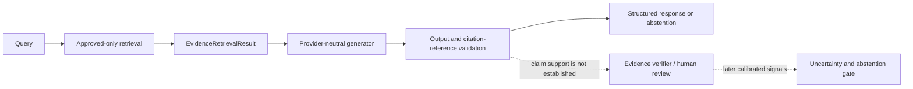

# Phase 8C — Evidence-Grounded Generation Design and Verification Plan

**Status:** Design plan only. Generation runtime implementation has not started.  
**Scope:** Provider-neutral generation over the existing approved-only retrieval result; no provider call, network operation, real-corpus decision, lab action, or target operation is authorized by this plan.

## 1. Current baseline and limitations

This plan was prepared against the current working tree, not inferred from `HEAD` alone. At inspection, `HEAD` was `263f367ce96daddf52e5bf79e9504768049dcf7d`, and the worktree already contained uncommitted Phase 8B.2.3 files and changes. `PROJECT_STATUS.md` records the Phase 8B.2.3 result as 58 focused tests and 218 full-suite tests. Those test commands were not rerun for this documentation-only phase.

The following current contracts were inspected:

| Area | Existing behavior and limit |
|---|---|
| Source and retrieval contracts | `aegiscore/rag.py` defines immutable source/chunk provenance, ranked retrieval results, `CitationReference`, and `validate_citation_references()`. `InMemoryTestRetriever` is a deterministic lexical test double, not semantic or production retrieval. |
| Approved retrieval | `aegiscore/rag_runtime.py` returns an `EvidenceRetrievalResult` with query, status, hits, approved-source count, and chunk-level citation references. The persistent selector verifies the current approved revision and local source integrity; it does not prove source authority, reviewer identity, or factual truth. |
| Citation checks | Citation validation establishes that a chunk was returned, its source ID matches, and provenance is available. `CitationValidation.factual_support` is explicitly `not_evaluated`. Reference membership alone does not show that a chunk supports a generated statement. |
| Existing tests | `tests/test_rag.py`, `tests/test_rag_runtime.py`, `tests/test_persistent_source_review.py`, `tests/test_source_review_cli.py`, `tests/test_safety_policy.py`, and `tests/test_guarded_execution.py` cover the current contracts and their safety boundaries. For example, the runtime tests cover approved-only retrieval, empty/irrelevant evidence, untrusted retrieved text, citation membership, changed content, stale approval, and registry errors. |
| Real corpus | A read-only check during this planning task found 11 manifest entries, all `candidate`, all with empty `review_events`, and `approval_status=no_sources_approved`. `git diff -- docs/source-review-manifest.json` was empty. A repository scan found no `.sqlite`, `.sqlite3`, or `.db` files. |
| Provider and egress | ADR 0002 keeps provider and embedding egress default-deny with no approved exception (`ARCH-OPEN-01`). The Gemini selection in ADR 0001 / `REQ-023` is a working project choice, not authorization to call a remote service. |

The architecture roadmap groups RAG, specialist, evidence, uncertainty, and reporting work as a later phase; it does not already define a Phase 8C generation contract. This plan details only the generation boundary and its future verification. It does not reorder or replace that broader roadmap. Existing requirement IDs remain the source of scope: in particular `REQ-004`, `REQ-010`–`REQ-016`, `REQ-017`, `REQ-021`, `REQ-023`, `REQ-024`, and `REQ-026`. No new `REQ-*` IDs are proposed.

Known limits remain: there is no generation runtime or production retriever; the real corpus has no approved sources; citation membership is not factual-support verification; reviewer labels are not authenticated; the uncertainty formula and threshold are unresolved; and no provider, lab, or target integration is verified.

## 2. Proposed architecture and component boundaries

The generation component receives one completed `EvidenceRetrievalResult`. It does not receive a registry, source-review writer, target ID, operation permit, transport, or unrestricted tool. Its only output is a typed response or a typed expected failure.



| Component | Responsibility | Authority limit |
|---|---|---|
| Retrieval and source review | Enforce approval, exact current revision, source hashes, manifest/database consistency, and deterministic retrieval metadata. | Retrieval score and approved status do not establish factual support. |
| Generation | Express a concise answer as claim-sized units and attach supplied source/chunk references to each factual claim. Abstain when the supplied evidence is absent, insufficient, or explicitly conflicting. | Cannot approve sources, change retrieval policy, infer target authorization, dispatch tools, or mark a vulnerability verified. |
| Output validator | Enforce response shape, required claim citations, citation membership, source-ID matching, duplicate rules, and no partial result on invalid output. | Can validate structure and reference membership, not semantic entailment or source truth. |
| Evidence verifier / reviewer | Compare claims with evidence and predefined evidence criteria; identify support, contradiction, incompleteness, benign explanations, or unsupported inference. | Human or separately validated evidence review; generation does not replace `REQ-012` or `REQ-013`. |
| Uncertainty gate | In a later phase, use evidence-related, validation-calibrated signals to choose report, bounded re-check, abstention, or human review. | Model self-confidence and retrieval score alone cannot authorize a finding (`REQ-014`/`REQ-015`). |
| Future orchestration/controller | Route typed results and enforce workflow state and deterministic safety decisions. | LLM or retrieved text cannot grant policy authority (`REQ-004`). |

The `EvidenceRetrievalResult.citations` tuple is global to the retrieval result, not a claim-to-citation map. A future answer must attach references per claim rather than copying all retrieval citations onto every statement.

## 3. Proposed input/output contracts and abstention behavior

The smallest useful interface is a single provider-neutral protocol whose input is the existing retrieval result. The exact Python names are proposals, not existing APIs:

```text
Generator.generate(EvidenceRetrievalResult) -> GenerationResult

GenerationResult:
  status: "answered" | "abstained"
  claims: tuple[GeneratedClaim, ...]
  abstention_reason: optional reason

GeneratedClaim:
  text: non-empty claim-sized statement
  citations: tuple[CitationReference, ...]
```

Proposed invariants:

- `answered` requires at least one claim. Each factual claim has one or more references found in the exact supplied retrieval result, with matching chunk and source IDs. Duplicate references are rejected.
- `abstained` has no factual claims. Its reason is one of `no_approved_sources`, `no_retrieved_chunks`, `insufficient_evidence`, or `conflicting_evidence`. These are proposed response values, not new requirements IDs.
- If `status == "no_approved_evidence"`, generation short-circuits without invoking the generator. `approved_source_count == 0` distinguishes no approved sources from approved sources that produced no qualifying chunks; both cases abstain. The generator must not fill the gap from prior knowledge.
- Malformed output, missing citations, unknown chunk IDs, or source-ID mismatches produce a typed expected generation/contract error and no partial answer. Unexpected programming errors are allowed to propagate rather than being mislabeled as integrity errors.
- Do not expose model self-confidence or retrieval score as a factual-support probability. If later provider metadata is needed for reproducibility, record provider/model and prompt versions without secrets under `REQ-017`/`REQ-021`.

The existing citation validator can be reused for reference membership and provenance availability. A successful validation must still report factual support as `not_evaluated`; it is not an entailment checker. Claim support, contradiction, and sufficiency require a separate evidence review process. For an explicit conflict, the initial policy should abstain and identify the conflict for review rather than silently choosing a side.

## 4. Prompt-injection and evidence-integrity considerations

- Treat every chunk as quoted, untrusted data, even when its source is approved. Approval means the revision passed the project’s review workflow; it does not make the text an instruction or prove it true.
- Keep system policy and output schema outside retrieved content. Serialize evidence as data with source/chunk identifiers; never concatenate retrieved text into a privileged instruction channel.
- Give the generator no target, policy, filesystem, network, shell, or tool capability. A prompt-injection string can at most affect an untrusted draft; it cannot change source approval, controller state, safety policy, or target operations.
- Validate returned references against the exact supplied result. Do not accept a citation invented by the generator or a reference to a chunk that was not retrieved.
- Hash/revision checks protect integrity relative to the recorded local manifest and database. They do not authenticate a publisher, reviewer, or fact. Preserve this distinction in response language and evaluation.
- Prompt wording, delimiters, and adversarial examples are defense-in-depth, not proof that an LLM cannot be manipulated. Existing `T-RAG-02` requires an isolated adversarial harness; a real provider test is gated on the provider/egress decision. Offline fake tests can prove interface isolation and deterministic behavior, not general LLM robustness.

## 5. Design alternatives and recommendation

| Option | Testability and reproducibility | Cost, privacy, and external dependency | Citation-grounding verification | Thesis suitability |
|---|---|---|---|---|
| Deterministic offline generator with no protocol | Strong unit tests and exact repeatability; simple to implement. | No service cost, data egress, or provider dependency. | Can test fixed claim/citation fixtures and output validation, but says nothing about LLM synthesis quality. | Useful as a local contract test, but not by itself evidence of the proposed LLM generation behavior. |
| One provider-neutral protocol with a deterministic fake implementation | Strong boundary tests; fake outputs are exactly reproducible and can exercise answer/abstention/error contracts. | No provider cost, secrets, network, or new dependency while only the fake is used. | Can enforce reference membership and claim-level citation shape; semantic support still needs adjudication. Does not validate a real model. | Best next engineering step: it provides the seam needed for later comparison while keeping the current phase offline and small. |
| Real LLM provider integration | Requires stochastic-output tests, repeated runs, version/prompt logging, and provider-specific failure handling. | Adds cost, credentials, service availability, privacy/data handling, and external egress; current egress decision is unresolved. | A model can emit references, but neither those references nor a provider confidence prove support. Requires independent claim/evidence review. | Relevant only after provider authorization and data-handling review; it cannot be claimed or exercised under the current default-deny posture. |

**Recommendation:** when implementation is separately authorized, add one small `Generator` protocol and one deterministic offline fake, then validate the typed response against the supplied result. Do not add a framework, provider SDK, or second abstraction layer. This is a testable contract step, not a claim that the thesis’s real LLM component is complete.

## 6. Test strategy and proposed acceptance criteria

Use only synthetic `EvidenceRetrievalResult` fixtures and temporary/local records for the first implementation. Keep the existing source-review, retrieval, CLI, safety, and guarded-execution tests intact and run them as regression suites when runtime code is later added.

| Criterion | Proposed automated check | Human review / limitation |
|---|---|---|
| Empty evidence abstention | For zero approved sources and for positive approved-source count with zero hits, assert an empty `abstained` result and that the fake/provider seam is not invoked. | Review whether the reason text is clear and does not imply a source was checked when none was approved. |
| Citation membership and source consistency | Every returned claim reference must exist in the exact input result; chunk and source IDs must match. Reject absent, fabricated, duplicate, or mismatched references and missing claim citations. Reuse `validate_citation_references()` for the membership portion. | Membership is not proof the cited text supports the claim. |
| Unsupported claims / insufficient evidence | Reject malformed or uncited factual claims automatically. Use fixed synthetic examples for known supported and unsupported statements. | Human adjudicators must decide factual entailment and evidence sufficiency; do not treat a fake or an LLM judge as ground truth without validation. |
| Conflicting evidence | Supply synthetic chunks with explicit incompatible statements; require the fake to abstain with `conflicting_evidence` and return no substantive conclusion. | Human review establishes whether the texts truly conflict, differ in scope/version, or can be reconciled. No general contradiction detector exists. |
| Prompt-injection resistance | Feed a synthetic chunk containing instructions to ignore policy, fabricate citations, or use tools. Assert that the generator has no policy/tool interface, output schema remains enforced, and unreturned references are rejected. | With a real model, review adversarial outputs in an isolated approved harness. No finite test proves general injection immunity. |
| Determinism | Repeated calls with the same input and fake configuration return byte-for-byte identical structured results. | Real provider outputs may vary; evaluate them separately over repeated runs. |
| Approved-source boundary | Build evidence only through temporary synthetic registries. Candidate/rejected sources and explicit unapproved IDs remain excluded before generation; the generator accepts only the result object and has no registry/write access. | Do not approve or use the real corpus for these tests. |
| Expected versus unexpected errors | Assert contract/provider-shaped expected errors are typed and preserve causes; inject a programming `RuntimeError` and assert it is not converted to an ordinary integrity failure. No partial answer is returned. | Review diagnostic wording for safe disclosure and adequate debugging context. |
| Regression compatibility | Run `tests/test_rag.py`, `tests/test_rag_runtime.py`, `tests/test_persistent_source_review.py`, `tests/test_source_review_cli.py`, `tests/test_safety_policy.py`, and `tests/test_guarded_execution.py` after an implementation change. | These suites establish software contracts, not source truth, provider quality, authorization, or network isolation. |

Automated tests can establish types, state transitions, reference membership, source-ID agreement, no-call boundaries, deterministic fake behavior, and error handling. They cannot reliably establish that natural-language claims are semantically entailed, that evidence is sufficient for a security conclusion, or that a model is generally prompt-injection-proof. Those require human-adjudicated examples and clearly reported limits.

## 7. Proposed evaluation metrics

Define the population, annotation guide, and denominators before collecting evaluation outputs. Keep abstentions separate from incorrect answers and from true negatives, consistent with `REQ-018`.

| Metric | Intended meaning |
|---|---|
| Valid citation-reference rate | Returned references that are members of the supplied retrieval result and have matching source IDs divided by all returned references. This is a structural metric only. |
| Claim-level citation precision | Adjudicated claim/reference pairs where the cited chunk materially supports that claim divided by all adjudicated claim/reference pairs. This requires human evidence review and is distinct from reference membership. |
| Claim citation coverage | Factual answer claims with at least one valid reference divided by all factual answer claims. This measures citation presence, not support. |
| Evidence-supported claim rate | Human-adjudicated factual claims supported by their cited evidence divided by all adjudicated factual claims in non-abstaining responses. Report insufficient/contradicted cases separately. |
| Unsupported-claim rate | Human-adjudicated factual claims unsupported or contradicted by the cited evidence divided by all adjudicated factual claims. State how mixed-support claims are counted. |
| Correct abstention rate | Cases labeled before generation as having no approved/retrieved evidence, insufficient evidence, or unresolved conflict that produce abstention, divided by all such cases. Report each reason category separately. |
| False-abstention rate | Cases labeled answerable by the pre-generation adjudication that produce abstention, divided by all answerable cases. |
| Response consistency | For the deterministic fake, exact structured-output agreement over repeated identical inputs. For a later provider, report repeated-run agreement on normalized claim/citation sets and the annotation method; do not imply exact reproducibility. |

No success threshold or benchmark result is asserted here. These generation measures complement, and do not replace, the proposal’s finding-level precision/recall/F1, Brier/ECE, verified finding rate, abstention rate, safety compliance, runtime, and tool-call metrics in `REQ-020`.

## 8. Dependencies and prerequisites for later phases

- The recommended protocol and fake require no new dependency and no network access.
- A live provider requires a recorded resolution of `ARCH-OPEN-01`, provider/model and data-handling review, credential storage and redaction, rate/cost limits, explicit real-versus-test modes, and a provider-only boundary separated from the Executor. ADR 0002 does not approve any such path.
- Real-corpus use requires explicit source review and any needed licensing/authority decisions. This plan makes no source decision and creates no review database.
- Semantic retrieval, production chunking/thresholds, embeddings, authenticated reviewer identity, and factual source verification remain open (`ARCH-OPEN-05`, `ARCH-OPEN-06`).
- Calibrated uncertainty and abstention thresholds require labeled development/validation evidence and must be frozen before final-test evaluation (`REQ-014`, `REQ-021`, `ARCH-OPEN-08`). They are outside the generation-only acceptance scope.
- Orchestration, vulnerability scanning, lab execution, baseline experiments, ground-truth preparation, and Phase 9 require their own phase gates and approvals; this plan does not authorize them.

## 9. Risks, unresolved decisions, and non-goals

Unresolved design questions before runtime implementation:

1. What annotation guide defines a factual claim, supported claim, contradiction, and sufficient evidence for general security guidance versus a vulnerability finding?
2. Should conflict handling always abstain, or may a response report attributed disagreement without resolving it? The proposed first implementation abstains.
3. What citation display form is appropriate for a chunk with only a local path, and which provenance fields may be shown to users?
4. Which local or remote provider, if any, is approved, and what data may cross that boundary? No choice or egress exception is inferred from `REQ-023`.
5. What human adjudication process and reviewer identity controls will be used for claim-support evaluation?

Risks include fluent but unsupported prose, citations attached to claims they do not support, source text that is inaccurate despite intact hashes, model variability, prompt injection, and mistaking retrieval relevance or model confidence for evidence quality.

Explicit non-goals: production LLM integration; prompt or model tuning; semantic/vector retrieval; approval of real sources; uncertainty-score or threshold implementation; multi-agent orchestration; vulnerability scanning; target/lab operations; ground-truth creation; comparative experiments; production-readiness claims; and Phase 9.

There is no conflict with the inspected source-of-truth requirements. This proposal preserves `REQ-010`’s approved-source boundary and “relevance is not proof,” `REQ-004`’s untrusted-content rule, `REQ-012`/`REQ-013`’s evidence verification and independent challenge, `REQ-014`/`REQ-015`’s later evidence-based uncertainty and abstention, and `REQ-016`’s non-authoritative report quality checks. It narrows the architecture’s broader later RAG/evidence roadmap to a provider-neutral design plan; it does not claim those modules are implemented.

## 10. Proposed implementation sequence and stop conditions

This is a proposal for a separately authorized implementation turn; no step below was executed to create this plan.

1. **Freeze the response contract.** Agree on claim granularity, answer/abstain invariants, and the initial conflict policy. Stop if these semantics conflict with the existing requirements or cannot distinguish reference membership from factual support.
2. **Add the smallest types and protocol.** Accept only `EvidenceRetrievalResult`; define claim-level `CitationReference` lists and typed expected errors. Stop if the generator gains registry, controller, target, transport, shell, filesystem-write, or network authority.
3. **Add one deterministic offline fake.** Implement empty-evidence abstention and fixed synthetic answer/conflict cases. Stop if test behavior depends on a live provider, real source approval, or nondeterministic external state.
4. **Add output validation.** Check response invariants and exact-result citation membership; return no partial response on invalid output. Stop if the implementation labels membership as factual support or turns model confidence/retrieval score into verification.
5. **Add synthetic adversarial and regression tests.** Cover prompt-injection-like text, unsupported/insufficient fixtures, conflicts, expected/unexpected errors, and the existing retrieval/source-review/CLI/safety suites. Stop on any approval-boundary regression, unexpected network call, or test failure.
6. **Review before provider work.** Document test results and limitations, then stop. Any provider integration requires an explicit separate decision for `ARCH-OPEN-01` and the listed privacy, credentials, cost, and egress prerequisites.

The Phase 8C plan itself ends at this design and verification plan. Runtime work, provider calls, source decisions, target activity, and Phase 9 remain unstarted.
