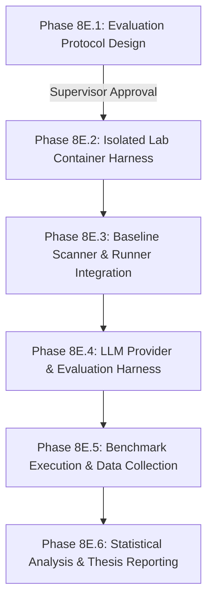

# AEGISCORE AI — Phase 8E.1
# Thesis Evaluation Protocol & Benchmark Design

**Document ID:** DOC-PHASE-8E1-EVAL-PROTOCOL  
**Status:** DRAFT / DESIGN-ONLY (No experiments executed; awaiting supervisor review)  
**Date:** 2026-10-27  
**Project:** AEGISCORE AI  
**Thesis Title:** “An Uncertainty-Aware Multi-Agent LLM Framework with Retrieval-Augmented Generation for Evidence-Based Web Application Vulnerability Assessment”  
**Context:** This document establishes the formal, reproducible thesis evaluation protocol and benchmark design for evaluating the AEGISCORE AI architecture against appropriate baselines and ablation conditions. It operationalizes the evaluation requirements defined in `docs/REQUIREMENTS.md` (§2, §5, §7), `docs/Thesis_Proposal.pdf` (pp. 4–11), and the multi-agent orchestration architecture specified in `docs/PHASE_8D1_MULTI_AGENT_DESIGN.md`.

---

## 1. Current Implementation Versus Proposed Research Capabilities

To maintain scientific integrity and prevent invalid empirical claims, Table 1 delineates what is verified and implemented in the current codebase versus what represents proposed research capabilities and future evaluation harness engineering.

### Table 1: Implementation Status vs. Proposed Research Capabilities

| Component / Subsystem | Implemented & Verified in Current Codebase (Phase 8D.4) | Research Stubs / Offline Fakes | Proposed Research Capabilities (Future Phases) |
|---|---|---|---|
| **Safety Controller & Guardrails** | Deterministic in-memory `PolicyEngine`, `GuardedExecutionBoundary`, exact target/operation permits (`aegiscore/safety.py`). 100% test-verified in-memory gating. | Benign synthetic request/response fixtures for software boundary testing. | Real HTTP transport with DNS pinning, socket-level IP validation, and OS-level network namespace isolation. |
| **Evidence Retrieval (RAG)** | Fail-closed SQLite registry mirror (`PersistentSourceReviewRegistry`), approved-only retrieval filter (`retrieve_approved_evidence`), raw SHA-256 and normalized SHA-256 manifest integrity validator (`validate_manifest_integrity`). | In-memory lexical/keyword retrieval test doubles (`tests/test_rag_runtime.py`). | ChromaDB or Milvus vector database with domain-specific embedding model (`text-embedding-3-small` or local `bge-large-en-v1.5`). |
| **Source Corpus Governance** | 11 candidate security source records (OWASP WSTG, ASVS, Top 10, MITRE CWE) with tamper-evident SHA-256 manifests. Default-deny state (`no_sources_approved`). | None. Manifest and raw file integrity checks are fully tested. | Formal human supervisor source review and signing of approved security guidance chunks. |
| **Claim & Evidence Validation** | Typed claim contracts (`ProposedClaimRecord`, `FindingValidationRecord`), structural citation provenance validator, verbatim citation excerpt substring validator (`validate_citation_excerpt`), fail-closed response gate (`validate_and_gate_generation`). | Deterministic excerpt extraction from fixture chunks. | Deep semantic entailment validation (natural language inference models or cross-encoder verification). |
| **Orchestration State Machine** | Deterministic 13-state machine (`OrchestrationStateMachine`) enforcing strict monotonic transitions, terminal failure/abstention handling, and audit event recording (`aegiscore/orchestration.py`). | Fixture transitions in unit tests. | Multi-turn adaptive re-planning, interactive tool loop, and multi-round peer debate. |
| **Specialist Roles** | Abstract interface `SpecialistRole` and typed specifications for 5 roles: Reconnaissance/Mapping, Vulnerability Analyst (XSS, SQLi, BAC), Evidence Verifier, False-Positive Reviewer, Uncertainty Assessor (`aegiscore/specialist_roles.py`). | Deterministic offline fakes (`DeterministicVulnerabilityAnalystFake`, `DeterministicEvidenceReviewerFake`, `DeterministicUncertaintyAssessorFake`) using rule-based token/keyword heuristics. | Real LLM-backed specialist agents using system prompts, structured tool use, and parameter-tuned inference. |
| **Uncertainty & Abstention** | Typed contracts (`UncertaintyAssessmentRecord`, `DecisionOutcome.ABSTAINED`), deterministic conflict marker detection (`CONFLICT_MARKER:`), epistemic keyword heuristics (`likely`, `suggests`, `unconfirmed`). | Deterministic keyword counters and token overlap ratios. | Calibrated probabilistic confidence scoring (Platt scaling, Isotonic regression, conformal prediction) on an empirical validation split. |
| **Benchmark & Lab Environment** | Minimal read-only FastAPI service (`aegiscore/api.py`). | In-memory synthetic assessment requests. | Docker Compose isolated network running pinned targets (OWASP Juice Shop, DVWA) and DAST scanner (OWASP ZAP). |

> [!CRITICAL]
> **Scientific Integrity Notice:** The current repository passes 351 unit and integration tests. These tests verify the *deterministic contracts, structural gating boundaries, state transitions, and fail-closed safety mechanics* using offline test doubles and fakes. They do **not** constitute empirical evidence of LLM capability, vulnerability detection accuracy, or model reasoning performance.

---

## 2. Research Questions and Hypotheses

The thesis evaluation is formulated around six formal Research Questions (RQ1–RQ6) and corresponding testable Hypotheses (H1–H6), expanding upon `docs/REQUIREMENTS.md` (§2) and thesis proposal specifications.

### RQ1: False-Positive Reduction via Uncertainty-Aware Abstention
*Does RAG-supported, uncertainty-aware verification reduce false-positive vulnerability reports compared to an identical Multi-Agent+RAG baseline that lacks uncertainty-based abstention?*

- **Hypothesis 1 (H1):** Under identical benchmark test cases, execution budgets, and evidence contexts, the proposed workflow ($P$) will achieve a statistically significant lower False-Positive Rate ($FPR$) and higher Precision than the baseline without abstention ($B2$), because low-confidence, contradictory, or insufficiently evidenced candidate findings are systematically routed to an `ABSTAINED` state rather than reported as confirmed vulnerabilities.
- **Independent Variable:** Uncertainty-aware abstention gating mechanism (Active in $P$ vs. Disabled in $B2$).
- **Dependent Variables:** Precision, False-Positive Rate ($FPR$), False Discovery Rate ($FDR$), Number of False Positives ($FP$).
- **Controlled Variables:** Benchmark target version, test scenarios, system prompts, retrieval corpus, model version, sampling temperature ($\tau = 0.0$), request budget, random seed.
- **Limitations:** Abstention reduces the reporting denominator; metrics must be evaluated under selective classification frameworks (Selective Risk vs. Coverage) to avoid trivial precision inflation.

### RQ2: Impact on Recall and Detection Coverage
*What effect does uncertainty-aware abstention have on true vulnerability detection recall and coverage across different vulnerability classes?*

- **Hypothesis 2 (H2):** The reduction in false positives achieved by uncertainty-aware abstention will incur a measurable trade-off in empirical Recall ($Recall_P \le Recall_{B2}$), where the magnitude of recall degradation depends on vulnerability class: low for syntactically deterministic flaws (reflected XSS, error-based SQLi) and moderate for semantic flaws (Broken Access Control) where evidence signals exhibit higher ambiguity.
- **Independent Variable:** Abstention decision threshold $\theta_{abstain}$ calibrated on the validation set.
- **Dependent Variables:** Recall ($Sensitivity$), True Positives ($TP$), False Negatives ($FN$), Vulnerability Class-stratified Recall ($Recall_{XSS}$, $Recall_{SQLi}$, $Recall_{BAC}$).
- **Controlled Variables:** Identical ground-truth testbed, identical maximum execution budget per case.
- **Limitations:** In security assessments, a false negative (missed critical vulnerability) carries higher organizational risk than a false positive. The trade-off curve must be explicitly mapped via Precision-Recall and Risk-Coverage frontiers.

### RQ3: Confidence Calibration and Reliability
*How well do the system's confidence estimates reflect empirical finding correctness, and can post-hoc calibration yield reliable probability assessments?*

- **Hypothesis 3 (H3):** Post-hoc calibrated confidence scores (derived via Platt scaling or Isotonic regression applied to composite evidence features on an independent validation set) will achieve significantly lower Expected Calibration Error ($ECE$) and Brier Score on the test set than raw, self-reported model verbalized confidence or uncalibrated composite heuristics.
- **Independent Variable:** Calibration method (Uncalibrated self-reported verbal confidence vs. Uncalibrated composite score vs. Post-hoc calibrated probability via validation split).
- **Dependent Variables:** Brier Score, Expected Calibration Error ($ECE$), Maximum Calibration Error ($MCE$), Reliability Diagrams.
- **Controlled Variables:** Binning strategy ($M=10$ uniform or quantile bins), evaluation test split.
- **Limitations:** With a small sample size ($N \approx 30\text{--}45$ benchmark cases), ECE estimates exhibit high variance and sample-size bias. ECE must be interpreted with bootstrap confidence intervals and treated as exploratory if $N < 100$.

### RQ4: Traceability and Grounding via Deterministic Citation Validation
*Does deterministic claim-level citation validation and excerpt verification reduce ungrounded assertions and hallucinated evidence compared to unverified agent outputs?*

- **Hypothesis 4 (H4):** Requiring verbatim excerpt verification and structural provenance checks on every proposed claim will eliminate hallucinated citation errors ($GhostChunkError$, $SourceIdSpoofError$, $ExcerptMismatchError$) to exactly 0% in verified findings, whereas an unvalidated baseline will periodically cite non-existent source chunks or attribute claims to irrelevant chunks under ambiguous reasoning.
- **Independent Variable:** Enforcement of deterministic claim and excerpt verification (`validate_and_gate_generation` and `validate_citation_excerpt`).
- **Dependent Variables:** Citation Grounding Error Rate, Hallucinated Excerpt Frequency, Provenance Integrity Rate.
- **Controlled Variables:** Approved RAG corpus snapshot, prompt instructions.
- **Limitations:** Passing structural excerpt validation confirms lexical presence in the cited document; it does not guarantee semantic entailment or factual truth of the underlying vulnerability claim.

### RQ5: Marginal Contribution of RAG and Role Ablations
*What is the marginal impact of the retrieval-augmented knowledge base, the independent False-Positive Reviewer role, and the Evidence Verifier on final report quality?*

- **Hypothesis 5 (H5):** Ablating the RAG retrieval module ($A1$) will reduce finding precision and increase hallucinated counter-arguments, while ablating the False-Positive Reviewer ($A2$) will significantly increase false positives on benign edge cases containing defensive sanitization markers.
- **Independent Variable:** Component ablation state (Full System $P$, No-RAG $A1$, No-Reviewer $A2$).
- **Dependent Variables:** Precision, Recall, F1-Score, Evidence Completeness Score.
- **Controlled Variables:** Identical test targets and scenario parameters.
- **Limitations:** Ablations consume substantial inference budgets and API tokens; secondary ablations may be prioritized based on budget feasibility.

### RQ6: Computational and Operational Overhead
*Is the multi-agent orchestration overhead (latency, token consumption, and tool-call frequency) justified by the achieved finding reliability compared to single-agent and automated scanner baselines?*

- **Hypothesis 6 (H6):** While the proposed multi-agent system ($P$) will exhibit substantially higher wall-clock latency and token consumption than a single-agent baseline ($B3$) and automated scanner ($B1$), its cost per *verified true positive* will be comparable or superior when factoring in downstream human triage time saved through false-positive suppression.
- **Independent Variable:** System architecture ($B1$ DAST Scanner vs. $B3$ Single-Agent vs. $P$ Proposed Multi-Agent).
- **Dependent Variables:** Wall-clock duration per test case (seconds), Total prompt and completion tokens, Total HTTP requests emitted to target, Cost per verified true positive.
- **Controlled Variables:** Target environment hardware, network latency, execution timeout ceilings.
- **Limitations:** Quantifying "human triage time saved" relies on established industry cost models (e.g., NIST/Ponemon triage estimates) rather than live human subject trials in this phase.

---

## 3. Benchmark Selection

Evaluating automated web vulnerability assessment frameworks requires target environments that provide reproducible vulnerabilities across diverse architectural paradigms while running strictly isolated in an offline academic lab.

### Table 2: Benchmark Candidate Comparison Matrix

| Evaluation Criterion | OWASP Juice Shop (v15.0.0) | DVWA — Damn Vulnerable Web App (v1.10) | OWASP WebGoat (v2023.4) |
|---|---|---|---|
| **Architecture & Technology** | Modern Single Page Application (SPA); Node.js, Express, Angular, SQLite/Sequelize, REST & GraphQL APIs. | Classic Multi-Page Application (MPA); PHP 7/8, Apache, MySQL, standard HTML form submissions. | Educational Java application; Spring Boot, embedded HSQLDB, React UI, modular lesson structure. |
| **Lab Suitability & Isolation** | **Excellent.** Official Docker container, self-contained, operates completely offline without external telemetry. | **Excellent.** Highly lightweight Docker container, zero external calls, minimal memory footprint (<256MB). | **Moderate.** Resource-heavy JVM container (>2GB RAM), slower startup and state reset overhead. |
| **Reflected / Stored XSS** | **High coverage.** Rich spectrum: reflected query XSS, stored user reviews, DOM-based sanitization bypasses, client-side template injection. | **High coverage.** Explicit Low/Medium/High/Impossible tiers for Reflected, Stored, and DOM XSS with inspectable source code. | **Moderate coverage.** Lesson-oriented XSS cases; often requires following specific synthetic lesson steps. |
| **Non-Destructive SQLi** | **High coverage.** SQLite injection in product search (`q=`), user authentication bypass (`/rest/user/login`), schema discovery via `UNION SELECT`. | **High coverage.** Classic MySQL injection in user ID lookups (`id=`), form-based authentication bypass, blind SQLi. | **Moderate coverage.** Dedicated SQLi lessons with parameterized query demonstrations. |
| **Broken Access Control (BAC)** | **Exceptional coverage.** Horizontal IDOR (basket/order viewing via `BasketId`), vertical admin path bypass (`/#/administration`), BOLA in user APIs. | **Limited coverage.** Basic Insecure Direct Object References and file inclusion, but lacks modern role-based API access control structures. | **Moderate coverage.** Specific access control lessons (e.g., profile editing, role tampering), but tightly bound to lesson mechanics. |
| **Ground-Truth Feasibility** | **High.** Challenges are documented in the official companion book (*Pwning OWASP Juice Shop*), programmatic challenge API (`/api/Challenges`), deterministic verification. | **High.** Explicit PHP source code for each vulnerability tier allows unambiguous, line-level ground-truth mapping. | **Moderate.** Lessons define completion states, but lesson state progression can interfere with autonomous scanning. |
| **Version Pinning & Reproducibility** | **High.** Pinned container digest (`bkimminich/juice-shop:v15.0.0@sha256:...`). Stable challenge scoring state. | **High.** Pinned container digest (`vulnerables/web-dvwa:1.10@sha256:...`). Static database seed. | **Moderate.** Pinned releases exist, but internal database state updates dynamically during lesson completion. |
| **Reset & Automation Overhead** | **Low.** Instant container re-creation or automated database re-seed via CLI/API. | **Low.** One-click or scripted database reset via `/setup.php`. | **High.** Requires resetting lesson progress via custom API calls or restarting the JVM container. |
| **Known Limitations** | Heavy client-side JavaScript rendering; DAST crawlers without headless browser support may miss client-rendered routes. | Dated architectural pattern (2010s PHP MPA); does not reflect modern JSON API/SPA attack surfaces. | Lesson completion flags enforce a rigid tutorial workflow; less representative of organic web application topologies. |

---

## 4. Recommended Primary and Secondary Benchmarks

### Primary Benchmark: OWASP Juice Shop (Pinned Container v15.0.0)

**Recommendation:** OWASP Juice Shop is selected as the **Primary Benchmark** for the AEGISCORE AI thesis evaluation.

#### Justification
1. **Architectural Realism:** As a modern Node.js/Angular Single Page Application communicating with JSON REST and GraphQL backends, Juice Shop accurately represents contemporary enterprise web applications where multi-agent vulnerability assessment frameworks face complex API structures, stateful workflows, and client-side data binding.
2. **Comprehensive Coverage of Target Vulnerability Classes:**
   - *Cross-Site Scripting:* Reflected query parameters, persistent customer reviews, search box DOM manipulation.
   - *SQL Injection:* SQLite-specific syntax, authentication bypass, data extraction via `UNION` queries, second-order injection.
   - *Broken Access Control:* Horizontal privilege escalation (viewing/modifying other users' baskets via manipulated IDs), vertical privilege escalation (unauthorized admin actions via token or route manipulation), and insecure file downloads.
3. **Programmatic Ground-Truth Verification:** Juice Shop features an internal challenge-tracking engine (`score-board`) with an administrative API that records challenge resolution states. This enables programmatic, tamper-evident verification of whether a specific exploit payload achieved its intended security impact without subjective manual guesswork.

#### Explicit Trade-offs and Mitigations
- *Trade-off (Client-Side Rendering):* Traditional HTTP crawlers (like standard ZAP spiders) struggle to discover routes dynamically rendered by Angular.
  - *Mitigation:* The evaluation protocol provides pre-mapped endpoint inventories (via OpenAPI specifications and Swagger definitions provided natively by Juice Shop at `/rest/admin/application-configuration`) to ensure all baselines evaluate the *assessment and verification* logic rather than crawling differences.
- *Trade-off (State Mutations):* Certain stored XSS or order creation challenges mutate application state.
  - *Mitigation:* The test harness enforces an automatic container reset or SQLite database re-seed between evaluation runs.

---

### Secondary Benchmark: DVWA — Damn Vulnerable Web Application (Pinned v1.10)

**Recommendation:** DVWA is selected as the **Secondary Benchmark** for controlled ablation and baseline calibration.

#### Justification
1. **Source-Level Ground-Truth Clarity:** DVWA provides four explicit, switchable security tiers: `Low`, `Medium`, `High`, and `Impossible`. This allows perfect pairing of vulnerable code paths (`Low`/`Medium`) with defensive, non-vulnerable implementations (`Impossible`) on identical endpoints and parameters.
2. **Defensive Edge Case Calibration:** The `Impossible` security tier implements robust server-side input validation, parameterized SQL statements (`PDO::prepare`), and strict contextual output encoding (`htmlspecialchars`). This provides ideal negative test cases (True Negative opportunities) to rigorously evaluate whether AEGISCORE AI's False-Positive Reviewer and Uncertainty Gate correctly abstain or reject benign cases rather than hallucinating findings.
3. **DAST Scanner Comparability:** OWASP ZAP and other conventional DAST tools have well-documented, optimal detection profiles against classic PHP applications like DVWA, establishing a fair, competitive baseline for traditional vulnerability types.

#### Explicit Trade-offs
- *Trade-off:* DVWA lacks modern Broken Access Control and REST API patterns.
- *Role in Thesis:* DVWA is utilized primarily for fine-grained XSS and SQLi sensitivity/specificity testing and calibration validation, while Juice Shop serves as the comprehensive system benchmark.

---

## 5. Ground-Truth Annotation Protocol

A rigorous evaluation requires an objective, pre-registered ground-truth matrix that decouples expected system behavior from model-generated reasoning, agent consensus, or source citations.

### 5.1 Definitional Criteria for Finding Classification

The evaluation treats each target endpoint-parameter-vulnerability tuple as an individual assessment instance. The primary **Unit of Analysis ($N$)** is the canonical case locus: `(Target URI, Injection Parameter / Input Vector, CWE Vulnerability Class)`.

- **True Positive (TP):** The system reports a finding in the `VERIFIED` state that matches a ground-truth vulnerable instance across the canonical matching triple (Target URI, Injection Parameter / Access Point, and CWE Vulnerability Class), and provides valid, reproducible execution evidence (e.g., exact marker reflection, differential error response, or unauthorized object access).
- **False Positive (FP):** The system reports a finding in the `VERIFIED` state under any of the following conditions:
  1. The target endpoint and parameter are non-vulnerable (e.g., a properly parameterized query or sanitizing endpoint on DVWA `Impossible`).
  2. The reported vulnerability class (CWE) is incorrect for that endpoint (e.g., reporting SQL injection on an endpoint that only suffers from an IDOR).
  3. The reported finding is based on hallucinated evidence, ungrounded inferences, or benign application artifacts (e.g., flagging standard JSON error messages as SQL syntax leakage).
  4. The finding points to an unverified parameter or locus not responsible for the vulnerability.
- **False Negative (FN):** The system fails to report a known ground-truth vulnerable instance, either by:
  1. Silently terminating without generating a candidate finding for that instance.
  2. Transitioning the candidate finding to `REJECTED` based on flawed counter-evidence.
  3. Withholding the finding as `ABSTAINED` due to excessive uncertainty (evaluated under standard detection metrics).
- **True Negative (TN):** The system correctly refrains from reporting a finding on an explicitly evaluated non-vulnerable test case (e.g., negative controls, hardened endpoints, or benign inputs), concluding in an explicit non-vulnerable assessment (`REJECTED` or clean state without finding generation).

> [!WARNING]
> **Dual Abstention Accounting Framework:** In accordance with `docs/REQUIREMENTS.md` (§5) and formal selective classification theory:
> 1. **Under Standard Detection Metrics (Confusion Matrix):** An `ABSTAINED` outcome is **never counted as a True Negative (TN)**. If the target is ground-truth vulnerable, an abstention counts as a **False Negative (FN)** because the vulnerability was missed. If the target is non-vulnerable, an abstention counts as a clean non-report (avoiding a false positive), but does not increment explicit TN unless an explicit rejection decision was rendered.
> 2. **Under Selective Classification (Risk-Coverage):** Abstentions are treated as withheld predictions. They reduce **Coverage ($\Phi$)** while lowering **Selective Risk ($R(\Phi)$)**, enabling evaluation along the precision-coverage frontier.
> 3. **Structural vs. Semantic Boundary:** Passing structural citation excerpt validation (`validate_citation_excerpt`) confirms that the cited excerpt exists verbatim in an approved security guidance chunk. It does **not** evaluate or prove semantic entailment or factual truth of the underlying vulnerability claim.

### 5.2 Canonical Finding Matching Triple

A reported finding is mapped to a ground-truth case if and only if all three components of the canonical triple match:

$$\text{Match}(\text{Finding}, \text{GroundTruth}) \iff (\text{URI} = \text{URI}_{GT}) \land (\text{Param} = \text{Param}_{GT}) \land (\text{CWE} \equiv \text{CWE}_{GT})$$

1. **Target URI / Route:** Normalized path component (e.g., `/rest/products/search` or `/vulnerabilities/xss_r/`). Query strings are stripped before path matching.
2. **Parameter / Injection Point:** Exact parameter name (e.g., `q`, `id`, `BasketId`, or `HTTP Header: Authorization`).
3. **CWE Vulnerability Class:** Exact CWE match or hierarchical child mapping per Table 3.

### Table 3: Permitted CWE Hierarchical Mappings

| Target Class | Canonical Ground-Truth CWE | Permitted Specific Child CWEs | Disallowed / Non-Matching CWEs |
|---|---|---|---|
| **Cross-Site Scripting (XSS)** | CWE-79 (Improper Neutralization of Input During Web Page Generation) | CWE-80 (Basic XSS), CWE-83 (HTML Attribute), CWE-87 (Alternate XSS) | CWE-116 (Encoding error alone), CWE-20 (Improper Input Validation - too broad) |
| **SQL Injection (SQLi)** | CWE-89 (Improper Neutralization of Special Elements used in an SQL Command) | CWE-564 (Hibernate injection), CWE-943 (Special elements in data query) | CWE-200 (Information disclosure alone without SQL proof) |
| **Broken Access Control (BAC)** | CWE-284 (Improper Access Control) | CWE-285 (Improper Authorization), CWE-639 (Insecure Direct Object Reference), CWE-862 (Missing Authorization), CWE-863 (Incorrect Authorization) | CWE-200 (Generic information exposure), CWE-306 (Missing Authentication - distinct from BAC) |

### 5.3 Duplicate Finding Adjudication

Multi-agent and scanning workflows frequently generate multiple candidate findings for the same underlying vulnerability (e.g., testing multiple payloads against the same parameter).

- **Deduplication Rule:** All reported findings within a single evaluation run sharing an identical `(URI, Param, CWE)` triple are grouped into a single finding cluster.
- **Scoring Rule:** 
  - If at least one finding in the cluster is a valid `VERIFIED` True Positive, the cluster scores as **exactly 1 TP**.
  - Subsequent duplicate findings in the same cluster are logged as `DUPLICATE_SUPPRESSED` in the audit trace and do **not** increment the TP count (preventing artificial metric inflation).
  - If a cluster contains only invalid or hallucinated findings, it scores as **exactly 1 FP**.

### 5.4 Severity Mismatch Evaluation

Vulnerability severity (e.g., `LOW`, `MEDIUM`, `HIGH`, `CRITICAL` or numeric CVSS v3.1 score) often exhibits subjectivity across automated tools.

- **Impact on Detection Metrics:** A mismatch between the reported severity and the ground-truth severity does **not** convert a True Positive into a False Positive, provided the canonical triple and evidence are valid.
- **Dedicated Metric:** Severity classification accuracy is evaluated independently using the **Severity Classification Agreement Rate** and **Quadratic Weighted Cohen's Kappa ($\kappa_w$)** across discrete severity tiers.
- **Safety Violation Gating:** As implemented in Phase 8D.4 (`test_scen_ma_10`), a finding reporting `CRITICAL` severity with zero empirical claims or evidence is automatically gated as an orchestration contract violation.

### 5.5 Proposed Candidate vs. Confirmed Finding

- **Candidate Finding:** An unverified hypothesis generated by a Vulnerability Specialist (Role MOD-06). Candidates have status `CANDIDATE` and are strictly excluded from performance metrics until they pass verification.
- **Confirmed Finding:** A finding that has successfully passed the Evidence Verifier (MOD-07), False-Positive Reviewer (MOD-08), Uncertainty Gate (MOD-09), and Report Quality Reviewer (MOD-10), concluding in state `VERIFIED`. Only `VERIFIED` findings are submitted to the Ground-Truth Evaluator (MOD-11).

### 5.6 Anti-Leakage Protocol

To ensure that evaluation results represent genuine vulnerability assessment reasoning rather than data memorization:
1. **Corpus Sanitization:** The offline RAG retrieval corpus (OWASP WSTG, ASVS, CWE documentation) must be strictly audited to remove any benchmark-specific challenge solutions, exploit walkthroughs, or references to Juice Shop / DVWA challenge names (e.g., "Score Board", "Juice Shop Basket ID bypass").
2. **Prompt Isolation:** No benchmark challenge solutions, expected vulnerability locations, or target parameter names may be included in system prompts, few-shot examples, or role templates.
3. **Execution Context:** The agents receive only raw application observations (HTTP request/response pairs, HTML/JSON bodies, headers) gathered during active observation.

---

## 6. Baselines and Ablation Study

To isolate the specific contributions of multi-agent collaboration, evidence verification, and uncertainty-aware abstention, the evaluation protocol establishes four primary comparison conditions and two targeted ablations.

### Table 4: Experimental Conditions and Ablations

| Condition ID | System Configuration | Target Scope & Request Budget | Retrieval Corpus (RAG) | Verification & Reviewer Roles | Uncertainty & Abstention Gate | Status / Execution Readiness |
|---|---|---|---|---|---|---|
| **B1 (DAST Baseline)** | OWASP ZAP (v2.15.0) Active Scanner with standard rule policy. | Identical target endpoints; capped at 50 requests/endpoint. | None (Traditional rule/signature heuristics). | None (Internal ZAP alert thresholding). | None (ZAP confidence: Low, Med, High alerts all reported). | **Future Harness Integration:** Requires Dockerized ZAP CLI wrapper. |
| **B2 (Multi-Agent Baseline without Abstention)** | Multi-Agent LLM architecture with all specialist roles active, but abstention disabled. | Identical target endpoints; capped at 50 requests/endpoint. | Approved RAG corpus active. | Verifier and Reviewer active, but cannot trigger `ABSTAINED`. | **Disabled:** All uncertain or conflicting candidates forced to `VERIFIED`. | **Future Experiment:** Requires configuring `OrchestrationStateMachine` with forced reporting. |
| **B3 (Single-Agent Baseline)** | Monolithic Single-Agent prompt executing mapping, analysis, and reporting sequentially. | Identical target endpoints; capped at 50 requests/endpoint. | Approved RAG corpus active (same context window). | None (Single prompt evaluates own output). | Single-pass self-reported confidence threshold. | **Future Experiment:** Requires single-agent orchestrator harness. |
| **P (Proposed Full System)** | Full AEGISCORE AI Multi-Agent architecture with calibrated uncertainty and claim validation. | Identical target endpoints; capped at 50 requests/endpoint. | Approved RAG corpus active. | Verifier (MOD-07) and FP Reviewer (MOD-08) active. | **Active:** Calibrated gate routes uncertain/conflicting cases to `ABSTAINED`. | **Core Evaluation Target:** Orchestration contracts implemented; requires LLM provider. |
| **A1 (Ablation: No RAG)** | Proposed Multi-Agent workflow ($P$) with retrieval module disabled (empty evidence bundle). | Identical target endpoints; capped at 50 requests/endpoint. | **Disabled:** Empty retrieval bundle (`retrieved_chunks=()`). | Verifier and FP Reviewer active. | Active (evaluating uncertainty without external grounding). | **Future Experiment:** Exercises existing empty bundle state machine paths (`SCEN-MA-02`). |
| **A2 (Ablation: No Reviewer)** | Proposed Multi-Agent workflow ($P$) with False-Positive Reviewer (MOD-08) bypassed. | Identical target endpoints; capped at 50 requests/endpoint. | Approved RAG corpus active. | Verifier active; FP Reviewer bypassed. | Active (evaluating uncertainty without adversarial challenge). | **Future Experiment:** Bypasses state machine step `RECORD_REVIEWER_EVALUATION`. |

### Parameters Held Constant Across All Conditions
1. **Benchmark Version:** OWASP Juice Shop pinned container v15.0.0; DVWA pinned container v1.10.
2. **Target State:** Clean database state re-seeded immediately prior to evaluating each scenario.
3. **Execution Budget:** Maximum 50 HTTP requests per test scenario; wall-clock timeout of 120 seconds per scenario.
4. **LLM Parameters (for B2, B3, P, A1, A2):** Temperature $\tau = 0.0$; Top-p $= 1.0$; Random seed fixed to $42$; identical base model version (e.g., `gemini-1.5-pro-002` or local `llama-3.1-70b-instruct`).
5. **Repeated Runs:** Each scenario is executed across $K = 3$ independent repeated trials to measure stochastic variance.

---

## 7. Metrics and Statistical Analysis

### 7.1 Metric Formulations and Denominators

All evaluation metrics are rigorously calculated based on the ground-truth outcomes defined in Section 5.

#### Precision (Positive Predictive Value)
Measures the proportion of reported verified vulnerabilities that are genuine:
$$\text{Precision} = \frac{TP}{TP + FP}$$
*Edge Case:* If $TP + FP = 0$ (the system reports zero findings), Precision is undefined; it is reported as $1.0$ if no vulnerabilities existed in the target subset, and $0.0$ if known vulnerabilities were present.

#### Recall (Sensitivity / Detection Rate)
Measures the proportion of genuine vulnerabilities successfully identified and verified:
$$\text{Recall} = \frac{TP}{TP + FN}$$
*Denominator Note:* $TP + FN$ equals the total count of ground-truth vulnerable instances present in the evaluated benchmark suite.

#### F1-Score
The harmonic mean of precision and recall:
$$F_1 = 2 \cdot \frac{\text{Precision} \cdot \text{Recall}}{\text{Precision} + \text{Recall}}$$

#### False-Positive Rate (FPR)
Measures the proportion of non-vulnerable instances incorrectly flagged as vulnerable:
$$\text{FPR} = \frac{FP}{FP + TN}$$
*Denominator Note:* $FP + TN$ is strictly defined as the total number of non-vulnerable (negative control) test cases evaluated.

#### Abstention Rate ($AR$)
Measures the proportion of test scenarios where the system withheld judgment:
$$AR = \frac{N_{\text{abstained}}}{N_{\text{total}}}$$
where $N_{\text{total}} = TP + FP + FN + TN_{\text{explicit}} + N_{\text{abstained}}$.

#### Selective Classification Metrics (Coverage and Selective Risk)
Under selective prediction (Geifman & El-Yaniv, 2017), the system may abstain from predicting when confidence is low:
- **Coverage ($\Phi$):** The fraction of cases on which the system issues a definitive reporting decision:
  $$\Phi = \frac{N_{\text{total}} - N_{\text{abstained}}}{N_{\text{total}}}$$
- **Selective Risk ($R(\Phi)$):** The empirical error rate on the non-abstained (covered) cases:
  $$R(\Phi) = \frac{FP_{\text{reported}}}{TP_{\text{reported}} + FP_{\text{reported}}} = 1 - \text{Precision}$$

#### Verified Finding Rate ($VFR$)
Measures the filtering efficiency of the verification pipeline:
$$VFR = \frac{N_{\text{verified}}}{N_{\text{candidate}}}$$
where $N_{\text{candidate}}$ is the total number of initial candidate findings proposed by Vulnerability Specialists.

#### Severity Classification Agreement ($\kappa_w$)
Evaluates agreement between predicted severity tiers ($\text{Low}, \text{Medium}, \text{High}, \text{Critical}$) and ground-truth severity using Quadratic Weighted Cohen's Kappa:
$$\kappa_w = 1 - \frac{\sum_{i=1}^k \sum_{j=1}^k w_{ij} O_{ij}}{\sum_{i=1}^k \sum_{j=1}^k w_{ij} E_{ij}}, \quad w_{ij} = \frac{(i - j)^2}{(k - 1)^2}$$
where $O_{ij}$ is the observed confusion matrix and $E_{ij}$ is the expected matrix under chance agreement.

#### Probabilistic Calibration Metrics (Tier 3 — Exploratory Only)
If the uncertainty module is extended to output continuous probability estimates $p_i \in [0, 1]$ representing finding confidence:
- **Brier Score:** Mean squared error of probabilistic predictions against binary ground-truth outcomes $y_i \in \{0, 1\}$:
  $$\text{BS} = \frac{1}{N} \sum_{i=1}^N (p_i - y_i)^2$$
- **Expected Calibration Error (ECE):** Partitioning $N$ predictions into $M = 3$ bins $B_1, \dots, B_M$ by confidence:
  $$\text{ECE} = \sum_{m=1}^M \frac{|B_m|}{N} \left| \text{acc}(B_m) - \text{conf}(B_m) \right|$$
  where $\text{acc}(B_m) = \frac{1}{|B_m|} \sum_{i \in B_m} y_i$ and $\text{conf}(B_m) = \frac{1}{|B_m|} \sum_{i \in B_m} p_i$.

> [!WARNING]
> **Tier 3 Feasibility and Sample Size Constraint on Calibration Metrics:**
> 1. *Architectural Constraint:* The current AEGISCORE AI contracts (`FindingCandidate`, `EvidenceEvaluation`, `UncertaintyAssessment`) emit discrete categorical states (`VERIFIED`, `REJECTED`, `ABSTAINED`) and discrete severity/confidence tiers, not continuous well-calibrated probabilities $p_i \in [0, 1]$. No probability calibration pipeline (such as Platt scaling, temperature scaling, or isotonic regression) exists in the codebase today.
> 2. *Sample Size Constraint:* Reliable ECE estimation requires sufficient observations per bin ($>10$ per bin) to avoid empirical bin noise. On a within-benchmark test set of $N_{\text{test}} = 14$ cases, even a 3-bin partition yields only $\approx 4.6$ cases per bin, causing finite-sample binomial variance to dominate over true calibration error.
> 3. *Reporting Status:* Brier Score and ECE are strictly classified as **Tier 3 Exploratory Metrics**. They cannot serve as primary evaluative claims in the thesis without architectural probability outputs and an order-of-magnitude larger sample size.

#### Operational Efficiency Metrics
- **Mean Latency per Scenario:** Wall-clock seconds from assessment request submission to terminal state transition.
- **Mean Token Consumption:** Total prompt tokens, completion tokens, and combined token volume per scenario.
- **Mean Tool Invocations:** Total count of guarded HTTP requests emitted to the target container.

---

## 8. Statistical Analysis Plan

Due to the paired nature of the evaluation (where all conditions evaluate identical benchmark scenarios), the statistical analysis uses non-parametric paired tests and bootstrap estimation.

### 8.1 Paired Hypothesis Testing
1. **Binary Categorical Outcomes (Precision / Recall Differences):**
   - Differences in binary detection success ($TP$ vs. $FP/FN$) between the proposed workflow ($P$) and baselines ($B1, B2$) are evaluated using **McNemar’s Test with Continuity Correction** for paired nominal data:
     $$\chi^2 = \frac{(|b - c| - 1)^2}{b + c}$$
     where $b$ is the number of instances detected by $P$ but missed/false-positive in $B2$, and $c$ is the reverse.
2. **Continuous Paired Metrics (Latency, Token Usage, Brier Scores):**
   - Differences in continuous operational metrics are evaluated using the **Wilcoxon Signed-Rank Test** (two-tailed, $\alpha = 0.05$), which does not assume normality.

### 8.2 Confidence Intervals via Resampling and Exact Methods
Given the targeted sample size ($N \approx 30\text{--}45$ benchmark scenarios, or $N_{\text{test}} \approx 14$ on stratified splits), asymptotic normality cannot be assumed for ratio metrics (Precision, Recall, F1).
- **Single-Proportion Metrics (Binomial Denominator):** For metrics with fixed or conditional binomial denominators (Recall, False-Positive Rate, Abstention Rate, and Precision when conditioned on positive predictions), primary confidence intervals will use either exact **Clopper–Pearson Intervals** (guaranteeing empirical coverage $\ge 1 - \alpha$ under the exact binomial distribution) or score-based **Wilson Score Intervals** (which exhibit well-documented small-sample robustness without the empirical degeneracy or endpoint instability of BCa bootstrap intervals on sparse discrete data). Note that Clopper–Pearson is the exact binomial method, while the Wilson score interval is an asymptotic score-test inversion method.
- **F1-Score (Non-Binomial Derived Ratio):** Because $F_1$ is a non-linear harmonic mean of two distinct random proportions rather than a binomial proportion $k/n$, single-proportion intervals (Clopper–Pearson or Wilson) are methodologically inapplicable. The protocol mandates reporting empirical point estimates of $F_1$ alongside the constituent single-proportion intervals (Clopper–Pearson or Wilson) of its components (Precision and Recall). Where an interval on $F_1$ itself is required, it must be estimated via a case-resampled **Percentile Bootstrap Interval** ($B = 2{,}000$ resamples of canonical loci $(Y_i, \hat{Y}_i)$), accompanied by an explicit disclosure of bootstrap lattice granularity on small samples.
- **Comparative Difference Metrics:** For paired differences between systems ($\Delta \text{Precision}, \Delta \text{Recall}, \Delta F_1$), point estimates will be accompanied by **95% Paired Percentile Bootstrap Confidence Intervals** generated over $B = 2{,}000$ paired resamples.

### 8.3 Explicit Small-Sample Limitations and Unit-of-Analysis Controls

1. **Unit of Analysis and Pseudo-Replication Controls:**
   - The primary unit of analysis is the canonical test case locus ($N \approx 36$).
   - Repeated trials ($K = 3$ runs per scenario) capture stochastic inference variance and are aggregated via majority consensus vote ($2/3$ agreement) for primary paired comparisons, or modeled using mixed-effects logistic regression with random intercepts per case locus.
   - Repeated trials **never** inflate sample size (evaluating $K = 3$ trials on $36$ cases yields $N = 36$ independent loci, not $108$).
2. **Statistical Power Constraints (McNemar's Paired Test):**
   - McNemar's statistical power depends strictly on the count of discordant pairs ($n_{\text{disc}} = b + c$), NOT the total sample size $N$. The number of discordant pairs cannot be determined prior to empirical execution. In security benchmarking, high concordance on obvious cases is common, which restricts the effective discordant sample size and severely limits power to detect true differences.
   - **No Proof of Equivalence:** A failure to reject the null hypothesis ($p \ge 0.05$) under these exploratory small-sample constraints must never be interpreted as empirical evidence of equivalence or parity between systems; it indicates only that the sample lacks power to differentiate them.
   - The thesis evaluation must be explicitly characterized as an **exploratory academic proof-of-concept benchmark**, not an adequately powered confirmatory trial.
   - Reporting Rule: The thesis will prioritize exact effect sizes, exact Clopper–Pearson or score-based Wilson confidence intervals for constituent single proportions, paired bootstrap intervals for differences, and qualitative error analyses over bare null-hypothesis significance testing ($p$-values).

---

## 9. Reproducibility Requirements

To satisfy academic thesis standards and enable independent re-execution:

1. **Deterministic Execution Baseline:**
   - LLM generation requests must enforce `temperature=0.0`, `seed=42`, and explicit output token budgets.
   - Pinned API/Model strings (e.g., `gemini-1.5-pro-002` or pinned Hugging Face revision digests for local models).
2. **Container digests:** Target benchmarks must run from immutable container image digests:
   - `bkimminich/juice-shop:v15.0.0@sha256:d55f9f8fa2688825f385cbe95dae5fa9c905de7f7223bdfbd812efd8de5ee8ea`
   - `vulnerables/web-dvwa:1.10@sha256:39ef74e6b7d2eb292d3f75d5e21fb1a4a03429fa03e8787f6dd2b3eeff2d4b99`
3. **Target State Resets:** Target container volumes and databases must be re-initialized between scenario runs via deterministic reset scripts (`docker-compose down -v && docker-compose up -d`).
4. **Structured JSONL Audit Logs:** Every run must emit an immutable JSONL audit trace recording:
   - Request timestamp, unique execution UUID, and scenario ID.
   - Exact input payload, headers, and HTTP request sent by `GuardedExecutionBoundary`.
   - Exact HTTP response code, headers, and response body received from the target.
   - Prompt text sent to each agent role and exact raw completion text received.
   - State machine transition history, citation provenance records, and gating decisions.
5. **Frozen Configuration Artifacts:**
   - Prompt templates frozen in version control.
   - RAG retrieval chunks and vector embeddings frozen in a versioned snapshot.
   - Abstention decision thresholds ($\theta_{\text{abstain}}$) frozen on validation data before test set evaluation.

---

## 10. Safety and Ethics Checklist

All future evaluation activities must comply with the strict safety guardrails defined in `docs/REQUIREMENTS.md` (§3, §7) and `docs/ADRs/0002-safety-policy-and-provider-egress.md`.

### Table 5: Pre-Evaluation Safety and Ethics Verification Checklist

| Safety Requirement | Operational Specification | Verification Mechanism |
|---|---|---|
| **Isolated Target Boundary** | Target must be hosted on local loopback (`127.0.0.1`, `::1`) or dedicated private Docker bridge network (`172.28.0.0/16`). | `PolicyEngine` enforces RFC1918 / loopback allowlist; rejects all public IP ranges (`SCEN-MA-01`). |
| **No Third-Party Targets** | Absolute prohibition on scanning, testing, or resolving non-authorized domains. | Zero DNS resolution of public domains during test runs; target allowlist strictly frozen to local lab instances. |
| **Default-Deny Egress** | Test execution container and target environment must run with outbound internet access disabled. | Docker bridge configured with `internal: true` or firewall dropping non-local egress. |
| **Non-Destructive Payloads** | Testing must use safe, non-destructive proof-of-concept payloads: | Pre-execution payload inspection: |
| — *XSS Payloads* | Non-executable or benign console/DOM markers: `<svg onload=console.log('AEGIS_POC')>`, `{{7*7}}`. No external script loading, cookie theft, or phishing redirection. | Automated regex filtering in `GuardedExecutionBoundary`. |
| — *SQLi Payloads* | Read-only boolean/union extraction or syntax errors: `' OR 1=1 --`, `UNION SELECT 1, 2, sqlite_version()`. Absolutely no `DROP`, `DELETE`, `UPDATE`, `INSERT`, or `xp_cmdshell`. | Enforce read-only payload dictionary. |
| — *BAC Payloads* | Passive observation of unauthorized records using synthetic test accounts (e.g., viewing Basket #2 while authenticated as User #1). No credential tampering or privilege hijacking. | Test matrix uses exclusively synthetic, pre-seeded accounts. |
| **Bounded Execution Budgets** | Hard limits on requests and time per test scenario: maximum 50 HTTP requests, 120s execution ceiling. | Deterministically enforced by `GuardedExecutionBoundary` permits. |
| **Emergency Stop Mechanism** | Immediate abort of testing if target returns anomalous error bursts, crashes, or attempts out-of-scope connections. | Global circuit-breaker triggers state machine `TERMINAL_ABSTAINED` or `TERMINAL_FAILED`. |
| **Secret & Credential Redaction**| No production credentials, real API tokens, or personal identifiers stored in RAG corpus or logs. | Pre-commit secret scanning; synthetic credentials only. |

---

## 11. Threats to Validity

### 11.1 Construct Validity
*Does the experimental setup accurately measure what it claims to measure?*
- **Threat:** Automated finding matching might misclassify subtle exploit attempts as false positives if ground-truth definitions are too narrow.
  - *Mitigation:* The protocol enforces pre-registered canonical matching triples (`URI, Param, CWE`) and allows hierarchical child CWE mappings (Table 3).
- **Threat:** Deterministic claim validation checks structural excerpt presence rather than true semantic entailment.
  - *Mitigation:* Section 1 explicitly documents this boundary. Structural excerpt validation is evaluated as a defense against *hallucinated citations*, not as a proof of factual correctness.

### 11.2 Internal Validity
*Are the observed performance differences caused by the independent variables rather than confounding factors?*
- **Threat (Prompt Sensitivity):** Minor variations in agent prompts might advantage one baseline over another.
  - *Mitigation:* All LLM baselines ($B2, B3, P, A1, A2$) share identical core persona descriptions, target observations, and retrieval context format.
- **Threat (LLM Non-Determinism):** Despite setting $\tau = 0.0$, modern LLM inference APIs can exhibit non-deterministic floating-point variations across hardware clusters.
  - *Mitigation:* Each scenario is repeated $K = 3$ times; variance across runs is explicitly measured and reported.
- **Threat (Data Leakage):** The LLM might have memorized Juice Shop or DVWA challenge solutions during pre-training.
  - *Mitigation:* Synthetic, custom-parameterized variations of scenarios are evaluated alongside standard challenges to test whether reasoning generalizes beyond canonical benchmark endpoints.

### 11.3 External Validity
*Can the evaluation findings generalize to real-world web application security assessments?*
- **Threat:** Synthetic benchmarks (Juice Shop, DVWA) do not capture the messy, legacy complexity of enterprise web applications with complex WAFs and multi-tiered authentication.
  - *Mitigation:* The thesis explicitly bounds its claims to the evaluated scope (isolated modern SPA and classic MPA benchmarks), noting that enterprise generalization requires future field trials.

### 11.4 Conclusion Validity
*Are the statistical conclusions drawn from the data justified?*
- **Threat:** The small planned sample size ($N \approx 36$ cases) risks Type II errors (failing to detect genuine differences) and unstable calibration estimates.
  - *Mitigation:* Statistical claims rely on bootstrap confidence intervals and effect sizes rather than bare p-values. Calibration metrics are explicitly labeled as preliminary.

---

## 12. Proposed Evaluation Test Scenarios

The evaluation protocol defines 16 concrete, pre-registered test scenarios spanning Cross-Site Scripting (XSS), SQL Injection (SQLi), and Broken Access Control (BAC), balanced across positive (vulnerable) and negative (non-vulnerable / hardened) cases.

### Table 6: Pre-Registered Evaluation Test Scenarios (16 Scenarios)

| Scenario ID | Target App | Target Endpoint & Parameter | Vulnerability Class (CWE) | Ground-Truth State | Expected Evidence Checklist | Expected Reviewer Challenge / Defense | Expected Orchestration Outcome |
|---|---|---|---|---|---|---|---|
| **SCEN-EVAL-01** | Juice Shop | `GET /rest/products/search?q=<payload>` | Reflected XSS (CWE-79) | **Vulnerable** | Unencoded reflection of query string in API response body or DOM output. | Check for `Content-Security-Policy` or Angular contextual escaping; verify reflection triggers script execution context. | **VERIFIED** (Finding reported with evidence) |
| **SCEN-EVAL-02** | Juice Shop | `POST /api/Feedbacks` (`comment` field) | Stored XSS (CWE-79) | **Vulnerable** | Injection payload persisted in database and re-rendered unescaped on `/api/Feedbacks` view. | Check if sanitized on retrieval; identify persistence locus across distinct request IDs. | **VERIFIED** (Finding reported with cross-request evidence) |
| **SCEN-EVAL-03** | Juice Shop | `GET /rest/products/search?q=<svg onload=...>` | Reflected XSS (CWE-79) | **Non-Vulnerable (Negative Control)** | Target with sanitization active (`DOMPurify.sanitize`); tags stripped or entity-encoded. | Reviewer identifies sanitization routine in client bundle; notes counter-evidence. | **REJECTED / ABSTAINED** (Zero false positives) |
| **SCEN-EVAL-04** | DVWA (Low) | `GET /vulnerabilities/xss_r/?name=<payload>` | Reflected XSS (CWE-79) | **Vulnerable** | Direct echo of `$_GET['name']` without `htmlspecialchars` into HTML response. | Reviewer confirms lack of server-side output encoding; validates reflection locus. | **VERIFIED** (Finding reported) |
| **SCEN-EVAL-05** | DVWA (Imp.) | `GET /vulnerabilities/xss_r/?name=<payload>` | Reflected XSS (CWE-79) | **Non-Vulnerable (Negative Control)** | Server applies `htmlspecialchars($_GET['name'], ENT_QUOTES, 'UTF-8')`. | Reviewer finds exact counter-evidence: output encoding present; claims refuted. | **REJECTED** (Correct true negative) |
| **SCEN-EVAL-06** | Juice Shop | `POST /rest/user/login` (`email`, `password`) | SQL Injection (CWE-89) | **Vulnerable** | Authentication bypass via `' OR 1=1 --` yielding HTTP 200 with valid JWT token for admin. | Reviewer confirms token issuance for admin user without knowledge of password. | **VERIFIED** (Finding reported with auth bypass evidence) |
| **SCEN-EVAL-07** | Juice Shop | `GET /rest/products/search?q=apple')) UNION SELECT ...` | SQL Injection (CWE-89) | **Vulnerable** | Schema extraction via SQLite `UNION SELECT`; response returns injected column data. | Reviewer validates returned column count and schema metadata matches SQLite signatures. | **VERIFIED** (Finding reported with schema evidence) |
| **SCEN-EVAL-08** | Juice Shop | `POST /rest/user/login` (Parameterized query) | SQL Injection (CWE-89) | **Non-Vulnerable (Negative Control)** | Input safely bound via parameterized query; `' OR 1=1 --` fails authentication (HTTP 401). | Reviewer observes consistent 401 Unauthorized; flags lack of differential response. | **REJECTED** (Correct true negative) |
| **SCEN-EVAL-09** | DVWA (Low) | `GET /vulnerabilities/sqli/?id=1' OR '1'='1&Submit=Submit` | SQL Injection (CWE-89) | **Vulnerable** | Multiple user records returned in HTML table for single-ID lookup request. | Reviewer verifies multiple rows returned; confirms string concatenation in PHP source. | **VERIFIED** (Finding reported with row count evidence) |
| **SCEN-EVAL-10** | DVWA (Imp.) | `GET /vulnerabilities/sqli/?id=1' OR '1'='1&Submit=Submit` | SQL Injection (CWE-89) | **Non-Vulnerable (Negative Control)** | Input bound via PDO prepared statement (`$stmt->bindParam(...)`); returns single or no record. | Reviewer notes parameterized query defense; refutes SQLi hypothesis. | **REJECTED** (Correct true negative) |
| **SCEN-EVAL-11** | Juice Shop | `GET /rest/basket/{BasketId}` (e.g., BasketId=1 while auth as User 2) | Broken Access Control / IDOR (CWE-639) | **Vulnerable** | HTTP 200 returning foreign user's shopping basket items without ownership check. | Reviewer verifies session token belongs to User 2 while returned `UserId` equals 1. | **VERIFIED** (Finding reported with object identity mismatch) |
| **SCEN-EVAL-12** | Juice Shop | `PUT /rest/basket/{BasketId}/order` (Tampered quantity/price) | Broken Access Control (CWE-862) | **Vulnerable** | Server processes order modifications without verifying user ownership of target basket. | Reviewer checks order completion status and database mutation. | **VERIFIED** (Finding reported) |
| **SCEN-EVAL-13** | Juice Shop | `GET /rest/admin/application-version` (With User role token) | Broken Access Control / Priv. Esc. (CWE-285) | **Non-Vulnerable (Negative Control)** | Server enforces `@RolesAllowed('admin')`; returns HTTP 403 Forbidden to regular user. | Reviewer observes clear 403 Forbidden; access control is properly enforced. | **REJECTED** (Correct true negative) |
| **SCEN-EVAL-14** | Juice Shop | `GET /ftp/legal.md%2500.pdf` | Broken Access Control / Path Traversal (CWE-22) | **Vulnerable** | Null byte / poisoned extension bypass allows downloading restricted `.md` files from `/ftp`. | Reviewer confirms response body contains raw proprietary text from restricted directory. | **VERIFIED** (Finding reported with file content evidence) |
| **SCEN-EVAL-15** | Juice Shop | `GET /rest/products/search?q=test` (Ambiguous error disclosure) | SQL Injection (CWE-89) | **Non-Vulnerable (Ambiguous Edge Case)** | Server returns generic 500 error on malformed input without SQL error strings or schema leak. | Reviewer challenges claim: error is unhandled generic exception, not proof of injection. | **ABSTAINED** (Uncertainty gate blocks false positive) |
| **SCEN-EVAL-16** | DVWA (Med) | `POST /vulnerabilities/xss_r/` (`name` containing `<SCRIPT>`) | Reflected XSS (CWE-79) | **Vulnerable** | Naive case-sensitive filter (`str_replace('<script>', '', ...)`) bypassed via `<sCrIpt>`. | Reviewer notes bypass payload executed; confirms flawed sanitization regex. | **VERIFIED** (Finding reported with bypass trace) |

---

## 13. Open Decisions Requiring Supervisor Approval

The following critical design decisions must be reviewed and formally approved by the thesis supervisor prior to testbed implementation and execution:

1. **LLM Provider and Model Selection:**
   - *Option A:* Cloud-based Gemini 1.5 Pro via Google AI API (requires formally approving a narrow outbound egress exemption in ADR 0002 for the LLM runner).
   - *Option B:* Local open-weights model (e.g., Llama-3.1-70B-Instruct or Qwen-2.5-Coder-32B) running via Ollama / vLLM on local GPU infrastructure (enforces strict zero-egress boundary, but requires dedicated compute hardware).
   - *Supervisor Decision Needed:* Select Option A or Option B.
2. **Final Evaluation Case Set Size (Exploratory Framing):**
   - The proposed dataset consists of 24 cases on OWASP Juice Shop and 12 cases on DVWA ($N = 36$ total; Table 6 defines the initial 16 core cases).
   - *Exploratory Framing:* This suite is explicitly defined as an **exploratory academic proof-of-concept dataset** rather than an adequately powered confirmatory sample. It is designed to demonstrate multi-agent orchestration, evidence verification, and selective abstention mechanisms in an isolated setting. Confirmatory claims of statistical generalizability would require an order-of-magnitude larger corpus.
   - *Supervisor Decision Needed:* Confirm whether this 36-case exploratory scope is acceptable for the thesis submission.
3. **Validation vs. Test Split Partitioning and Threshold Gating (Future Specification):**
   - Cross-benchmark calibration (calibrating on DVWA PHP forms and testing on Juice Shop Angular APIs) is rejected due to severe out-of-distribution domain shift.
   - To avoid data snooping while preserving domain consistency, abstention thresholds ($\theta_{\text{abstain}}$) must be frozen on a disjoint within-benchmark validation split.
   - *Current Code vs. Future Threshold Tuning:* In the current codebase (`aegiscore/orchestration.py`), response gating evaluates boolean `uncertainty.abstention_recommended`. If future model extensions emit continuous confidence scores, continuous threshold tuning on $N_{\text{val}} = 10$ cases is prohibited due to small-sample instability (1 case shift = 20% sensitivity/specificity swing); threshold selection must be restricted to a coarse 3-point grid ($\theta \in \{0.50, 0.70, 0.85\}$) or pre-registered defaults.
   - *Supervisor Decision Needed:* Formally approve the **Within-Benchmark Stratified Partitioning** scheme on OWASP Juice Shop: 40% Validation ($N_{\text{val}} = 10$ disjoint cases at controller level) / 60% Test ($N_{\text{test}} = 14$ disjoint cases), evaluated with coarse-grained thresholding conditional on score-producing models, with DVWA evaluated as an independent parallel secondary benchmark to measure cross-architecture generalization.
4. **Human Review Panel Protocol:**
   - Ambiguous or contested findings require independent adjudication.
   - *Supervisor Decision Needed:* Confirm whether adjudication is performed by the primary researcher plus supervisor, and whether an inter-annotator agreement threshold (e.g., Cohen's $\kappa \ge 0.80$) is required.
5. **Ablation Prioritization:**
   - If computational time or API token budgets are constrained, select whether Ablation A1 (No RAG) or Ablation A2 (No Reviewer) takes priority.

---

## 14. Staged Implementation Roadmap

Following supervisor approval of this design document, implementation will proceed through the following strictly gated phases:

1. **Phase 8E.2 — Isolated Lab Container Harness:**
   - Construct offline Docker Compose environment hosting OWASP Juice Shop (v15.0.0) and DVWA (v1.10) on an isolated, internal bridge network (`172.28.0.0/16`) with zero external internet routing.
   - Author deterministic database reset scripts and health-check verifiers.
2. **Phase 8E.3 — Baseline Scanner & Runner Integration:**
   - Implement automated runner for OWASP ZAP (v2.15.0) baseline ($B1$).
   - Implement standardized JSONL logging and evidence extraction harness.
3. **Phase 8E.4 — LLM Provider & Evaluation Harness:**
   - Connect approved LLM provider (local or cloud per supervisor approval).
   - Implement single-agent baseline runner ($B3$) and multi-agent without abstention runner ($B2$).
   - Freeze RAG vector store snapshot and system prompts.
4. **Phase 8E.5 — Benchmark Execution & Data Collection:**
   - Execute all experimental conditions ($B1, B2, B3, P, A1, A2$) across the 16 pre-registered scenarios over $K = 3$ repeated trials.
   - Enforce automatic container reset between scenario runs.
   - Collect and archive raw JSONL audit logs.
5. **Phase 8E.6 — Statistical Analysis & Thesis Reporting:**
   - Execute Ground-Truth Evaluator (MOD-11) against frozen adjudication matrix.
   - Calculate Precision, Recall, F1, Selective Risk/Coverage, Brier scores, and bootstrap confidence intervals.
   - Produce camera-ready LaTeX comparison tables, reliability diagrams, and risk-coverage curves for the final thesis manuscript.
