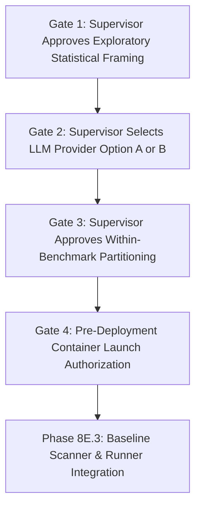

# AEGISCORE AI — Phase 8E.2B
# Offline Benchmark Testbed Harness Engineering

**Document ID:** DOC-PHASE-8E2B-OFFLINE-HARNESS  
**Status:** COMPLETE / OFFLINE CONFIGURATION ONLY  
**Date:** 2026-10-27  
**Project:** AEGISCORE AI  
**Thesis Title:** “An Uncertainty-Aware Multi-Agent LLM Framework with Retrieval-Augmented Generation for Evidence-Based Web Application Vulnerability Assessment”  
**Context:** Offline testbed harness configuration, isolation specification, and deterministic reset/health-check design for OWASP Juice Shop and DVWA.

---

## 1. Executive Summary

Phase 8E.2B establishes the static configuration, network isolation architecture, and offline validation contracts for the AEGISCORE AI benchmark testbed.

> [!IMPORTANT]
> **Strict Phase Boundary:** Phase 8E.2B is documentation, static configuration, and offline validation only.
> - **Zero container launches:** `docker compose up`, `docker run`, and background services were NOT executed.
> - **Zero image pulls:** Remote registries were NOT contacted; images were NOT downloaded.
> - **Zero network requests:** No HTTP requests or socket connections were emitted.
> - **Zero database creation:** No persistent database files were created or modified.

The testbed configuration files, validation scripts, and 19 dedicated unit tests are checked in, verified, and pass completely offline.

---

## 2. Testbed Architecture & Network Boundaries

### 2.1 Isolated Network Design
The testbed environment is governed by `testbed/docker-compose.yml`. Network isolation is enforced through an internal Docker bridge network:

```yaml
networks:
  aegiscore-internal-net:
    name: aegiscore-internal-net
    driver: bridge
    internal: true
    ipam:
      driver: default
      config:
        - subnet: 172.28.0.0/16
          gateway: 172.28.0.1
```

### 2.2 Key Network Isolation Invariants
1. **`internal: true` (Zero Egress):**
   - The Docker bridge driver with `internal: true` disables all default outbound routing and NAT rules on the container network.
   - Benchmark containers attached to this network cannot initiate external connections to the public internet, LAN hosts, or external model providers.
2. **Subnet Scope (`172.28.0.0/16`):**
   - Allocates an isolated RFC1918 private address space.
   - Target services receive deterministic static IPs:
     - OWASP Juice Shop: `172.28.0.10`
     - DVWA: `172.28.0.20`
   - *Host Conflict Note:* No repository evidence indicates a conflict with `172.28.0.0/16`. However, because Docker CLI host queries were prohibited in this offline phase, live verification of host network adapter conflicts remains deferred to pre-deployment checks.
3. **Single Network Attachment:**
   - Benchmark services attach exclusively to `aegiscore-internal-net`. No secondary external or default networks are attached.
   - Host networking (`network_mode: host`) is strictly prohibited and rejected by static checks.

---

## 3. Target Versions, Image Pinning, & Digest Limitations

### 3.1 Pinned Benchmark Targets

| Target Service | Pinned Version Tag | Container Name | Internal IP | Loopback Host Port |
|---|---|---|---|---|
| **OWASP Juice Shop** | `bkimminich/juice-shop:v15.0.0` | `aegiscore-testbed-juice-shop` | `172.28.0.10` | `127.0.0.1:3000:3000` |
| **DVWA** | `vulnerables/web-dvwa:1.10` | `aegiscore-testbed-dvwa` | `172.28.0.20` | `127.0.0.1:8080:80` |

### 3.2 Image-Tag Limitations vs. Cryptographic Digests
- **Tag Mutability Boundary:** Pinned image tags (e.g., `:v15.0.0`, `:1.10`) provide semantic version stability, but upstream registry maintainers can theoretically overwrite tags.
- **Future Digest Pinning Requirement:** Prior to empirical experimental runs (Phase 8E.5), the evaluation protocol mandates resolving and freezing exact cryptographic SHA-256 digests:
  - `bkimminich/juice-shop:v15.0.0@sha256:d55f9f8fa2688825f385cbe95dae5fa9c905de7f7223bdfbd812efd8de5ee8ea`
  - `vulnerables/web-dvwa:1.10@sha256:39ef74e6b7d2eb292d3f75d5e21fb1a4a03429fa03e8787f6dd2b3eeff2d4b99`
- In Phase 8E.2B, no images were pulled, and no remote registries were queried.

---

## 4. Host-Port Binding Decisions

### 4.1 Loopback-Only Policy (`127.0.0.1`)
In `testbed/docker-compose.yml`, published ports are bound explicitly to `127.0.0.1`:
- Juice Shop: `"127.0.0.1:3000:3000"`
- DVWA: `"127.0.0.1:8080:80"`

### 4.2 Rationale & Safety Boundary
1. **Local Access for Harness:** Loopback binding allows the local assessment runner and health check scripts running on the host machine to communicate with the benchmarks over `127.0.0.1`.
2. **Strict Non-Exposure to External Interfaces:** Binding to `127.0.0.1` prevents the container ports from listening on `0.0.0.0`, ensuring the vulnerable applications are completely inaccessible to external hosts on the physical network (Ethernet, Wi-Fi, LAN/WAN).
3. **Fail-Closed Enforcement:** The parser [`validate_compose_content`](file:///s:/AegisCore/aegiscore/testbed.py) strictly validates that every port binding begins with `"127.0.0.1:"`. Any attempt to bind to `0.0.0.0` or publish bare ports (`"3000:3000"`) raises `TestbedSecurityError`.

---

## 5. State Reset & Health Check Behavior

### 5.1 Deterministic State Reset
To maintain evaluation reproducibility across trials, benchmark database state must be re-initialized between scenario executions.

- **Juice Shop Reset:**
  - Database: Local SQLite instance located in container storage (`/juice-shop/data/juiceshop.sqlite`).
  - Reset Procedure: `docker compose -f testbed/docker-compose.yml down -v && docker compose -f testbed/docker-compose.yml up -d juice-shop`
  - Volume wipe ensures all injected comments, registered users, and mutated orders are discarded.
- **DVWA Reset:**
  - Database: MySQL database pre-packaged in container.
  - Reset Procedure: `docker compose -f testbed/docker-compose.yml down -v && docker compose -f testbed/docker-compose.yml up -d dvwa`
- **Execution Guard:** The script [`scripts/testbed_reset.py`](file:///s:/AegisCore/scripts/testbed_reset.py) and method `ResetOperation.execute_live()` strictly fail closed in Phase 8E.2B if live execution is attempted.

### 5.2 Pre-Registered Health Checks

| Target | Endpoint URL | Timeout Ceiling | Expected Status | Expected Substring |
|---|---|:---:|:---:|---|
| **Juice Shop** | `http://127.0.0.1:3000/rest/admin/application-version` | 5.0s | 200 | `version` |
| **DVWA** | `http://127.0.0.1:8080/login.php` | 5.0s | 200 | `login.php` |

- **Bounded Timeouts:** All health check specifications enforce a timeout ceiling of $\le 5.0$ seconds (hard limit 10.0 seconds) to prevent hanging assessment workers.
- **Execution Guard:** The script [`scripts/testbed_health.py`](file:///s:/AegisCore/scripts/testbed_health.py) and method `HealthCheckTarget.execute_live()` strictly fail closed in Phase 8E.2B.

---

## 6. Target Allowlisting & Scope Enforcement

An internal Docker network is **not** a substitute for software-level target allowlisting. The future assessment runner must enforce dual-layer defense:

1. **Network Layer:** Docker bridge network with `internal: true` prevents unauthorized outbound egress.
2. **Application / Policy Layer:** The existing [`ScopePolicy`](file:///s:/AegisCore/aegiscore/safety.py#L270) and [`verify_target_allowlist`](file:///s:/AegisCore/aegiscore/testbed.py#L250) functions reject any request whose destination URL is not explicitly pre-registered on `127.0.0.1` or `172.28.0.0/16`.

```python
# Verified in tests/test_testbed_harness.py
verify_target_allowlist("http://127.0.0.1:3000/rest/admin")   # PASS
verify_target_allowlist("http://172.28.0.10:3000/rest/admin") # PASS
verify_target_allowlist("http://8.8.8.8:3000/")              # REJECTED (Public IP)
verify_target_allowlist("http://example.com:3000/")          # REJECTED (External domain)
verify_target_allowlist("http://127.0.0.1:80/")              # REJECTED (Unapproved port)
```

---

## 7. What Remains Unverified (Pending Deployment)

Because no containers were launched or images downloaded, the following items remain unverified and must be validated in future authorized phases:

1. **Docker Host Availability:** Whether the Docker daemon and Docker Compose v2 CLI are installed and operational on the host system.
2. **Host Subnet Collisions:** Whether `172.28.0.0/16` conflicts with any active host network interfaces, VPN routes, or existing Docker bridges.
3. **Image Availability & Digest Match:** Whether `bkimminich/juice-shop:v15.0.0` and `vulnerables/web-dvwa:1.10` match the proposed SHA-256 digests.
4. **Target Startup Timings:** Actual initialization latency of Juice Shop and DVWA containers under clean database resets.
5. **Real Transport Behavior:** In-flight network cancellation and HTTP socket timeouts against real HTTP endpoints (currently verified via synthetic fake transport only).

---

## 8. Supervisor Approval Gates

Prior to any container deployment or scanner execution, the following gates remain open:



1. **Gate 1:** Formal approval of exploratory academic proof-of-concept framing (Section 13, Item 2 of evaluation protocol).
2. **Gate 2:** Formal selection of LLM Provider (Cloud Gemini 1.5 Pro with narrow egress exemption vs. Local Llama-3.1-70B with zero egress).
3. **Gate 3:** Formal approval of Within-Benchmark Stratified Partitioning scheme.
4. **Gate 4:** Explicit authorization to launch Docker containers and perform image pulls.

---

## 9. Recommendation: CONDITIONAL GO FOR HARNESS PREPARATION

- **Status:** Phase 8E.2B is **COMPLETE**.
- **Recommendation:** **CONDITIONAL GO** for subsequent offline runner and test suite integration.
- **Strict Prohibition:** Container startup, image pulling, benchmark deployment, target requests, scanning, and model provider integration remain **STRICTLY ON HOLD** pending supervisor approval.
