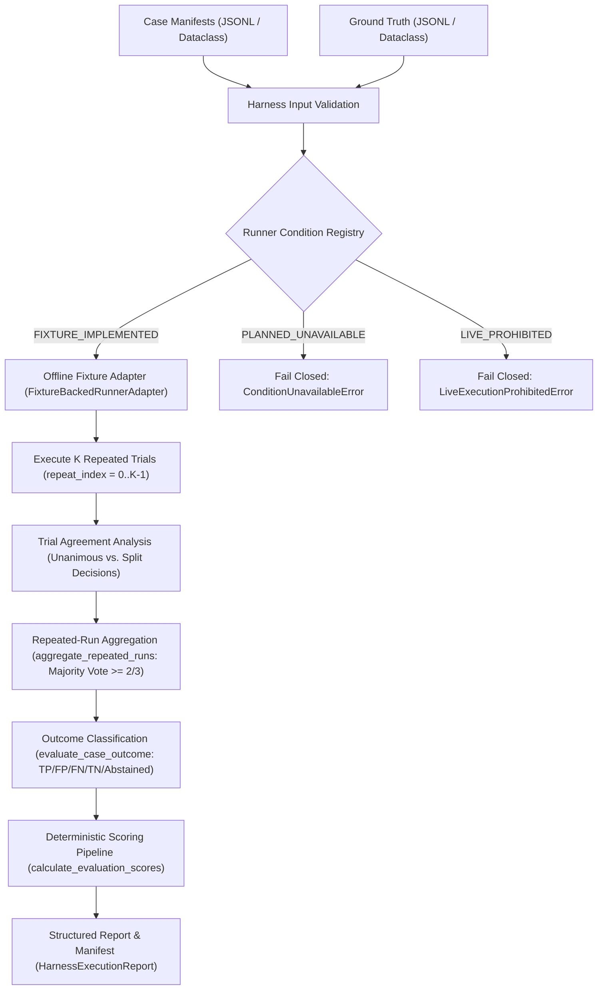

# Phase 8E.4 — Offline Runner Wrappers & Fixture-Based Evaluation Harness

## 1. Overview & Objective

Phase 8E.4 constructs a reproducible, provider-neutral offline evaluation harness (`aegiscore/evaluation_harness.py`) built strictly upon the Phase 8E.3 evaluation contracts and deterministic scoring pipeline (`aegiscore/evaluation.py`).

The primary purpose of this harness is to validate the end-to-end evaluation lifecycle—from case manifest and ground-truth ingestion, through runner selection, repeat trial execution ($K=3$), majority-vote aggregation, outcome scoring, and structured output reporting—**strictly without live LLM calls, target dispatch, scanning, container lifecycle operations, or network requests**.

> [!IMPORTANT]
> **Strict Fixture Status & Disclaimer:**
> All runner conditions in this phase operate exclusively via explicitly labeled synthetic test fixtures (`FixtureBackedRunnerAdapter`). Replaying deterministic fixtures validates harness pipeline mechanics; **it does NOT demonstrate real-world vulnerability detection accuracy or empirical LLM reliability**.

---

## 2. Architecture & Orchestration Workflow

The offline evaluation harness follows a unidirectional, fail-closed pipeline:



### Pipeline Stages

1. **Ingestion & Integrity Validation:**
   - Manifest cases are checked for duplicate `case_id`s and duplicate canonical loci `(target_uri, parameter, cwe_id)`.
   - Ground truth records are indexed by `case_id`; missing ground truth or foreign key violations fail closed.
   - If `strict_adjudication=True`, any ground truth with `adjudication_state != AdjudicationState.ADJUDICATED` raises `HarnessValidationError`.
2. **Condition Resolution:**
   - Resolves the requested condition via `RunnerConditionRegistry`.
   - Fails closed if the condition is unregistered, planned but unavailable, or live-prohibited.
3. **Repeated Trial Execution:**
   - For $k \in [0..repeat\_count-1]$, executes the registered adapter for each case locus.
   - Validates that returned `EvaluationRunRecord` matches expected `case_id`, `repeat_index`, and has a unique `run_id`.
4. **Trial Agreement Analysis:**
   - Gathers decisions across runs per locus to compute `TrialAgreementSummary` (unanimous vs. split decisions).
   - Labels agreement as deterministic fixture repeatability rather than empirical LLM reliability.
5. **Majority Consensus Aggregation:**
   - Uses `aggregate_repeated_runs` to collapse repeated trials ($K=3$) back to the canonical locus ($N \approx 36$) without inflating sample size.
   - Requires $\ge 2/3$ agreement; split decisions (1 verified, 1 rejected, 1 abstained) fail closed to `ABSTAINED`.
6. **Deterministic Scoring:**
   - Evaluates aggregated decisions against ground truth via `evaluate_case_outcome`.
   - Computes standard detection and selective risk metrics via `calculate_evaluation_scores`.
7. **Structured Artifact Output:**
   - Produces a deterministic `HarnessExecutionReport` with a cryptographically fingerprinted `EvaluationRunManifest`.

---

## 3. Runner Condition Registry & Status Taxonomy

The `RunnerConditionRegistry` categorizes all evaluation conditions into three explicit operational statuses:

| Condition Identifier | Canonical Enum | Registered Status | Description & Safeguard |
|---|---|---|---|
| `PROPOSED_MULTI_AGENT` / `MULTI_AGENT_FULL` | `RunnerCondition.PROPOSED_MULTI_AGENT` | `FIXTURE_IMPLEMENTED` (when bound) / `PLANNED_UNAVAILABLE` | Proposed uncertainty-aware multi-agent framework with evidence review and abstention gating. Only fixture adapters permitted offline. |
| `BASELINE_SINGLE_AGENT` / `SINGLE_AGENT_BASELINE` | `RunnerCondition.BASELINE_SINGLE_AGENT` | `FIXTURE_IMPLEMENTED` (when bound) / `PLANNED_UNAVAILABLE` | Single-agent standard prompt baseline without peer review. |
| `BASELINE_MA_NO_ABSTENTION` / `MULTI_AGENT_NO_ABSTENTION` | `RunnerCondition.BASELINE_MA_NO_ABSTENTION` | `FIXTURE_IMPLEMENTED` (when bound) / `PLANNED_UNAVAILABLE` | Multi-agent framework with forced binary decisions (abstention gating disabled). |
| `ABLATION_NO_RAG` / `RAG_DISABLED_ABLATION` | `RunnerCondition.ABLATION_NO_RAG` | `FIXTURE_IMPLEMENTED` (when bound) / `PLANNED_UNAVAILABLE` | Multi-agent framework operating without approved-source retrieval context. |
| `ABLATION_NO_REVIEWER` / `EVIDENCE_REVIEWER_DISABLED_ABLATION` | `RunnerCondition.ABLATION_NO_REVIEWER` | `FIXTURE_IMPLEMENTED` (when bound) / `PLANNED_UNAVAILABLE` | Multi-agent framework operating without independent adversarial evidence review. |
| `BASELINE_DAST_ZAP` / `DAST_ZAP` | `RunnerCondition.BASELINE_DAST_ZAP` | `LIVE_PROHIBITED` | Active dynamic scanning baseline requiring live OWASP ZAP container. Strictly prohibited in offline harness. |

### Registration Invariants

1. **No Silent Fallback:** Attempting to invoke an unavailable live runner or a condition without a registered fixture adapter raises `ConditionUnavailableError` or `LiveExecutionProhibitedError`. The harness never silently substitutes mock data for an unconfigured baseline.
2. **No Fabricated Model Outputs:** If an ablation or baseline is not implemented, it is declared `PLANNED_UNAVAILABLE` and cannot be evaluated.

---

## 4. Input & Output Schemas and Reproducibility Manifests

### Run Manifest Record (`EvaluationRunManifest`)

Every harness execution generates an immutable reproducibility manifest:

```json
{
  "manifest_id": "manifest-proposed-multi-agent-91afa3232a47",
  "fixture_dataset_id": "synthetic-testbed-fixtures",
  "fixture_dataset_version": "1.0.0",
  "runner_condition": "proposed-multi-agent",
  "configuration_fingerprint": "91afa3232a474668...",
  "repeat_count": 3,
  "application_version": "0.1.0",
  "input_case_ids": ["CASE-TEST-001", "CASE-TEST-002"],
  "start_time_iso": "2026-10-27T17:35:00.000000+00:00",
  "end_time_iso": "2026-10-27T17:35:00.120000+00:00",
  "execution_status": "completed",
  "validation_errors": [],
  "is_synthetic_simulation": true,
  "reproducibility_notes": "SYNTHETIC FIXTURE REPLAY ONLY: All outputs derived from deterministic test fixtures. Does not demonstrate real-world vulnerability detection accuracy or live LLM performance. Deterministic fixture repeats produce identical outputs by design."
}
```

### Structured Output Report (`HarnessExecutionReport`)

The full report serializes cleanly to JSON and includes:
- `manifest`: Execution metadata and synthetic disclaimer.
- `trial_agreement`: Stability across repeats (`total_cases`, `unanimous_cases_count`, `split_decision_cases_count`, `trial_agreement_rate`).
- `score_summary`: Confusion matrix counts (`tp`, `fp`, `fn`, `tn`, `abstained_pos`, `abstained_neg`), candidate finding totals, and complete dictionary of calculated `MetricOutputRecord`s.
- `unique_case_loci_count`: Validated count of independent test loci ($N$).
- `aggregated_outcomes`: Case-level adjudicated classifications with full traceability to canonical locus definitions.
- `raw_trial_runs`: Complete audit log of every individual trial execution record.

---

## 5. Metric Invariants & Calculation Safeguards

All metric calculations adhere to the formal invariants established in Phase 8E.3:

1. **Abstention on Vulnerable is Empirical False Negative ($FN$):**
   Failing to report a real vulnerability due to uncertainty penalizes detection recall:
   $$\text{Recall} = \frac{TP}{TP + FN_{\text{explicit}} + \text{Abstained}_{\text{pos}}}$$
2. **Abstention on Non-Vulnerable is NOT True Negative ($TN$):**
   Withholding judgment on a non-vulnerable control is an Abstention, never rewarded as a True Negative.
3. **Zero Denominator Transparency:**
   Metrics with zero denominators (e.g. Precision when 0 findings verified; Selective Risk when 0 decisions retained) return `status = MetricStatus.UNDEFINED` with `value = None`. Zeroes or ones are never fabricated.
4. **Calibration Metric Disablement:**
   Brier Score and Expected Calibration Error (ECE) are set to `status = MetricStatus.NOT_SUPPORTED` with `value = None`. Uncalibrated categorical votes cannot yield continuous probability estimates.

---

## 6. Execution and Safety Restrictions

The evaluation harness implements hard enforcement of the following safety policies:

- **Offline Only:** Setting `execution_mode != "offline_fixture"` raises `LiveExecutionProhibitedError`.
- **Zero Sockets:** Harness execution makes zero socket connections, zero DNS resolutions, and zero HTTP requests.
- **Zero Scanners:** DAST and container-based scanners are marked `LIVE_PROHIBITED` and cannot be initialized.
- **Fail-Closed on Unadjudicated Ground Truth:** In strict adjudication mode, unverified or disputed labels are rejected before any runner execution begins.

---

## 7. Supervisor Decision Gates

Prior to advancing beyond Phase 8E.4:

1. **Ground Truth Adjudication Review:** Formally review and approve the ground-truth mappings for the 36 canonical loci across OWASP Juice Shop and DVWA.
2. **Ablation Implementation Approval:** Review the technical design of real RAG-disabled and reviewer-disabled components before authorizing non-fixture ablation code.
3. **Benchmark Execution Authorization:** Maintain a strict hold on Docker Compose container startup, benchmark image pulling, live scanning, and model provider API integration until formal protocol sign-off.
