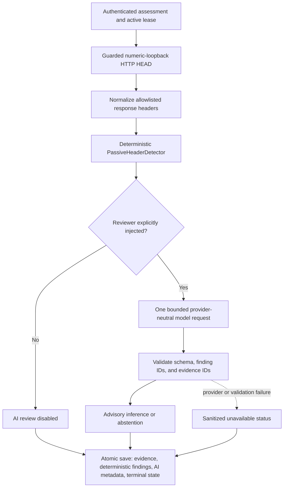

# TASK 06.5 — AI Engine Integration Audit

## Outcome

**CONDITIONAL IMPLEMENTATION.** The passive assessment route now supports an explicitly injected, schema-checked AI advisory review using the existing provider-neutral `ModelAdapterInterface`. The normal API remains provider-free; live provider modes still fail closed. The Python regression suite passes. Gemini, production RAG/vector search, and the offline FSM remain unconnected to live assessment execution, by design and because their current contracts do not match the passive HTTP evidence model. TASK 06.4.4 Linux egress verification remains deferred and is not represented as complete.

## What existed before this task

The API assessment path performed authenticated assessment creation, authoritative target checks, leased guarded loopback `HEAD` execution, peer verification, normalized allowlisted header evidence, deterministic `PassiveHeaderDetector` findings, and transactional persistence. It did not invoke the model adapter, custom FSM, RAG, specialist roles, or uncertainty engine.

The custom FSM and AI-related modules were already substantial, but serve a separate offline evidence-replay workflow. Their contracts analyze retrieved approved source chunks for XSS, SQL injection, and broken access control hypotheses. The live assessment currently records response security headers, which cannot support those source-code vulnerability claims. Passing runtime HTTP observations off as approved RAG corpus evidence would also violate the source-review provenance contract, so I did not connect those specialists directly to this route.

## Existing component integration map

| Component | Existing responsibility and contract | Status in the actual assessment workflow |
|---|---|---|
| FastAPI assessment routes | Create and execute authorized assessments; require permissions, lease ownership, and guarded execution. | Production path. It collected the passive observation and deterministic findings before this task. It now optionally calls the advisory reviewer after detection. |
| `OrchestrationStateMachine` | Enforces request validation → retrieval → specialist analysis → adversarial review → uncertainty/conflict assessment → claim validation → final gating. | Used by the offline `OrchestrationReplayAdapter` and tests. It is not invoked by the protected HTTP assessment route. It remains unchanged. |
| Specialist roles | XSS, SQLi, and access-control analyst contracts; an evidence reviewer; a deterministic uncertainty assessor. Test specialists are fixture-driven fakes. | Not called by the HTTP assessment route. The source-code analyst roles are not suitable for header-only response observations. |
| `GroundedSpecialistAdapter` and model adapter | Provider-neutral request/response contracts, output parsing, evidence citation validation, deterministic fake adapter, and `UnauthorizedLiveModelAdapter`. `is_live_provider_authorized()` returns false. | The provider-neutral interface is now an optional dependency of the HTTP route through the new reviewer. `GroundedSpecialistAdapter` remains in the offline FSM flow. No Gemini adapter or live model call is available. |
| RAG and source review | Local text/Markdown ingestion, provenance and content hashes, human-reviewed source approval, read-only approved-source retrieval, citation membership validation. | Separate evidence API/offline workflow. The retriever is `InMemoryTestRetriever`, using lexical token overlap; it is not a semantic/vector production index. The assessment reviewer does not retrieve or promote unreviewed content. |
| Vector store and embeddings | None found in the active Python implementation or dependencies. | Not implemented: no ChromaDB, FAISS, embedding model, or embedding dependency/configuration. |
| Prompt templates | Specialist role prompts and grounded-specialist prompt builders are embedded in Python modules. | Existing prompts remain offline. The new passive reviewer has a narrow static prompt that treats HTTP header values as untrusted data. |
| Evaluation | `evaluation.py` and `evaluation_harness.py` provide offline fixture/replay evaluation, metrics, FSM replay, and uncertainty outputs. | Not connected to live provider calls or the production HTTP assessment route. The new reviewer is tested with local deterministic adapters only. |
| Evidence and findings persistence | Assessment evidence and findings are stored in SQLite JSON payloads; findings must reference evidence belonging to the assessment. | The transaction remains the same. AI advisory metadata is stored under `execution_result.ai_review`; official findings stay deterministic and retain their current schema. |
| Dependencies and provider configuration | Runtime dependencies are FastAPI, Pydantic, Argon2, and Uvicorn. No Google Gemini SDK/client or vector/embedding package is declared. `ModelProviderConfig.api_key` is excluded from `repr` and rendered redacted. | No key loader, provider client, or API key was added. The live-provider gate remains closed. `uv.lock` was not edited. |

The runtime package contains no `TODO`/`FIXME` marker identifying an unfinished Gemini adapter; live provider execution is explicitly unavailable in the model adapter. `aegiscore - Copy/` is a duplicate untracked directory, not the imported runtime package, and was not used or changed.

## Implemented integration

`create_app(assessment_ai_model_adapter=...)` accepts an explicit in-process adapter. Omitting this argument leaves review disabled and makes no model request. An invalid adapter configuration is reported as unavailable for AI review without taking deterministic assessment execution offline. Non-fake provider modes are rejected before `complete()` while the existing live-provider authorization gate is false.

After the guarded `HEAD` request and deterministic header detection, the route now invokes the reviewer if configured. It gives the model only the bounded allowlisted response headers, header-size flags, deterministic finding text/IDs, and the observation evidence ID. It omits the target URL, response body, credentials, and unallowlisted headers. Header values are treated as untrusted prompt data and passed through the repository's existing secret redactor. The prompt timeout is capped at two seconds and the reviewer makes one call with no retry.

The structured output is advisory only. Validation requires an exact output schema, one review for each deterministic finding or an explicit abstention, non-empty uncertainty, a recommendation, and evidence IDs already attached to that finding. Unknown findings, extra fields, and unknown evidence IDs are rejected. The model cannot supply new finding IDs, change official severity, or change the assessment terminal state. Its text is stored only in `execution_result.ai_review`, with `confidence_calibrated=false` and `factual_support=not_evaluated`.

Provider errors and unexpected reviewer errors are converted to bounded status codes such as `timeout`, `connection_failure`, `provider_unauthorized`, `invalid_output`, or `analysis_unavailable`. Raw provider messages and responses are not persisted. Assessment evidence, deterministic findings, AI review status, and terminal state still use the existing atomic persistence operation. AI failure does not mark a reachable assessment failed or discard deterministic findings.

### Pipeline



This is an optional post-detection analysis seam; it does not replace or alter the existing custom FSM. Live-provider use still requires an explicit future provider approval and a compatible deployment egress decision.

## Gemini, RAG, and agent assessment

**Gemini:** Not implemented. There is no provider SDK, HTTP adapter, key loader, or production model configuration. The existing decision gate disables live provider calls, and the deployment policy is loopback-only. Enabling a public Gemini endpoint would require a separate approval, data-handling review, provider-specific rate limiting, secret-manager-backed key configuration, provider error/response tests, and a deployment egress decision. No API key or approval record was fabricated.

**RAG:** Existing approved-only retrieval validates source provenance, hashes, citations, and read-only database state. Retrieval remains lexical/test-only and has no embeddings or vector database. It is not injected into this passive reviewer: no applicable approved knowledge registry is guaranteed in the assessment path, and retrieved documents are not needed to decide which headers were observed. Existing RAG tests cover retrieval failures and untrusted retrieved content; those contents cannot authorize a target or control the reviewer. A future knowledge-backed recommendation layer should use the existing approved-only runtime and preserve citation provenance.

**Specialists/FSM:** Existing specialist roles remain valuable for the separate offline source-evidence workflow. Their execution order and gates remain enforced by the current FSM in replay. Adding them to the HTTP response-header path would misrepresent their evidence contract; a distinct configuration-observation role and an approved production evidence model would need evaluation before broader FSM integration.

**Evaluation and confidence:** The current evaluation harness is fixture-based and does not measure Gemini or real-provider calibration. AI review uncertainty is required, but no numeric confidence is emitted; calibration and factual entailment remain explicitly `not_evaluated`.

## Focused verification

Each focused module below was run separately; these counts are not summed with the full suite.

| Command | Collected | Passed | Failed | Skipped | Duration |
|---|---:|---:|---:|---:|---:|
| `python -m pytest tests/test_assessment_ai_integration.py --durations=0 -q` | 18 | 18 | 0 | 0 | 4.06 s |
| `python -m pytest tests/test_model_adapter.py --durations=0 -q` | 23 | 23 | 0 | 0 | 0.56 s |
| `python -m pytest tests/test_orchestration_state_machine.py --durations=0 -q` | 11 | 11 | 0 | 0 | 0.25 s |
| `python -m pytest tests/test_specialist_roles.py --durations=0 -q` | 24 | 24 | 0 | 0 | 0.27 s |
| `python -m pytest tests/test_rag.py --durations=0 -q` | 21 | 21 | 0 | 0 | 0.59 s |
| `python -m pytest tests/test_rag_runtime.py --durations=0 -q` | 33 | 33 | 0 | 0 | 1.87 s |
| `python -m pytest tests/test_evaluation_harness.py --durations=0 -q` | 21 | 21 | 0 | 0 | 0.31 s |
| `python -m pytest tests/test_uncertainty_engine.py --durations=0 -q` | 34 | 34 | 0 | 0 | 0.33 s |
| `python -m pytest --durations=0 -q` | 818 | 818 | 0 | 0 | 40.01 s |

The AI-specific tests cover opt-in invocation in the API, disabled-by-default behavior, invalid configuration, structured output rejection, unsupported finding/evidence references, abstention, hostile header text, bounded timeouts, live-provider denial, sanitized provider failures, and deterministic findings surviving AI failure. Existing RAG tests include approved-source selection, retrieval failure, source integrity, citation validation, and untrusted-content handling. Existing FSM, specialist, uncertainty, and evaluation module suites also pass.

No Gemini API request or external network test was made. The deployment-level Linux egress verification remains deferred per TASK 06.4.4; this task did not change that status.

## Security impact and remaining risks

- **Improved:** Optional model commentary cannot create official findings or modify deterministic severity/status. Every accepted review is tied to a current finding and its existing evidence ID.
- **Preserved:** Target authorization, guarded execution, one passive `HEAD`, connected-peer validation, lease checks, deterministic findings, and atomic persistence are unchanged.
- **Default behavior:** Model requests remain disabled. Live provider mode is rejected by the existing approval gate.
- **Residual model risk:** Schema and citation membership checks prove reference membership, not semantic truth. AI review text is advisory and uncalibrated and must not be presented as a confirmed vulnerability.
- **Provider readiness:** No real Gemini adapter, provider key configuration, or global provider rate limiter exists. The two-second model request bound is a contract for an injected adapter; any future provider must enforce it.
- **Deployment:** Current loopback-only network policy cannot reach a public AI provider. TASK 06.4.4 remains deferred and no OS isolation claim is made here.

## Project status

The project now has an optional AI review hook in the real passive assessment transaction, using an explicit adapter dependency and deterministic validation. The core HTTP assessment remains deterministic by default. The offline FSM/RAG/specialist/evaluation subsystem remains separate; production Gemini, embedding/vector retrieval, semantic calibration, and Linux live isolation verification remain incomplete.

## Repository safety

The initial `git status --short` was captured before edits. It already contained broad pre-existing user modifications and deletions, including API/persistence changes, documentation deletions, a modified `uv.lock`, and many untracked artifacts/reports, backend modules, deployment files, and tests. The final status retains that work and adds:

```text
?? aegiscore/assessment_ai.py
?? docs/TASK_06_5_AI_ENGINE_INTEGRATION_AUDIT.md
?? tests/test_assessment_ai_integration.py
```

The API app/routes were already marked modified at task start and remain modified with the integration. No `uv.lock` or Flutter files were changed. Nothing was staged or committed, and no destructive Git command was run. No byte-for-byte preservation claim is made.
