# TASK 07.0 — Thesis Outline, Architecture & Defense Preparation

## Format note

No university thesis handbook or official template was found. The project proposal and project-authored study book are not institution-specific formatting rules. Use this outline as a content structure, then map it to the required title page, chapter order, citation style, declaration, ethics/permission statements, page limits, and defense duration when the university requirements are available.

The older project study book contains historical readiness/test figures and broader claims that are superseded or not supported by the current implementation. Do not copy those numbers or present the book as independent academic evidence.

## Recommended preliminary pages

Adapt to the institution's template: title page; approval/declaration; originality/ethics statement; acknowledgements; abstract; keywords; table of contents; lists of figures/tables; abbreviations and terminology. Do not invent supervisor approvals, institutional affiliations, ethics approvals, or project authorization.

## Draft abstract

AEGISCORE AI is a locally oriented prototype for narrowly scoped passive security-header assessment. In the tested path, with a registered numeric loopback target and an injected verifier, assessment binds to the exact endpoint, applies guarded single-request HTTP `HEAD` execution, converts allowlisted response-header evidence into deterministic configuration observations, and optionally validates advisory commentary against supplied finding and evidence references. SQLite persistence uses lease ownership, transactional result writes, and recovery for expired running assessments. In a synthetic fixture experiment, 100 repeated detector calls produced one normalized finding set with five findings per call, and all 500 generated evidence references matched the supplied identifiers. Deterministic fake-adapter tests exercised output-schema and reference constraints; a separate local timing experiment measured validator overhead without invoking a live model. The results support repeatability and represented failure-path behavior for the tested fixtures. They do not establish real-world detection accuracy, model quality, calibrated uncertainty, production authorization, browser-to-live-backend acceptance, or operating-system egress isolation. Debian 13 egress verification remains deferred.

Before submission, align the abstract wording and word count with the university requirements and verify every number against the cited experiment/test record.

## Thesis chapter outline

### 1. Abstract

Use the draft above as a starting point. State the problem, actual narrow method, strongest measured result, and key limitations. Avoid novelty, accuracy, or production-readiness claims unless new evidence is collected.

### 2. Introduction

- Explain the practical problem: safely recording and interpreting a bounded passive observation without treating unverified targets or generated commentary as authority.
- Introduce the AEGISCORE prototype and distinguish its passive assessment route from the repository's separate offline FSM/RAG components.
- State the study's scope and exclusions before describing intended benefits.
- End with the revised implementation-bounded research questions and chapter map.

### 3. Problem Statement

Frame the engineering problem as how to bind a passive assessment to an authorized local endpoint, produce deterministic evidence-referenced observations, and isolate optional advisory text from official results. Do not claim that this particular problem is missing from all prior literature. A field-wide research gap requires a systematic, source-supported literature review that has not yet been completed.

### 4. Research Objectives

1. Describe and test the currently implemented numeric-loopback, exact-endpoint passive execution path.
2. Measure deterministic output repeatability and evidence-reference membership for the recorded fixed fixture.
3. Evaluate the advisory validator against its existing reference, schema, unsupported-claim, abstention, and failure-isolation fixtures.
4. Summarize lifecycle, transaction, lease, authorization, and recovery test evidence without converting test counts into a security probability.
5. Measure local deterministic-only versus deterministic-plus-fake-adapter processing time and state its exclusions.
6. Identify unimplemented proposal objectives and deployment evidence still required.

### 5. Research Questions

- **RQ1:** For one fixed valid header-evidence fixture, does the detector return an identical normalized finding set over 100 repeated calls? **Observed:** yes for that fixture; one distinct set.
- **RQ2:** Are generated findings bound to the supplied assessment and evidence identifiers? **Observed:** 500/500 references passed the fixture membership check.
- **RQ3:** Does the local advisory validator accept its valid fixture and reject the represented fabricated-reference, unsupported-claim, and malformed-schema cases? **Observed:** all listed fixture cases met their expected validator outcomes; sample sizes are small and constructed.
- **RQ4:** Do represented reviewer failure cases preserve deterministic findings and terminal assessment state? **Observed:** API and repeated-failure tests passed the asserted invariants.
- **RQ5:** Do represented authorization, target-boundary, lease, persistence, and recovery cases fail closed or preserve stored state? **Observed:** their regression assertions passed; this is not proof of all possible security failures.
- **RQ6:** What local processing overhead does the actual advisory validator add when backed by a deterministic in-memory fake adapter? **Observed:** 250-pair timing results are listed below; no provider or network time is included.

Do not carry over proposal questions about calibrated confidence, RAG ablation, ZAP comparison, or vulnerability-class recall as answered questions. They are not measured by this implementation/evidence set.

### 6. Literature Review

The reviewed candidate literature distinguishes broad, active, multi-stage LLM penetration testing from AEGISCORE's narrow passive observation. PentestGPT uses an interactive LLM workflow and staged task benchmark [1]; Isozaki et al. further examine benchmark reproducibility and human-in-the-loop variability [2]. Happe and Cito's review identifies testbed, sample, baseline, and metric choices as limits on claims about LLM security systems [3]. PentestEval studies expert-annotated stage-level and end-to-end attack tasks [4], while PENTESTLLMAGENT studies a multi-agent IP-to-root architecture [5]. These systems and evaluations do not validate the passive header rules or advisory reviewer implemented here. The ACL agent-uncertainty work provides context for distinguishing abstention from calibrated uncertainty [6]. The OWASP WSTG sources provide practitioner guidance [7, 8]; the other project pages are contextual resources, not AEGISCORE test data [9, 10].

This is a focused review of the proposal's candidate list, not a systematic literature review. The source set does not directly establish the correctness or accuracy of AEGISCORE's header rules, semantic evidence entailment, prompt-injection resistance, or a production authorization-provenance design. The critical source-by-source analysis, provisional bibliography, citation matrix, and unresolved metadata are in [TASK 07.2 Literature Review and Research Gap](TASK_07_2_LITERATURE_REVIEW_AND_RESEARCH_GAP.md). Its bracketed reference numbers are draft cross-references only; final citation style remains subject to NWU/supervisor confirmation.

### 7. Research Gap

Within the six candidate research papers reviewed for this milestone, the dominant systems evaluate broad active or multi-stage penetration testing, exploit-capable automation, or uncertainty in interactive agents [1–6]. None of those six was found to evaluate the exact combination implemented by AEGISCORE: numeric-loopback-only endpoint authorization, one passive HTTP HEAD observation, deterministic header/configuration findings with evidence references, optional advisory commentary that cannot alter official findings or lifecycle state, and lease-backed persistence/recovery. This is a bounded gap in the reviewed subset, not proof of a field-wide absence and not an algorithmic novelty claim.

The project requirement gap remains distinct: the original proposal included a broader RAG-supported multi-agent evaluator, comparisons, and calibrated uncertainty. The delivered passive route does not answer those performance or accuracy questions. The defensible contribution is an engineering integration and its fixture/test evidence. The 100-run repeatability and 500/500 evidence-link results establish behavior only for the constructed fixture; they do not establish real-world detection accuracy or reviewer quality. The reviewed bibliography does not directly support claims of semantic evidence entailment, comprehensive prompt-injection resistance, or production authorization provenance. See the gap and claim-to-evidence qualification in [TASK 07.2](TASK_07_2_LITERATURE_REVIEW_AND_RESEARCH_GAP.md).

### 8. Proposed Methodology

Use a design-and-evaluation narrative that matches what was actually done:

- Describe the prototype, threat boundaries, and explicit test-only versus live interfaces.
- Use the deterministic fixture experiment and existing regression suite as separate evidence classes.
- Freeze the fixed detector input, IDs, target URL, normalization rule, and number of calls. The repeated calls are not independent target samples.
- Report advisory fixture cases with exact numerators/denominators and the deterministic fake-adapter condition.
- Explain the paired local timing setup: 20 warmups per path, 250 measured pairs, `perf_counter`, and empirical P95 at `floor(0.95*(n-1))` in the sorted samples.
- Do not compute accuracy metrics without independently labeled outcomes and explicit denominators.
- State that the reviewer adapter is synchronous and its post-call timeout check cannot interrupt a provider blocked indefinitely.

### 9. System Architecture

Use the current implementation diagram below. The offline custom FSM/RAG workflow is shown separately because the passive assessment API does not call it.

```mermaid
flowchart LR
  subgraph Client[Flutter client]
    UI[GoRouter and Riverpod UI]
    Repo[Assessment API repository]
    Token[Secure token storage abstraction]
    UI --> Repo
    Repo <--> Token
  end

  subgraph API[FastAPI application]
    Routes[Authentication and assessment routes]
    Auth[Local Argon2id account and in-memory bearer sessions]
    Routes --> Auth
    Create[Create: resolve exact registered endpoint]
    Routes --> Create
    Registry[Authorized target registry]
    Verifier[Injected AuthorizationVerifier]
    Create --> Registry
    Create --> Verifier
    Execute[Execute: recheck binding and claim lease]
    Routes --> Execute
    Executor[AuthorizedAssessmentExecutor]
    Execute --> Executor
    Guard[PolicyEngine and GuardedExecutionBoundary]
    Executor --> Guard
    Transport[Peer-checked loopback HEAD transport]
    Guard --> Transport
    HEAD[One HTTP HEAD; bounded timeout; no body read; no redirect follow]
    Transport --> HEAD
    Transport --> Verifier
    Evidence[Normalized allowlisted header evidence]
    HEAD --> Evidence
    Detector[PassiveHeaderDetector]
    Evidence --> Detector
    Findings[Deterministic findings with evidence IDs]
    Detector --> Findings
    Reviewer[Optional PassiveAssessmentAIReviewer]
    Adapter[Injected deterministic fake adapter in tests; no live provider configured]
    Findings -. enabled only when explicitly injected .-> Reviewer
    Evidence -. bounded review input .-> Reviewer
    Reviewer -->|bounded request| Adapter
    Adapter -->|untrusted response| Reviewer
    Result[Execution result with separate advisory metadata]
    Reviewer -->|advisory metadata| Result
    Execute --> Result
    Store[LocalRecordStore: SQLite]
    Findings --> Store
    Evidence --> Store
    Result --> Store
    Recovery[Startup recovery and bounded periodic recovery worker]
    Recovery --> Store
  end

  Repo <-->|Existing bearer-authenticated API contracts| Routes

  subgraph Separate[Separate offline analysis subsystem]
    FSM[Custom OrchestrationStateMachine]
    RAG[Offline retrieval and specialist/evidence contracts]
    FSM --> RAG
  end
  Separate -. not invoked by passive assessment routes .- API
```



The reviewer result is advisory metadata in the execution result; deterministic findings remain the official persisted finding rows. The default API app has no reviewer adapter. An app-factory injection is used for deterministic tests. The standard launcher has no production authorization verifier, so the executor remains unavailable unless a real reviewed verifier is configured through an approved deployment integration.

### 10. Implementation

Describe the actual components and their roles:

- **Flutter:** Material 3 interface, GoRouter navigation, Riverpod state, repositories/models for creation, history, details, evidence, findings, and separate advisory display.
- **FastAPI:** auth and assessment routes, app configuration, target registry/verifier injection, guarded execution executor, response schemas.
- **Passive execution:** exact registered numeric loopback endpoint, guarded one-use permit, single bounded `HEAD`, connected peer verification, allowlisted security-header extraction.
- **Deterministic detector:** currently emits up to five configuration observations from normalized header presence and HTTPS status.
- **Advisory review:** optional only; strict structured response shape, finding/evidence membership, claim-language checks, size limits, bounded elapsed-time check, safe unavailable state.
- **Persistence:** SQLite assessment, evidence, findings, result and lease records; recovery metadata is separate from prior execution result.
- **Separate workflow:** custom FSM and offline RAG/specialist modules are present but do not serve as the passive API orchestrator.

### 11. Security Design

#### Trust boundaries

1. **Operator/browser to Flutter:** user-provided target string and bearer session are client inputs; the client does not create approval authority.
2. **Flutter to API:** bearer-authenticated local HTTP contract; current intended binding is loopback. No complete live browser/API origin deployment has been verified.
3. **API to authorization source:** target registration is not proof. The verifier contract must attest issuer, signature, endpoint/version binding, expiry, and current revocation state. Current production authority/verifier is absent.
4. **API to target:** only a consumed guarded permit for a registered endpoint is dispatched; peer identity is checked before accepting the response.
5. **Target response to application:** only selected security headers enter evidence/reviewer input. Header values remain untrusted data; body content is not inspected.
6. **Reviewer adapter to official assessment:** output is untrusted and cannot create official findings, change severity, or change terminal state.
7. **Application to SQLite:** terminal state and persisted evidence/findings are lease-checked and transactional in tested paths. Database file permissions, backup, and deployment durability require environment controls.

#### Controls and limitations

- The authentication service verifies a local Argon2id password hash; bearer sessions are held in memory and expire. If auth config is absent, protected workflow access is unavailable.
- The target policy accepts numeric loopback addresses (`127.0.0.0/8` and `::1`) only when an exact registration/authorization binding permits the specific endpoint. Loopback status by itself is insufficient.
- The target request path is `HEAD` only, with bounded request timeout and request count; redirects are not followed and response bodies are not read. API `GET` routes remain read-only history/detail endpoints and do not execute target requests.
- Prompt injection in header values is treated as untrusted content. System policy and output validation constrain advisory behavior, but these controls do not prove semantic immunity to prompt injection.
- Expired/revoked/unverifiable approvals and leases fail closed in the tested code paths. The approval source is not production-configured.
- TASK 06.4.4 Debian 13 namespace/firewall egress verification remains deferred. No operating-system-level egress isolation claim is permitted.

### 12. Experimental Setup

Record the current setup explicitly: Windows 11 workspace, Python 3.13.2, repository virtual environment; fixed synthetic evidence identifiers; deterministic fake adapter; temporary local SQLite files for persistence tests; no real authority, provider, production target, or Debian namespace. Record script/test version and exact command. Do not refer to the study book's historical test count as current.

### 13. Results and Analysis

| Measure | Result | Conclusion allowed |
|---|---:|---|
| Normalized detector output sets | 1 over 100 calls to one fixture | Repeatable for this fixture. |
| Findings per call | 5 | Rules produced five observations for the chosen empty-header HTTPS fixture. |
| Evidence links | 500/500 valid membership references | Correct assessment/evidence binding for the fixture output. |
| Reviewer valid reference acceptance | 1/1 | Valid fixture response accepted. |
| Reviewer invalid references | 3/3 rejected | Tested unknown/cross-finding references rejected. |
| Unsupported/unqualified claim fixtures | 2/2 rejected | Tested strings rejected; no semantic model quality inference. |
| Insufficient-evidence abstention | 1/1 before adapter call | Represented no-evidence case abstained. |
| Invalid schema fixtures | 2/2 rejected | Missing/unexpected fields rejected in test cases. |
| API advisory failure isolation | 4/4 cases | Tested failures retained deterministic results and terminal state. |
| Repeated advisory failure isolation | 5/5 cases | Tested repeated timeouts stayed bounded/sanitized. |
| Local detector median | 0.0233 ms | One local timing run, not a service latency guarantee. |
| Local detector + fake-review median | 0.5087 ms | In-memory fake-adapter path, not model latency. |
| Median local increment | 0.4854 ms | Local processing increment only. |
| Full Python suite | 863 passed, 0 failed, 0 skipped; 47.26 s | Automated regression suite passed on the recorded Windows run. |

The exact commands and methodology are recorded in `docs/TASK_06_9_THESIS_EVALUATION.md` and `scripts/task_06_9_fixture_experiments.py`. Do not turn these results into precision, recall, F1, accuracy, false-positive rate, calibration, or generalization claims.

### 14. Discussion

Explain that the strongest evidence is reproducibility and integrity behavior for a fixed synthetic input plus regression tests over selected security/lifecycle boundaries. Discuss the practical value of clearly separated official findings and optional advisory text. Contrast the actual narrow workflow with the broader proposal, naming each unimplemented objective. Do not claim a measured benefit to detection quality.

### 15. Limitations

Include, at minimum:

- No independently labeled real response dataset, no precision/recall/F1 or false-positive/negative estimate.
- One deterministic detector fixture repeated 100 times; runs are not independent targets.
- Reviewer metrics use scripted fake outputs; no live model quality/calibration data.
- Lexical claim checks and ID membership do not establish factual entailment.
- Synchronous adapter timeout cannot interrupt a call that never returns.
- No trusted production issuer/verifier, signed approval, or real authorized assessment.
- No live browser-to-API assessment or persistent production database exercise.
- No Debian 13 runtime or OS-level egress verification; TASK 06.4.4 remains deferred.
- No ZAP, RAG ablation, or proposal-baseline comparison.

### 16. Conclusion and Future Work

Conclude only that the implementation and selected regression/fixture experiments demonstrate the behaviors recorded in the results. Future work: obtain authority integration, configure durable deployment, verify browser/API composition, complete Debian 13 egress acceptance, build and independently adjudicate a permissioned benchmark, then test any provider separately. Keep active scanning outside the thesis unless scope and authorization are formally changed.

### 17. References

The provisional bibliography and its verification register are in [TASK 07.2 Literature Review and Research Gap](TASK_07_2_LITERATURE_REVIEW_AND_RESEARCH_GAP.md). The source numbering there is used only to keep this draft's in-text citations traceable. It is not a selected NWU citation style and must be reformatted after the applicable faculty/department instructions are confirmed. The ACL author discrepancy and PentestEval publisher metadata remain unresolved; unused candidate documentation should not be carried into the final thesis bibliography without a supporting in-text claim. Internal task reports and tests remain project evidence, not scholarly references.

### 18. Appendices

- A. Current architecture diagrams and component/file map.
- B. Experiment fixture, reproduction script, and recorded JSON output.
- C. Reviewer fixture inventory and test-to-invariant matrix.
- D. Relevant regression command outputs with collected/passed/failed/skipped/duration.
- E. Redacted sample evidence/finding records and API response schemas.
- F. Current requirements/claim traceability matrix.
- G. Security threat/control matrix and explicit deferred items.
- H. Demo script and clear fixture/live labels.
- I. Approval/ethics/permission documents only if genuinely issued and permitted to disclose.

## Current architecture explanation for the defense

### Assessment lifecycle sequence

```mermaid
sequenceDiagram
  actor User
  participant UI as Flutter UI/repository
  participant API as FastAPI routes
  participant Auth as LocalAuthService
  participant Executor as AuthorizedAssessmentExecutor
  participant Verify as AuthorizationVerifier
  participant DB as SQLite LocalRecordStore
  participant Guard as PolicyEngine/GuardedExecutionBoundary
  participant Transport as Peer-checked transport
  participant HTTP as HTTP HEAD engine
  participant Detector as PassiveHeaderDetector
  participant AI as Optional advisory reviewer

  User->>UI: Create assessment for target URL
  UI->>API: POST /assessments (target_url)
  API->>Auth: Validate bearer session and permission
  API->>Executor: Resolve exact registry binding
  Executor->>Verify: Verify issuer, target, endpoint, time, revocation
  API->>DB: Persist target ID, canonical endpoint, authorization metadata
  DB-->>API: Created assessment
  API-->>UI: Assessment record

  User->>UI: Execute assessment
  UI->>API: POST /assessments/{id}/execute
  API->>Auth: Validate bearer session and permission
  API->>Executor: Preflight persisted binding
  Executor->>Verify: Recheck authorization
  API->>DB: Claim running state and lease
  API->>Executor: Reload record and execute
  Executor->>Verify: Revalidate binding after lease
  Executor->>Guard: Authorize exact one-use HEAD operation
  Guard->>Transport: Dispatch consumed permit
  Transport->>Verify: Final authorization/revocation check
  Transport->>HTTP: One HEAD to canonical endpoint
  HTTP-->>Transport: Status and response headers; peer checked
  Transport-->>API: Bounded observation
  API->>Detector: Analyze normalized evidence
  Detector-->>API: Deterministic findings
  opt Reviewer explicitly injected
    API->>AI: Review bounded evidence/findings
    AI-->>API: Validated advisory or bounded unavailable state
  end
  API->>DB: Atomic save of evidence, findings, result, terminal state
  DB-->>API: Persisted terminal record
  API-->>UI: Assessment, findings, evidence references, separate advisory

  Note over DB: If persistence is unavailable after execution, terminal success is not reported. Recovery waits for storage and lease expiry, then marks the stale run failed without inventing execution results.
```

### Source map

| Concern | Main implementation |
|---|---|
| Flutter routing, setup, assessment detail | `frontend/lib/core/navigation/app_router.dart`; `frontend/lib/features/assessment_setup/`; `frontend/lib/services/` |
| API/app configuration and recovery worker | `aegiscore/api/app.py`; `aegiscore/api/__main__.py` |
| Authentication and permissions | `aegiscore/api/auth.py`; `aegiscore/api/routes.py` |
| Assessment creation/execution/read APIs | `aegiscore/api/routes.py`; `aegiscore/api/schemas.py` |
| Target registration and canonicalization | `aegiscore/target_authorization.py`; `aegiscore/safety.py` |
| Authorization evidence contract | `aegiscore/authorization_verification.py` |
| Production execution and guarded dispatch | `aegiscore/production_execution.py`; `aegiscore/guarded_execution.py`; `aegiscore/execution.py` |
| Deterministic findings | `aegiscore/passive_detector.py` |
| Advisory reviewer | `aegiscore/assessment_ai.py`; provider-neutral adapter contract in `aegiscore/model_adapter.py` |
| Persistence, leases, transaction, recovery | `aegiscore/local_persistence.py`; `aegiscore/api/app.py` |
| Separate offline custom FSM/RAG workflow | `aegiscore/orchestration.py`, `aegiscore/rag*.py`, `aegiscore/specialist_roles.py` |

## Evidence traceability matrix for thesis claims

| Claim to say in thesis/defense | Implementation | Experiment/test artifact | Required limitation wording |
|---|---|---|---|
| A fixed passive-header fixture is reproducible. | `aegiscore/passive_detector.py` | `scripts/task_06_9_fixture_experiments.py`; 100 calls, 1 normalized set. | One synthetic input only; not accuracy/generalization. |
| Detector output links to supplied evidence. | Detector validates assessment/evidence IDs and emits evidence IDs. | 500/500 membership checks in fixture measurement; `tests/test_passive_pipeline.py`. | Link membership is not semantic evidence sufficiency. |
| Reviewer rejects selected invalid output and isolates tested failures. | `aegiscore/assessment_ai.py`; route stores advisory separately. | `tests/test_assessment_ai_integration.py`; fixture metrics and API failure assertions. | Fake adapter, small engineered sample; no live model or factual calibration. |
| Exact target authorization and lease ownership are checked. | Target registry, verifier contract, guarded executor, lease persistence. | `tests/test_authorization_verification.py`, `tests/test_assessment_execution_api.py`, `tests/test_assessment_lifecycle_recovery.py`. | Injected verifiers/controlled transports; no production authority or OS isolation. |
| Evidence/findings/result persistence is atomic and recoverable in tested cases. | `aegiscore/local_persistence.py` and recovery worker in `aegiscore/api/app.py`. | `test_genuine_sqlite_transaction_rollback`, `test_two_stale_assessments_rollback_on_trigger_failure`, `test_persistence_failure_recovers_without_application_restart`, restart test. | Temporary SQLite; deployment storage/durability untested. |
| Flutter supports assessment workflow contracts and separate advisory display. | Flutter repository, models, details UI. | TASK 06.7 and TASK 06.8 Flutter tests/analyzer/build report. | No live browser-to-backend authenticated acceptance. |
| Custom FSM governs the passive assessment. | No supporting integration in passive API route. | Source trace shows route calls detector/executor directly. | Do not make this claim; FSM is a separate subsystem. |
| AEGISCORE improves real vulnerability accuracy or is calibrated. | No supporting implementation/evaluation artifact. | No labeled benchmark or provider-generated evaluation. | Do not make this claim. |
| Debian 13 egress is isolated. | Deployment files specify an intended policy. | No live OS/firewall execution in this environment. | **Not verified; TASK 06.4.4 remains deferred.** |

## Defense narrative and presentation outline

### Problem-to-solution narrative

1. Untrusted assessment targets and generated conclusions can create safety and evidence risks.
2. The project narrows the workflow to registered numeric-loopback endpoints and one passive `HEAD` observation.
3. Deterministic rules produce explicit header-configuration observations tied to response evidence.
4. Optional advisory text is bounded and validated, but remains secondary to deterministic findings.
5. SQLite leases, transactions, and recovery protect the stored lifecycle in the test cases exercised.
6. The evaluation demonstrates fixture repeatability and selected control behavior; it does not measure real-world accuracy or production deployment security.

### Suggested 10-minute presentation outline

This plan allocates exactly 10 minutes of speaking time. Confirm the actual limit with the department before the defense. Use the updated [AEGISCORE thesis master draft](AEGISCORE_THESIS_MASTER_DRAFT.md) as the technical source of truth.

| Time | Slide | Content and evidence |
|---:|---|---|
| 0:30 | 1. Title and scope | North Western University, Khulna placeholders; describe AEGISCORE as a passive-assessment prototype. State the exclusions: no active scanning, live model, or deployment acceptance claim. |
| 0:50 | 2. Problem and literature context | Need for bounded requests and trustworthy evidence; contrast broader active LLM pentesting studies with this narrow observation task. Cite only the reviewed literature. |
| 0:50 | 3. Research questions and contribution | Present the four implementation-bounded questions. Contribution is an integrated implementation and fixture evaluation, not a novel detector or claim of superiority. |
| 1:20 | 4. Implemented architecture | Flutter → authenticated FastAPI → registered target/verifier contract → guarded `HEAD` → normalized evidence/detector → optional advisory → SQLite. Show the FSM/RAG subsystem separately from this route. |
| 1:10 | 5. Security and lifecycle | Numeric loopback and exact endpoint binding, connected-peer check, one-use boundary, evidence/advisory trust boundary, lease ownership, transactional persistence, and bounded recovery. Clearly say production authority and OS egress are unverified. |
| 1:00 | 6. Method | Synthetic HTTPS response, fixed IDs, 100 calls; fake reviewer adapter; controlled transports and temporary SQLite. Define what was and was not measured. |
| 1:05 | 7. Main fixture results | One normalized set; five findings per call; 500/500 identifier-membership checks. Show only a prepared fixture/test-output excerpt if useful; label it **fixture-based**, not a live target demo. |
| 1:05 | 8. Reliability and reviewer results | Reviewer fixture denominators; 863/863 historical Python suite; 59 passed and 1 skipped in historical Flutter run; local fake-adapter timing. Keep all dates and exclusions visible. |
| 1:00 | 9. Limitations | No accuracy/false-positive/negative estimate, live model samples, trusted authority, authenticated browser workflow, production storage, or Debian 13 egress verification. Distinguish all historical test results from a new run. |
| 1:10 | 10. Conclusion and next evidence | Summarize only tested behavior; list the next steps: university template, authority verifier, live browser/storage acceptance, Debian egress test, and independently adjudicated dataset. |

**Fixture demonstration note:** the six-test TASK 06.9 selection is a scripted test sequence with injected auth/authorization, controlled transport, fake reviewer, and temporary SQLite. Its recorded duration was 3.56 seconds. It is not an interactive browser session and contacts no production-authorized target. If shown during the defense, display the prepared command/output within Slide 7 and label it clearly; do not call it a live deployment demonstration.

### Demo plan: label every step

**Recommended mode: fixture-based.** The following command is a sequence of six tests using injected test authentication, synthetic authorization, fake or controlled local transport, and temporary SQLite. It is not one continuous browser session, does not contact an actual authorized deployment target, and does not call a model provider.

```powershell
.\.venv\Scripts\python.exe -m pytest -q `
  tests/test_assessment_creation_api.py::test_valid_loopback_target_creates_assessment `
  tests/test_passive_pipeline.py::test_exactly_one_head_request_occurs `
  tests/test_assessment_ai_integration.py::test_api_provider_failure_keeps_assessment_and_deterministic_findings `
  tests/test_passive_pipeline.py::test_persistence_failure_recovers_without_application_restart `
  tests/test_assessment_lifecycle_recovery.py::test_process_restart_recovers_expired_assessment_lease `
  tests/test_authorization_verification.py::test_missing_verifier_fails_closed
```

Recorded TASK 06.9 result: **6 passed**. Show output as test evidence. Do not describe it as a live product demo. A live demo must wait for a genuine authority-backed approval, configured authentication/storage, a supported browser/API composition, and Debian 13 egress acceptance.

## Likely examiner questions and evidence-based answers

**What is the research novelty?**  
No novel detection algorithm is claimed. The defensible contribution is a scoped implementation integrating deterministic passive observations, evidence-reference checks, an optional constrained advisory layer, and fail-closed lifecycle controls, evaluated with explicit fixtures and regression tests.

**Does 100 repeated runs mean 100 independent successful assessments?**  
No. It is one synthetic fixture called 100 times. It tests deterministic repeatability, not independent targets, coverage, or accuracy.

**What does 500/500 evidence-reference validity prove?**  
It proves the 500 finding references generated in this fixture matched the supplied assessment/evidence IDs. The repeated references are not 500 independent cases and do not establish that a finding is factually true.

**Did the AI reviewer detect vulnerabilities better than the deterministic system?**  
That was not measured. All reviewer experiments used scripted fake outputs. There is no labeled accuracy benchmark or live model evaluation.

**Why include an AI reviewer if it cannot create findings?**  
It is an opt-in advisory seam for bounded interpretation. Deterministic findings remain authoritative so the advice cannot silently change official severity, findings, or terminal status.

**How does the system handle prompt injection in response data?**  
Header values and evidence are treated as untrusted data; the prompt constrains their role and the result is schema/reference/claim checked. These controls reject represented cases, but do not prove complete semantic resistance to prompt injection.

**How is target authorization proven?**  
The application defines a verifier contract and checks verifier-returned claims and freshness. Current tests inject synthetic verifiers; a real authority, trusted keys, and production verifier integration are absent. No live authorization is claimed.

**Why is execution limited to a loopback `HEAD`?**  
That is the implemented MVP safety scope: exact registered endpoint, one bounded passive request, no body read or redirect follow. Expanding to crawling or active tests would require a separate authorization, threat, and evaluation scope.

**Did you compare with ZAP or the proposal's multi-agent/RAG baseline?**  
No. The passive route does not integrate the separate offline RAG/FSM workflow, and there is no comparable labeled dataset or ZAP run. Those original proposal objectives remain unfulfilled.

**Does the full passing suite prove the application is secure?**  
No. It shows that 863 collected Python tests passed in the recorded run. Tests cover specific invariants; they are not a formal proof or evidence of production firewall behavior.

**What happens if SQLite is unavailable during terminal persistence?**  
The API does not report a terminal success that it could not persist. The running lease remains until storage is available and recovery can mark the expired run failed. Tests cover a trigger failure followed by recovery without restarting the application, using temporary SQLite.

**Is the latency result the time for a real AI review?**  
No. It measures local Python processing with a fake adapter. Provider latency, network, queueing, token generation, and blocking-call cancellation are excluded.

**Is the frontend-to-backend workflow production-ready?**  
No live browser acceptance is claimed. Flutter tests and a Web build exist, but the prior audit identified missing runtime configuration and a rejected cross-origin preflight.

**Is outbound traffic isolated at the operating-system level?**  
Not verified. The current environment is Windows, and TASK 06.4.4 Debian 13 namespace/firewall verification remains deferred.

**What is the next research step?**  
Create a permissioned, human-adjudicated, versioned response dataset with defined positive/negative labels; freeze the protocol; measure per-rule error rates and confidence intervals. Evaluate live advisory models only after authorization, privacy, and egress controls are approved.

## Final defense checklist

- Confirm the North Western University, Khulna template, chapter format, word/page limits, citation style, and allotted defense time. Do not use a template for South Africa's North-West University.
- Recheck every numerical claim against the recorded experiment script/test output.
- Keep fixture, automated test, live model, and live deployment evidence in separate labels.
- Verify references against primary sources and remove claims unsupported by sources.
- Explain the separate custom FSM clearly; do not suggest the passive assessment route uses it.
- State that no accuracy, calibration, live authority, live model, browser acceptance, or Debian 13 egress result is available.
- Present the fixture demo accurately and avoid showing credentials or sensitive data.
